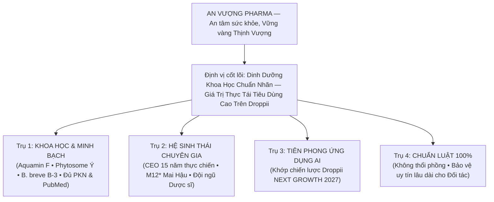
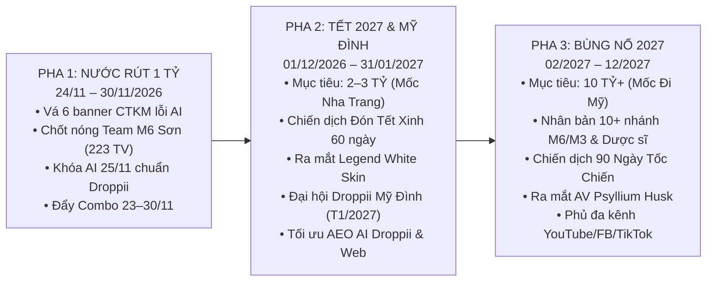

# AV PLAN 2026–2027: KẾ HOẠCH TỔNG THỂ PHÁT TRIỂN THƯƠNG HIỆU AN VƯỢNG PHARMA

> **Cơ sở dữ liệu thực chiến**: Phân tích toàn bộ **617 tin nhắn** (`09/11 – 23/11/2026`), **21 ảnh HD** (CTKM, bảng HDSD ghim, trao đổi lãnh đạo Droppii), **19 file tài liệu/video**, **15+ đường dẫn** từ 2 nhóm Zalo **`Suport AN VƯỢNG PHARMA`** (12 thành viên) & **`CONTENT AN VƯỢNG PHARMA`** (128 thành viên), kết hợp kiểm toán trực tiếp website **`anvuongpharma.vn`** và toàn bộ kho tài sản Media hiện có.

---

## I. CHẨN ĐOÁN HIỆN TRẠNG & 7 ĐIỂM NGHẼN CỐT LÕI (DATA-BACKED AUDIT)

An Vượng Pharma (thành lập `08/05/2026`, trụ sở 122 Lý Thái Tổ, Bắc Nha Trang) chỉ sau nửa năm ra mắt đã tiến sát **mốc doanh số 1 Tỷ đồng trên Droppii**, sở hữu 4 SKU dinh dưỡng chất lượng cao, có hậu thuẫn cực mạnh từ **M12* Mai Hậu Droppii**, đội ngũ Dược sĩ (Ds Lê Quý, Ds Thủy...) và hệ sinh thái **BNI Nha Trang / CT Nguyễn Thị Hằng (65K followers)**.

Tuy nhiên, dữ liệu 15 ngày gần nhất từ 2 nhóm Zalo chỉ ra **7 điểm nghẽn trực tiếp kìm hãm tốc độ nhân bản từ 1 Tỷ lên 10 Tỷ**:

> [!IMPORTANT]
> **Nguyên lý cốt lõi của AV Plan**: An Vượng Pharma không thiếu sản phẩm tốt và không thiếu tinh thần chiến đấu — cái đang thiếu là **hệ thống hóa** (đóng gói kiến thức sản phẩm cho đại lý mới, chuẩn hóa vận hành khớp 100% văn hóa Mentor Droppii, vá lỗi tài sản số/visual và tối ưu hóa AI Droppii cho năm 2027).

| # | Điểm nghẽn thực tế (Bằng chứng từ 2 nhóm Zalo & Audit) | Tác động đến doanh số & thương hiệu | Giải pháp khóa chặt trong AV Plan |
| :-: | :--- | :--- | :--- |
| **1** | **Đại lý chưa hiểu rõ sản phẩm** *(CT Hằng 22/11: "thấy chưa mấy ai hiểu gì hết trơn")* | Đại lý ngại tư vấn, không biết chốt combo, chỉ chờ CTKM lớn mới có đơn. | Bộ **Card 1-Trang / 7 Ngày Làm Chủ Sản Phẩm** + đăng đều 1 bộ Infographic rõ công dụng mỗi ngày. |
| **2** | **Nhạy cảm chiến lược với Mentor Droppii** *(Anh Công BCA hỏi Mai Hậu `15:20` ngày `23/11` về khóa AI 25/11: "E kiểm soát nội dung không e"; Mai Hậu cảnh báo "Droppii chạy k giống bên ngoài")* | Nếu PDP đào tạo "xây nhân hiệu / bán hàng" tách rời hệ thống, Mentor lớn sẽ ngại đưa đội nhóm về An Vượng. | Đóng gói lại khung đào tạo AI thành **"Công Cụ Hỗ Trợ Đối Tác Droppii"** — 100% đồng hành cùng Mentor, **không bán chéo / không lấn sân chiến lược hệ thống**, duyệt giáo trình trước cùng M12*. |
| **3** | **AI Tra cứu Droppii chưa tự gợi ý An Vượng** *(Zoom Sếp Nguyễn Hữu Sơn `10/11`: hỏi hoài AI không tự nhắc AV Protein, phải dò lại mới báo "rẻ nhất kệ")* | Mất hàng nghìn lượt đề xuất tự nhiên từ 130.000+ đối tác khi Droppii đẩy mạnh AI năm 2027. | Triển khai **AEO (AI Engine Optimization)** trên Droppii Portal: chuẩn hóa từ khóa, định lượng, giá/khẩu phần & câu hỏi tư vấn. |
| **4** | **Lỗi thiết kế AI trên 6 banner CTKM `23/11–30/11`** *(Vỏ hộp bị AI bóp méo chữ nghiêm trọng: `CURCUMIN RPTISOME`, `Hương Noni`, `HULUIN`, `ANVUÔNG`, `VITAMIN D3 77,9 µg` thay vì `779,4 IU`, hộp Curcumilk bị in chữ `Vitamin K2`!)* | Ảnh hưởng nặng uy tín ngành Dược khi khách/Dược sĩ soi kỹ bao bì; nguy cơ sai lệch thông tin công bố. | **Vá khẩn cấp trong 24h**: Thay toàn bộ bằng **ảnh tách nền hộp thật 2200px IS-Net** đã có sẵn tại Studio (`0%` sai chữ). |
| **5** | **Hiệu suất Zoom nội bộ thấp & lỗi vận hành** *(Zoom `15/11`: 23 người gồm 16 nội bộ, hủy gấp Zoom CT Hằng, hết giờ giữa chừng, bật nhầm phòng duyệt, chiếu nhầm màn hình; Zoom `19/11`: "quân ta 20, quân địch 20")* | Lãng phí công sức của CEO, M12* Mai Hậu & Ds Lê Quý; giảm độ chuyên nghiệp trước đối tác mới. | Áp dụng **SOP Zoom 5 Bước**: chốt lịch & kịch bản trước 48h, dùng Zoom VIP không giới hạn giờ, tắt phòng chờ, KPI **≥70% là đối tác mới** qua cơ chế ghép lịch với các nhánh M6/M3. |
| **6** | **Rủi ro pháp lý TPBS & lỗi lên đơn Combo** *(Một số bài cũ 15/11 dùng từ "gấp 29 lần, thổi bay cơn đau"; ranh giới nhãn Bojomi người lớn vs Combo chiều cao; 23/11 đại lý đặt nhầm mã Combo 3 Bojomi không đổi được trên Droppii)* | Nguy cơ vi phạm Luật Quảng cáo TPBS/chính sách sàn; gây ức chế cho đại lý khi mất quà tặng. | Ban hành **Từ Điển Pháp Lý TPBS Đỏ–Xanh** (giữ chuẩn giọng văn Hậu Hoàng `17–23/11`) + **Thẻ Hướng Dẫn Lên Đơn Combo 3 Bước** gắn kèm mọi CTKM. |
| **7** | **Website `anvuongpharma.vn` chưa đồng bộ & trùng tên đối thủ** *(Lệch giá `+130k–630k` so với Droppii; URL Curcumilk vẫn là `mockup-coffee`; Collamela 10 gói ghi nhầm 20 gói; toàn bộ `Chưa phân loại`; blog dừng `06/10`; trùng tên `anvuongpharma.com.vn` ở Hà Nội)* | Khách hàng/đối tác tra cứu Google bị hoang mang vì giá lệch quá lớn và trang web thiếu chuyên nghiệp. | Cải tổ toàn diện `anvuongpharma.vn` thành **Cổng Xác Thực Thương Hiệu & Thư Viện Khoa Học Chuẩn** (đồng bộ giá niêm yết + nút *"Đặt mua chính hãng qua Đối tác Droppii"*). |

---

## II. ĐỊNH VỊ THƯƠNG HIỆU & KIẾN TRÚC SẢN PHẨM (BRAND HOUSE)

### 2.1. Ngôi Nhà Thương Hiệu An Vượng Pharma

- **Tách bạch nhận diện (Brand Protection)**: Luôn gắn bộ 3 dấu hiệu nhận diện trong mọi tiêu đề SEO, bio Facebook, YouTube và chân trang: **`Công ty Cổ phần An Vượng Pharma (Nha Trang) · anvuongpharma.vn · Đối tác chính thức trên Droppii`** để tách tuyệt đối khỏi đơn vị trùng tên tại Hà Nội (`anvuongpharma.com.vn`).
- **Ngôn ngữ thị giác thống nhất (Visual DNA)**:
  - **Màu chủ đạo**: Xanh Lục Bảo Hoàng Gia (`#04291B` – `#084730`) + Vàng Kim Ánh Kim (`#E6B442`) + Nền Kem Sạch (`#FFFDF6`) cho bảng HDSD/Khoa học.
  - **Quy tắc bất biến về bao bì**: 100% banner CTKM, bài đăng, video đều sử dụng **ảnh packshot/cutout thật độ nét cao** — tuyệt đối không dùng AI tự vẽ lại chữ trên hộp sản phẩm.

### 2.2. Kiến Trúc Danh Mục Sản Phẩm & 3 Concept Combo Chiến Lược

Thay vì bán lẻ từng hộp khó cạnh tranh, đóng gói **4 SKU chủ lực + 2 SKU mở rộng** thành **3 Concept Giải Pháp Tái Tiêu Dùng Cao** (đúng định hướng *"huấn luyện và bán theo concept sản phẩm"* của M12* Mai Hậu):

| Concept Giải Pháp | Tổ hợp Sản phẩm | Khách hàng mục tiêu | Thông điệp bán hàng chuẩn luật | Giá trị đơn & Chu kỳ tái mua |
| :--- | :--- | :--- | :--- | :--- |
| **1. KHUNG XƯƠNG & KHỐI CƠ VỮNG VÀNG** *(Phễu đầu tàu)* | **AV Protein** (`350k`) + **Bojomi** (`520k`) | Gia đình chăm bố mẹ lớn tuổi; người tập luyện/vận động; gia đình tìm hiểu dinh dưỡng nền tảng *(lưu ý tư vấn chuẩn nhãn cho trẻ nhỏ)* | *"Xây nhà cần cả khung lẫn gạch — Đạm thực vật nuôi cơ, Canxi tảo biển D3-K2-Collagen dưỡng xương"* | `870.000 đ`/bộ cơ bản · Combo CTKM `1.56M – 1.75M` · Tái mua mỗi **20–30 ngày** |
| **2. ĐÓN TẾT XINH — 60 NGÀY KHỎE ĐẸP TỪ GỐC** *(Đinh dịp Tết 2027)* | Sáng **AV Protein** (`350k`) + Tối **Collamela** (`920k`) & **Curcumilk Phyto** (`650k`) *(+ **Legend White Skin** khi lên kệ)* | Phụ nữ 28–55 tuổi, dân văn phòng, phụ nữ sau sinh muốn giữ dáng – sáng da – êm dạ dày đón Tết | *"Chăm da & dáng mỗi ngày thay vì đợi sát tiệc mới cấp tốc — Sáng nhẹ bụng giữ cơ, tối dưỡng ẩm sáng da"* | `1.920.000 đ`/bộ 3 SP · Combo 4 SP **`2.440.000 đ`** (tặng Collamela `920k`) · Tái mua **30 ngày** |
| **3. QUÀ TẶNG SỨC KHỎE GIA ĐÌNH & DOANH NGHIỆP (BNI)** | **Combo 4 SP Toàn Diện** (`2.440k`) hoặc **2 Bojomi + 2 Curcumilk** (`2.340k`) + Túi/Hộp quà Tết & Thiệp viết tay | Thành viên BNI, chủ doanh nghiệp tặng đối tác/nhân sự, con cái biếu bố mẹ/thầy cô dịp Tết 2027 | *"Món quà sức khỏe thiết thực — Sang trọng, minh bạch nguồn gốc, dùng được mỗi ngày"* | `2.34M – 2.44M`/set (đạt luôn mốc `≥2 triệu` nhận quà/ưu đãi) |

> [!TIP]
> **Chiến lược mở rộng SKU 2027**:
> 1. **Legend White Skin** (12 hồ sơ PKN đã nộp Đỗ Duyên ngày `09/11`): Ra mắt ngay khi duyệt kệ Droppii làm **bộ đôi "Trẻ Hóa & Sáng Da Toàn Diện"** ghép cùng **Collamela** (Collagen Tripeptide + Glutathione/NMN).
> 2. **AV Psyllium Husk** (Vỏ hạt mã đề — chất xơ tự nhiên): Bổ sung vào **Combo Tiêu Hóa – Kiểm Soát Cân Nặng** cùng **AV Protein** & **Curcumilk Phyto** cho chiến dịch *90 Ngày Tốc Chiến* Q2/2027.

---

## III. LỘ TRÌNH TĂNG TRƯỞNG 3 PHA (1 TỶ → 2–3 TỶ → 10 TỶ+ / 2027)

### Pha 1: 7 Ngày Nước Rút Cán Mốc 1 TỶ (`24/11 – 30/11/2026`)
1. **Hành động khẩn 24h (Ngày 24/11)**:
   - **Thiết kế lại sạch 100% bộ 6 banner CTKM `23/11 – 30/11`** bằng ảnh hộp thật `2200px` IS-Net (xóa sạch toàn bộ lỗi chính tả AI) + gắn thêm **1 thẻ hướng dẫn mã lên đơn Combo trên App Droppii** để không lặp lại sự cố đặt nhầm như ngày `23/11`.
   - **Tung ngay bộ 8 Infographic chuẩn thành phần (`261122`)** vào nhóm `CONTENT AN VƯỢNG PHARMA` (128 TV) và nhóm `ĐỐI TÁC AN VƯỢNG` (180 TV) theo đúng chỉ đạo CT Hằng: *mỗi sáng 1 bộ 2 tấm (Thành phần chuẩn + Cơ chế/Lợi ích)* trong 4 ngày liên tiếp (`24/11 AV Protein` → `25/11 Bojomi` → `26/11 Collamela` → `27/11 Curcumilk`).
2. **Chuyển hóa nóng phễu Mentor đã mở (24/11 – 28/11)**:
   - Tận dụng ngay sức nóng buổi Zoom tối `23/11` của M12* Mai Hậu & **Tân M6 Bùi Thanh Sơn (`HAPPY GROUP 2` — 223 thành viên)**: lập tức gửi **Bộ Tài Liệu Khởi Nghiệp Nhanh An Vượng** (Bảng HDSD 4 SP + 8 Infographic + 4 Video HDSD + Bảng CTKM `23–30/11`) và chốt ngay 1 buổi Zoom chuyên môn 5AM/tối cùng Ds Lê Quý riêng cho nhánh M6 Bùi Thanh Sơn + nhánh M3 Thanh Nga trong tuần này.
   - Đẩy tiếp chuỗi chăm sóc sau Zoom cho nhánh **Dược sĩ Thủy** & cụm đối tác **Đắk Lắk**.
3. **Vận hành Khóa AI `25/11` (Đơn từ 2 Triệu) tuyệt đối an toàn với Droppii**:
   - Đổi định vị truyền thông khóa học từ *"Xây dựng nhân hiệu / Bán hàng"* sang **"Thực hành tạo ảnh cá nhân & ảnh sản phẩm đẹp cùng An Vượng Pharma (Công cụ hỗ trợ đối tác Droppii)"**; gửi trước dàn ý chi tiết buổi `25/11` (do **Nguyễn Hạnh & Ý** giảng kỹ thuật + **CT Hằng** mở lời đồng hành) cho **M12* Mai Hậu** xác nhận để hóa giải 100% băn khoăn từ Anh Công BCA và các Mentor.

### Pha 2: Bứt Phá Mùa Tết 2027 & Đại Hội Droppii Mỹ Đình (`01/12/2026 – 31/01/2027`) — Mục tiêu 2–3 TỶ
1. **Chiến dịch Đinh: "60 NGÀY ĐÓN TẾT XINH — DÁNG THON, DA SÁNG, XƯƠNG KHỎE"** (`01/12 – 25/01`):
   - **Combo chủ lực**: *Sáng AV Protein + Tối Collamela & Curcumilk Phyto* (kèm Lịch check-in 30 ngày uống cùng An Vượng trên Group Facebook `CỘNG ĐỒNG DROPPII - AN VƯỢNG PHARMA` có minigame thưởng mỗi tuần).
   - **Set Quà Tết An Vượng 2027 (B2C + B2B BNI)**: Thiết kế hộp/túi giấy Xanh Lục Bảo – Ép Kim Vàng + thiệp chúc Tết viết tay cho Set 4 SP (`2.440k`) và Set Sức Khỏe Cha Mẹ (`Bojomi + Curcumilk`). Khai thác mạnh mạng lưới **BNI Nha Trang & BNI Luxury** của CT Hằng cho đơn quà doanh nghiệp.
2. **Ra mắt SKU thứ 5: `LEGEND WHITE SKIN` trên Droppii**:
   - Hoàn tất duyệt hồ sơ với Đỗ Duyên/Droppii, chuẩn bị sẵn **Bộ Launch Kit** (2 Infographic đã làm sẵn, Video Talking Head Dược sĩ, HDSD, Bảng so sánh kết hợp cùng Collamela thành *Combo Trắng Da – Căng Bóng Đón Tết*).
3. **Sức bật Sự Kiện: Đại Hội Năm Droppii 2027 tại Cung Điền Kinh Mỹ Đình (Tháng 1/2027)**:
   - Lên kế hoạch sớm bộ ấn phẩm Booth/Standee (kết nối đầu cầu miền Bắc **Ds Lê Quý**), **Mẫu thử pha uống trực tiếp (Sampling)** 4 vị (Vani Bojomi, Vani Curcumilk, Đào Collamela, AV Protein) + **QR Code quét nhận bộ E-book 30 Mẫu Bài Chuẩn Luật + Vào Nhóm Zalo Content** ngay tại sự kiện để kéo nhóm từ `128` lên **`500–1.000+ đối tác`**.
4. **Chuẩn Hóa Hạ Tầng Số & Tối Ưu AEO Cho AI Droppii (Tháng 12/2026)**:
   - **Tối ưu AI Droppii (AEO)**: Viết lại 100% mô tả sản phẩm trên Droppii Portal theo cấu trúc AI dễ đọc nhất: *Tên chuẩn + Định lượng nổi bật + Giá/khẩu phần cực cạnh tranh (`AV Protein 350k/20 gói = 17.500đ/gói` — đạm thực vật giá tốt nhất kệ!) + Chứng nhận/Nguyên liệu quốc tế (Aquamin F, Phytosome Ý, B. breve B-3) + 10 câu FAQ khách hay hỏi nhất*.
   - **Cải tổ `anvuongpharma.vn`**: Sửa ngay slug `mockup-coffee` → `tpbs-curcumilk-phyto`, sửa lỗi Collamela 10 gói, đồng bộ thống nhất chính sách giá hiển thị với Droppii, gắn mục **Hồ Sơ Khoa Học & Kiểm Nghiệm Minh Bạch** và đăng tối thiểu `2 bài SEO/tuần` về kiến thức dinh dưỡng chuẩn y khoa.

### Pha 3: Quy Mô Hóa Hệ Thống & 90 Ngày Tốc Chiến (`02/2027 – 12/2027`) — Mục tiêu 10 TỶ+
1. **Nhân bản "Liên Minh 10 Nhánh Mentor × 10 Dược Sĩ Vệ Tinh"**:
   - Không phụ thuộc vào 1 mình Ds Lê Quý hay M12* Mai Hậu: đào tạo & cấp chứng nhận **"Chuyên Gia Tư Vấn Dinh Dưỡng An Vượng"** cho các Dược sĩ đang có sẵn trong nhóm (`Ds Thủy`, `Ds Minh Ngát`, `Dược Sĩ Ánh Tuyết`...) để chia ca phủ sóng **Zoom 5AM Club** đều đặn mỗi tuần cho 10+ nhánh M3/M6/M9 trên toàn quốc.
2. **Làm Chủ Sân Chơi "Droppii NEXT GROWTH 2027 — AI Ecosystem"**:
   - Đóng gói bộ **Trợ Lý AI Tư Vấn An Vượng (Custom GPT / Prompt Kit Chuẩn Luật)** tặng miễn phí cho mọi đối tác có đơn hàng: chỉ cần nhập tuổi + nhu cầu khách, AI tự gợi ý câu hỏi thăm dò, khẩu phần tham khảo đúng nhãn và bài đăng cá nhân hóa không trùng lặp (`0%` lỗi pháp lý).
3. **Chiến Dịch "90 Ngày Tốc Chiến 2027" (Q2/2027)**:
   - Ra mắt thêm SKU **AV Psyllium Husk** (Chất xơ vỏ hạt mã đề), chạy chương trình đua top doanh số quý tặng chuyến **Du lịch Trải nghiệm Nha Trang / Tham quan Showroom & Nhà máy An Vượng** (tạo vòng lặp nội dung thực tế cực mạnh).

---

## IV. CHIẾN LƯỢC NỘI DUNG, MEDIA & QUY CHUẨN PHÁP LÝ TPBS

### 4.1. Kiến Trúc 3 Tầng Kênh Nội Dung (Xóa Tình Trạng Trộn Lẫn)

| Kênh | Vai trò chính | Chủ sở hữu | KPI Mục tiêu Q1/2027 |
| :--- | :--- | :--- | :--- |
| **Zalo `CONTENT AN VƯỢNG`** (`128` → `500+` TV) | **Kho đạn bán hàng sạch** — chỉ đăng bài mẫu, Infographic, video HDSD, feedback có hashtag phân loại (`#AVProtein`, `#Bojomi`, `#Collamela`, `#Curcumilk`, `#CTKM`), khóa bình luận rác | Hậu Hoàng · Nguyễn Hạnh · Media | 100% đối tác tìm thấy tài liệu SP trong `<10 giây` |
| **Zalo `ĐỐI TÁC AN VƯỢNG`** (`180` → `1.000+` TV) | **Nhóm Hỏi – Đáp ca khó & Thông báo lịch Zoom / CTKM** — có Dược sĩ trực giải đáp | Ds Lê Quý · Quế An · Hậu Hoàng | Phản hồi câu hỏi tư vấn trong `<30 phút` |
| **Group FB `CỘNG ĐỒNG DROPPII - AN VƯỢNG`** | **Nơi xây Social Proof & Minigame** — đối tác khoe đơn, check-in 30 ngày uống đẹp, video khách thật | Nguyễn Hạnh · Hương Nguyễn | `1.000+` thành viên, `30+` bài review thật/tuần |
| **YouTube `An Vượng Pharma`** *(mới lập `11/11`)* | **Thư viện đào tạo chuẩn hóa (Evergreen)** — 4 Playlist rõ ràng: (1) HDSD 1 phút, (2) Dược sĩ giải mã khoa học, (3) Record Zoom 5AM/Tối, (4) Review BNI & Chuyên gia | Hương Nguyễn · Hữu Media | `50+` video chuẩn hóa, `100%` Zoom có bản ghi lưu trữ |
| **TikTok / Facebook Reels (CT Hằng + Kênh Brand)** | **Phễu kéo nhận diện & uy tín thương hiệu** — tận dụng tệp `65K followers` của CT Hằng + 60 clip quay gốc `261112` | CT Hằng · Hữu Media | `12–16` video Reels/tháng (`3–4` video/tuần) |

### 4.2. Lịch Nội Dung 7 Ngày/Tuần Cho Nhóm `CONTENT AN VƯỢNG PHARMA`

| Thứ | Chủ đề cố định | Định dạng Media ưu tiên | Góc tiếp cận chuẩn luật |
| :---: | :--- | :--- | :--- |
| **Thứ 2** | **AV Protein** (Năng lượng đầu tuần) | Infographic Thành phần/Lợi ích + 1 Video ngắn `45–60s` (phong cách Kute Pastel) | Bữa sáng đủ đạm vs dư tinh bột; đạm thực vật êm bụng |
| **Thứ 3** | **Bojomi** (Xương khớp & Vận động) | Infographic Kiềng 3 chân + Video Talking Head Dược sĩ v4 | Hỏi kỹ nguồn gốc Canxi tảo biển Aquamin F + D3 + K2 |
| **Thứ 4** | **Collamela** (Làm đẹp đón Tết) | Bộ 3 ảnh Lifestyle + Bài kể chuyện phụ nữ sau 30 | Chăm da đều mỗi ngày thay vì đợi sát tiệc mới cấp tốc |
| **Thứ 5** | **Curcumilk Phyto** (Êm dạ dày & Bồi bổ) | Infographic Công nghệ Phytosome + Video pha ấm 30 giây | Nỗi lo uống nghệ thường khó tan vs hệ 3 nguồn Curcumin |
| **Thứ 6** | **Bán Theo Combo Concept** | 1 Bài dài kết hợp 2–4 SP + Bảng giá/CTKM + Thẻ hướng dẫn lên đơn | Combo Chiều cao/Vận động · Combo Đón Tết Xinh |
| **Thứ 7** | **Social Proof & BNI / Chuyên Gia** | Video Giám đốc Phòng khám, BNI Showroom, Feedback thật, Ảnh giao đơn | Tăng niềm tin thực tế — *"Trải nghiệm thật, cảm nhận thật"* |
| **Chủ Nhật** | **Lịch Zoom Tuần Mới & Thử Thách Cộng Đồng** | Banner lịch Zoom cả tuần (1 tấm duy nhất) + Minigame Group FB | Khóa lịch sớm cho đại lý & các Mentor kéo đội nhóm |

### 4.3. Khai Thác Ngay Kho Media 60+ Clip Quay Gốc (`261112 - Quay AV`)
- **Phân nhánh 2 phong cách sản xuất video của Studio**:
  1. **Nhánh Chuyên Gia / Dược Sĩ (`talking-head-v3/v4`)**: Dành cho **Bojomi, Curcumilk Phyto, Legend White Skin** — giữ phòng sáng chuyên nghiệp, thẻ thông số khoa học chuẩn xác, phụ đề rõ ràng trong vùng an toàn `9:16`.
  2. **Nhánh Lifestyle / Kute Pastel (`htpm-av-talking-head`)**: Dành cho **AV Protein & Collamela** — tươi sáng, thân thiện, nhắm thẳng phụ nữ 25–45 tuổi & mẹ bỉm bận rộn.
- **Mỗi buổi quay `261112`** cắt thành chuỗi **16–20 video ngắn (`45–65s`)** trải đều 1 tháng, đồng bộ 100% lên YouTube Shorts, Reels, TikTok và thả trực tiếp file MP4 sạch vào nhóm `CONTENT AN VƯỢNG PHARMA` cho đại lý tải về đăng lại.

### 4.4. Bộ Quy Tắc Pháp Lý TPBS Đỏ – Xanh (`0% Vi Phạm Luật`)

> [!CAUTION]
> **Ranh giới tuyệt đối phải kiểm duyệt trước khi đăng (theo chỉ đạo CT Hằng `23/11` & tài liệu khoa học Curcumilk)**:
> - **VÙNG ĐỎ (CẤM DÙNG)**: *"Chữa khỏi / Điều trị / Đặc trị / Thổi bay cơn đau dạ dày / Giải độc gan / Hấp thu gấp 29 lần (khi chưa có COA riêng chứng minh) / Đảm bảo con cao thêm X cm / Cam kết trị nám"*.
> - **VÙNG XANH (CHUẨN LUẬT)**: *"Thực phẩm bổ sung / Hỗ trợ bổ sung dưỡng chất / Góp phần duy trì khối cơ, hệ xương, độ ẩm da / Phối hợp cùng chế độ ăn cân đối và vận động"*. Luôn gắn câu miễn trừ ở cuối bài & cuối video: **`Thực phẩm bổ sung. Không phải là thuốc và không có tác dụng thay thế thuốc chữa bệnh.`**
> - **Xử lý tinh tế ranh giới Bojomi & Chiều cao**: Tuân thủ đúng văn phong chuẩn mực của Hậu Hoàng (`22/11`) — giới thiệu Bojomi chuẩn nhãn (*cho người trưởng thành và người lớn tuổi*), khi phụ huynh hỏi cho trẻ nhỏ luôn khuyến nghị *"xem kỹ đối tượng trên nhãn và trao đổi cùng bác sĩ/chuyên gia dinh dưỡng nhi theo độ tuổi của bé"*.

---

## V. QUY TRÌNH VẬN HÀNH KỶ LUẬT (SOP) CHO TEAM 12 NGƯỜI & HỆ THỐNG ZOOM

### 5.1. Ma Trận Phân Vai Rõ Ràng (Chấm Dứt Tình Trạng "Chủ Tịch Trực Nhóm")

| Khối chức năng | Người chịu trách nhiệm chính (R) | Phối hợp (C/S) | Đầu ra đo lường hàng tuần |
| :--- | :--- | :--- | :--- |
| **Chiến lược Droppii & Mở Nhánh Mentor** | **Mai Hậu Droppii** · **Châu Nguyễn** | CT Hằng · Doan Hai Yen | Chốt ít nhất `2 nhánh M3/M6 mới`/tháng; đồng bộ định hướng Droppii BOD |
| **Duyệt Pháp Lý, Kiểm Nghiệm & B2B BNI** | **CT Hằng** · **Nguyễn Hạnh** | Đỗ Duyên | `0` bài vi phạm luật; duyệt xong `Legend White Skin`; `2+` đơn/hoạt động BNI/tháng |
| **Đào Tạo Chuyên Môn & Giải Đáp Ca Khó** | **Ds Lê Quý** · *(mở rộng Ds Thủy...)* | Hậu Hoàng | `2` buổi Zoom chuyên môn/tuần (1 buổi 5AM nhánh Mentor + 1 buổi tối cố định) |
| **Quản Trị Nội Dung & Cộng Đồng Zalo/FB** | **Hậu Hoàng** · **Nguyễn Hạnh** | Hương Nguyễn | Đăng đều `100%` lịch 7 ngày; duyệt thành viên, khóa spam; lưu bảng tin ghim gọn gàng |
| **Vận Hành Portal Droppii, CTKM & YouTube** | **Hương Nguyễn Droppii** · **Quế An** | Nguyễn Hạnh | Đăng ký Portal sớm 72h; xử lý thắc mắc đơn hàng `<30 phút`; up `100%` record lên YouTube |
| **Sản Xuất Design, Video & Website** | **Hữu Media (Studio)** · **Nguyễn Hạnh & Ý** | CT Hằng · Hậu Hoàng | Vá 6 banner CTKM; xuất `3–4` video ngắn/tuần từ kho `261112`; chuẩn hóa Web & AEO |

### 5.2. SOP Vận Hành Zoom "0 Lỗi Kỹ Thuật — ≥70% Đối Tác Mới"
1. **T-72h (Trước 3 ngày)**: Chốt **1 lịch tuần duy nhất** (kiểm tra trước để **không trùng lịch M12* Mai Hậu**), chốt rõ *Diễn giả + Tiêu đề + 3 gạch đầu dòng nội dung* được **CT Hằng & Diễn giả duyệt trước** (chấm dứt tình trạng hủy gấp hoặc đặt tiêu đề diễn giả chưa biết).
2. **T-48h**: Đăng ký lên **Droppii Portal** + gửi 1 Banner chuẩn HD + 1 mẫu tin ngắn cho Mentor các nhánh khách mời (như M6 Bùi Thanh Sơn, Happy Group, Mentor Vân Nguyễn) kéo người — **ưu tiên đưa An Vượng sang phòng Zoom của nhánh Mentor (5AM/tối) thay vì tự mở phòng rồi kéo 16 người nội bộ vào ngồi**.
3. **T-20 phút (Checklist Kỹ thuật bắt buộc)**:
   - Dùng **tài khoản Zoom Pro/VIP không giới hạn thời gian** (không dùng Zoom 40 phút gây đứt gãy giữa chừng).
   - **TẮT phòng chờ (Waiting Room)** để đại lý vào thẳng không bị kẹt duyệt.
   - Bố trí **1 Host kỹ thuật riêng** (Hương Nguyễn / Nguyễn Hạnh) quản lý share slide & video intro, không để diễn giả tự chỉnh.
4. **T+2h (Sau Zoom)**: Cắt ngay **1 video highlight 60s** + up full record lên **YouTube An Vượng** + gửi form/tin nhắn **Checklist chốt đơn CTKM** vào nhóm ngay khi cảm xúc còn nóng.

---

## VI. CHỈ SỐ KPI MỤC TIÊU & CHECKLIST HÀNH ĐỘNG NGAY 48 GIỜ TỚI

### 6.1. Bảng KPI Theo Dõi Hằng Tuần / Hằng Tháng

| Nhóm chỉ số | Hiện tại (`23/11/2026`) | Mục tiêu `30/11/2026` | Mục tiêu `31/01/2027` (Tết & Mỹ Đình) | Mục tiêu `Q4/2027` |
| :--- | :---: | :---: | :---: | :---: |
| **Doanh số tích lũy Droppii** | Sát mốc `1 Tỷ` | **Vượt 1 Tỷ** | **2 – 3 Tỷ** *(Mốc Nha Trang)* | **10 Tỷ+** *(Mốc Đi Mỹ)* |
| **Cộng đồng Zalo Content + Đối tác** | `128` + `180` = `308` TV | `450+` TV | `1.000+` TV | `3.500+` TV |
| **Số nhánh Mentor M3/M6 kích hoạt** | 3–4 nhánh đầu | `5` nhánh *(chốt M6 Sơn)* | `10` nhánh | `25+` nhánh |
| **Sĩ số trung bình / buổi Zoom** | 23–40 người *(50–70% nội bộ)* | `60+` người *(≥60% mới)* | `120+` người *(≥75% mới)* | `250+` người |
| **Số SKU trên kệ Droppii** | 4 SKU | 4 SKU | **5 SKU** *(+ Legend White Skin)* | **6+ SKU** *(+ AV Psyllium Husk)* |
| **Kho nội dung Video chuẩn hóa** | 7 file MP4 + 3 record | 12+ video | 40+ video + trọn bộ AEO Portal | 150+ video đa kênh |

### 6.2. Checklist 5 Việc Ưu Tiên Số 1 Làm Ngay Trong 48 Giờ Tới (`24/11 – 25/11`)

- [ ] **Việc 1 (Cấp bách nhất — Media Studio)**: Thiết kế lại **6 banner CTKM `23/11 – 30/11`** thay toàn bộ hộp AI lỗi chữ bằng ảnh hộp thật `2200px` IS-Net + thiết kế **1 Thẻ Hướng Dẫn 3 Bước Lên Đơn Combo Droppii** gửi ngay vào 2 nhóm Zalo sáng `24/11`.
- [ ] **Việc 2 (Sáng `24/11` — CT Hằng & Hậu Hoàng)**: Đăng **Bộ 1/4 (`AV Protein` — 2 tấm Infographic `261122`)** kèm bài mẫu chuẩn luật vào nhóm Content & Đối tác; duy trì đều 4 ngày `24–27/11` cho đủ 4 SP.
- [ ] **Việc 3 (Trưa `24/11` — Nguyễn Hạnh, Ý & Mai Hậu)**: Chốt dàn ý **Buổi 1 Khóa Tạo Ảnh AI (`19h30 ngày 25/11`)** gửi M12* Mai Hậu xác nhận — khóa đúng tinh thần *"Hướng dẫn công cụ tạo ảnh cá nhân & sản phẩm chuẩn luật cho Đối tác Droppii"*.
- [ ] **Việc 4 (Ngày `24–25/11` — Mai Hậu, Châu Nguyễn & Ds Lê Quý)**: Bám sát đà Zoom tối `23/11` cùng **Tân M6 Bùi Thanh Sơn (`HAPPY GROUP 2` — 223 TV)**, chốt lịch 1 buổi chia sẻ sản phẩm chuyên sâu + đẩy Combo `23–30/11` để dứt điểm mốc **1 TỶ** trước ngày `30/11`.
- [ ] **Việc 5 (Trong tuần `24–30/11` — Kỹ thuật Web & Hương Nguyễn)**: Sửa ngay 4 lỗi nóng trên `anvuongpharma.vn` (slug `mockup-coffee`, lỗi Collamela 10 gói, đồng bộ giá/chính sách Droppii, gắn danh mục chuẩn) và rà soát lại văn bản mô tả sản phẩm trên **Droppii Portal** để tối ưu hiển thị trên AI Droppii.
