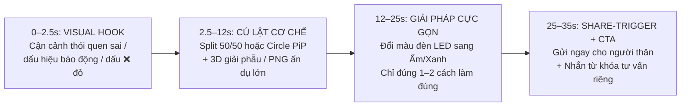

# PHÂN TÍCH DNA TRIỆU VIEW `DR-MUSTAFA ADEL` & BỘ 20 KỊCH BẢN TALKING HEAD THỰC CHIẾN
## Dành Riêng Cho **AN VƯỢNG PHARMA (10 Tập)** & **HẰNG THU PHARMA (10 Tập)**

> [!IMPORTANT]
> **Cơ sở dữ liệu thực tế vừa khảo sát trực tiếp từ `facebook.com/muustafaadel10/reels/`**:
> - **Chủ kênh**: **Dr-Mustafa Adel** — Bác sĩ bệnh viện Al-Azhar (Ai Cập), `11 triệu+` người theo dõi trên Facebook (`14 triệu+` đa nền tảng).
> - **Hiệu suất thống kê trên 730 Reels gần nhất**: **`507/730` video đạt ≥ 1 triệu view (`69,5%`)**, **`102/730` video đạt ≥ 10 triệu view (`14%`)**, Top 3 ghim đầu trang đạt **`65 triệu` – `57 triệu` – `56 triệu` views**.
> - **Thời lượng vàng**: Phần lớn video triệu view chỉ dài **`14 giây – 36 giây`** (nhịp cắt siêu gọn, không mở bài rườm rà, kéo tỉ lệ xem hết >100% và nút **Share** cực cao `11K – 119K shares/clip`).

---

## PHẦN 1: GIẢI MÃ 100% "CÔNG THỨC GÂY NGHIỆN" CỦA DR-MUSTAFA ADEL

### 1.1. Sáu "Vũ Khí Thị Giác" Làm Người Xem Đứng Hình Ngay 1,5 Giây Đầu
| # | Kỹ thuật quay & dựng của Mustafa | Ví dụ triệu view thực tế trên kênh | Cách áp dụng cho **An Vượng & Hằng Thu** |
| :-: | :--- | :--- | :--- |
| **1** | **Split 50/50 Trên–Dưới (Chữ ký mạnh nhất)** | *65M* (thóp bé + 3D sọ), *57M* (bé ăn vạ), *39M* (hành vi trẻ), *34M* (loét môi → 3D) | Nửa trên `50%`: B-Roll hành vi sai / cận cảnh pha nước / 3D cơ thể. Nửa dưới `50%`: Chị Hằng / Dược sĩ nhìn thẳng ống kính, mắt mở to, tay ra dấu dừng `✋` hoặc chỉ thẳng lên nửa trên. |
| **2** | **Full-Screen B-Roll Hook `0–2.5s` (Đồ uống / Triệu chứng)** | *56M* (rót trà bỏ phụ gia), *33M* (ấn cẳng chân lõm sâu), *24M* (nồi cà phê sôi) | Giây `0–2s` chưa vội lộ mặt — **đẩy thẳng cận cảnh** ly cà phê sáng bụng rỗng, cốc nước sôi `100°C` pha bột, vòi sen áp lực mạnh, quả táo thâm đen... rồi mới cắt về chuyên gia nói thẳng! |
| **3** | **Circle PiP Góc Trên-Phải + 3D/B-Roll Bo Góc `80%`** | *31M* (ngủ đè tay tê bì), *24M* (3D tế bào/mạch máu nền đỏ) | Áp trực tiếp Engine `kobe-motion-talking-head` + `talking-head-v3` của Studio: giữ **Circle PiP** gọn trong vùng trắng an toàn `9:16` (`X ≤ 884px`, `Y ≥ 250px`), nhường sân khấu cho 3D cơ chế hấp thu. |
| **4** | **PNG Vật Thể Phóng Đại Ẩn Dụ (`Giant Cutout`)** | *30M* (quả Lê & quả Táo đỏ bóng khổng lồ đè lên cơ thể 3D giải thích hormone nữ) | Biến kiến thức y khoa khô khan thành **1 vật thể đời thường phóng to giữa khung**: miếng bọt biển khô vs ẩm (Collamela), quả táo bị oxy hóa (White Skin), khung sắt vs gạch (Bojomi + Protein), khu vườn chỉ cắt ngọn cỏ (Viên uống Eva). |
| **5** | **Dấu `❌` Đỏ To + Mũi Tên Đỏ Chĩa Thẳng Vào Sai Lầm** | *15M, 8.2M, 2.1M* (mũi tên đỏ chỉ mối nguy & chữ `X` đỏ chéo màn hình) | Đóng dấu `❌` đỏ + tiếng *buzz/click* ngay trên nước sôi `100°C`, vòi sen xịt sâu, nước hoa vùng kín, bát ăn sáng dư tinh bột → kích thích phản xạ *"Ủa mình cũng hay làm vậy!"*. |
| **6** | **Mã Hóa Màu Đèn LED Theo Cảm Xúc + Góc Quay Trong Ô Tô** | **Đèn Đỏ** (*39M, 24M, 22M*): Cảnh báo cấm · **Đèn Xanh Dương** (*65M, 56M, 34M*): Y khoa uy tín · **Đèn Vàng Cam** (*31M, 30M*): Thấu cảm gia đình · **Trong xe hơi** (*36M, 26M*): Đời thực gần gũi | Quay 1 buổi đổi đúng **3 mood ánh sáng** (hoặc chỉnh nền LED tách RVM): **Đỏ trầm** cho cảnh báo, **Xanh Lục Bảo / Xanh Y Khoa** cho giải mã khoa học, **Vàng Kem Ấm** cho câu chuyện vợ chồng/chăm bố mẹ; thêm 2–3 tập quay tự nhiên ngay trong ô tô cho cực kỳ thật! |

### 1.2. Năm Luật Ngầm Khiến Video Cuốn Không Thể Lướt Qua
1. **Cấm mở bài kiểu truyền thống**: Xóa sạch *"Xin chào mọi người, hôm nay Chị Hằng / Dược sĩ sẽ chia sẻ..."*. Giây `0.0s` phải là **một cú phanh gấp**: *"Dừng lại ngay nếu sáng nào bạn cũng..."*, *"Nhìn quả táo này — da bạn sau 25 tuổi đang y hệt..."*, *"Tuyệt đối đừng pha nước sôi 100 độ vào hộp này!"*.
2. **Độ dài siết chặt `25–36 giây` (~85–115 chữ tiếng Việt)**: Mỗi câu chỉ dài 8–14 chữ, cắt sạch khoảng thở thừa (`jump-cut` sạch + micro-fade `33ms`), đổi góc hình/B-Roll mỗi **`2,0 – 3,5 giây`** để mắt không kịp chán.
3. **1 Video = Đúng 1 Cú Lật Tư Duy (`1 Insight + 1 Metaphor`)**: Không đọc thuộc lòng 10 công dụng của sản phẩm! Chỉ xoáy sâu vào **1 sai lầm hoặc 1 cơ chế khiến người xem "Ồ!" lên**, rồi đưa sản phẩm vào như **mảnh ghép giải pháp tự nhiên nhất ở 10 giây cuối**.
4. **Chữ trên màn hình Tối Giản & An Toàn `9:16`**: Không làm chữ rối che mặt. Chỉ dùng **1 dòng Hook trắng viền đen / Gradient 5-stop** ở 3 giây đầu + phụ đề gọn tối đa 2 dòng nằm trọn trong vùng trắng an toàn TikTok × Reels (`X = 54..884px`, `Y = 250..1545px`).
5. **Chốt bằng "Cò Bấm Share" trước khi gọi Inbox**: Mustafa ăn triệu view nhờ người xem **nhớ ngay tới một người thân cần xem clip này** → luôn cài 1 câu kéo Share tự nhiên (*"Gửi ngay cho người hay bỏ bữa sáng!"*, *"Lưu lại hoặc gửi cho chồng xem ngay!"*) rồi mới chốt CTA nhắn tin tư vấn.

---

## PHẦN 2: BỘ 10 KỊCH BẢN TALKING HEAD — **AN VƯỢNG PHARMA**
> [!NOTE]
> **Quy chuẩn khóa cứng cho cả 10 tập An Vượng Pharma**:
> - **Màu nhận diện**: Xanh Lục Bảo `#04291B` · Vàng Kim `#E6B442` · Kem Sạch `#FFFDF6` (kết hợp đèn LED Đỏ/Xanh/Ấm theo mood Mustafa).
> - **Chuẩn pháp lý TPBS `100%` Vùng Xanh**: Không dùng từ cấm (*chữa khỏi, điều trị, đặc trị, thổi bay, gấp 29 lần, cam kết tăng chiều cao*). Mọi định lượng khớp 100% vỏ hộp thật (`IS-Net 2200px`). Cuối mỗi video luôn chạy dòng miễn trừ nhỏ rõ nét: *`Thực phẩm bổ sung. Không phải là thuốc và không có tác dụng thay thế thuốc chữa bệnh.`*
> - **Người nói gợi ý**: Chị Hằng / Dược sĩ Lê Quý / Mẫu USP An Vượng (chỉ cần chọn 1 người hoặc chia luân phiên Chuyên gia + Đời thường).

---

### TẬP AV01 — AV PROTEIN: Bẫy Bữa Sáng 25K Khiến Bạn Sập Nguồn Lúc 10h Sáng
- **Sản phẩm**: **AV Protein** (`350.000đ` · 20 gói × 15g · Khẩu phần 2 gói = `22,05g` đạm thực vật + `1.632mg` L-Leucine)
- **Format Mustafa**: *Full B-Roll Hook (2s) → Split 50/50 Trên–Dưới → Full A-Roll Chốt* | **Đèn**: Đỏ trầm → Xanh Lục Bảo | **Thời lượng**: `32s`
- **3 Phương án Hook 3s**:
  - *Pain*: **"Đừng thắc mắc vì sao ăn sáng no căng mà 10 giờ đã buồn ngủ rũ rượi!"**
  - *Curiosity*: **"Nhìn hai bữa sáng cùng tầm tiền này — một bên kéo bạn tụt pin, một bên giữ bạn tỉnh táo tới trưa!"**
  - *Contrarian*: **"Bạn không bị thiếu ngủ đâu — bạn đang ăn sáng THIẾU ĐẠM trầm trọng!"**

| Giây | Lời thoại (Tự nhiên, dứt khoát) | Hình ảnh A-Roll & B-Roll / 3D / Ẩn dụ | Text On-Screen (An toàn 9:16) & Micro-SFX |
| :-: | :--- | :--- | :--- |
| **0–3s** | *"Đừng thắc mắc vì sao ăn sáng no căng mà 10 giờ đã buồn ngủ rũ rượi!"* | **Full B-Roll Hook**: Cận cảnh ổ bánh mì / tô bún đầy tinh bột + đồng hồ nhảy **10:00** và người gục nhẹ xuống bàn. | Hook lớn: **ĂN NO MÀ 10H SẬP NGUỒN?** `SFX`: Tiếng đồng hồ tích tắc + *Airy Whoosh* (`-110ms`). |
| **3–13s** | *"Bữa sáng toàn tinh bột làm đường huyết vọt lên cực nhanh... rồi tụt dốc không phanh chỉ sau hai tiếng! Cơ thể bạn không cần thêm tinh bột — nó đang khát ĐẠM SẠCH để giữ năng lượng và nuôi cơ!"* | **Split 50/50**: Nửa trên là đồ họa 3D mũi tên đỏ vọt lên rồi rơi cắm đầu + dấu `❌` đỏ lên dĩa tinh bột dư thừa. Nửa dưới: Người nói ánh đèn Đỏ trầm, mắt nghiêm nghị, tay vẽ đường rơi xuống. | Nhãn ngắn: **TINH BỘT TĂNG VỌT → TỤT DỐC** `SFX`: *Soft Click* + tiếng trượt giảm nhẹ. |
| **13–25s** | *"Thay vì nhịn sáng hay ăn đại cho xong, chỉ 30 giây pha 2 gói AV Protein là bạn có ngay 22,05 gam đạm thực vật từ đậu Hà Lan và gạo, thêm 1.632 miligam L-Leucine giữ khối cơ săn chắc — nhẹ bụng mà no êm tới trưa!"* | **Đổi nền LED sang Xanh Lục Bảo sáng**: Nửa trên quay cận cảnh xé 2 gói **AV Protein** đổ vào bình lắc `300ml` nước mát, lắc sánh mịn; nổi 2 thẻ số vàng kim **`22,05g ĐẠM`** & **`1.632mg L-LEUCINE`**. Nửa dưới: Người nói cầm hộp **AV Protein thật** chỉ thẳng vào bảng dinh dưỡng. | Thẻ Glass: **`22,05g` Đạm Thực Vật · `30s` Pha** `SFX`: 2 tiếng *Pop* tăng cao độ `+1 semitone`. |
| **25–32s** | *"Gửi ngay video này cho đồng nghiệp hay ngáp dài lúc 10 giờ nhé! Muốn nhận thực đơn bữa sáng 30 giây đủ đạm, nhắn chữ PROTEIN bên dưới!"* | **Full A-Roll** cận trung ấm áp, nâng ly AV Protein mỉm cười, giơ tay chỉ nhẹ về nút Share & Comment + hiện hộp thật góc trái an toàn (`X ≤ 884px`). | CTA: **Gửi đồng nghiệp · Nhắn "PROTEIN"** + Miễn trừ TPBS. `SFX`: *Ping Glass* nhẹ chốt hạ. |

- **Caption đăng ngay**: *Ăn sáng no nhưng 10h đã rũ mắt? Coi chừng bữa sáng của bạn đang dư tinh bột mà thiếu đạm sạch! 🥛✨ 2 gói AV Protein mỗi sáng = 22,05g đạm thực vật + 1.632mg L-Leucine, pha chỉ 30 giây nhẹ bụng, no êm tới trưa. Nhắn **"PROTEIN"** để nhận bảng thực đơn 5 bữa sáng nhanh gọn nhé! (Thực phẩm bổ sung, không phải là thuốc và không có tác dụng thay thế thuốc chữa bệnh) #AnVuongPharma #AVProtein #BuaSangDuDam*

---

### TẬP AV02 — AV PROTEIN: TUYỆT ĐỐI ĐỪNG Pha Nước Sôi `100°C` Vào Hộp Này!
- **Sản phẩm**: **AV Protein** (`50mg` nguyên liệu lợi khuẩn *B. breve* B-3 + `1.090mg` Inulin · HDSD chuẩn `20–40°C`)
- **Format Mustafa**: *Dấu `❌` Đỏ Cảnh Báo Cực Mạnh (kiểu 36M & 21M)* | **Đèn**: Đỏ cảnh báo → Xanh Ngọc | **Thời lượng**: `28s`
- **3 Phương án Hook 3s**:
  - *Pain*: **"Dừng tay lại ngay nếu bạn đang pha bột đạm bằng nước sôi 100 độ!"**
  - *Curiosity*: **"Chỉ sai đúng nhiệt độ nước, bạn đã tự tay đánh mất thứ đắt giá nhất trong gói này!"**
  - *Contrarian*: **"Đừng nghĩ nước càng nóng pha bột càng tan — với AV Protein thì ngược lại hoàn toàn!"**

| Giây | Lời thoại | Hình ảnh A-Roll & B-Roll / 3D / Ẩn dụ | Text On-Screen & Micro-SFX |
| :-: | :--- | :--- | :--- |
| **0–3s** | *"Dừng tay lại ngay nếu bạn đang pha bột đạm bằng nước sôi 100 độ!"* | **Split 50/50**: Nửa trên là ấm siêu tốc rót nước sôi `100°C` bốc khói nghi ngút → lập tức đóng dấu **`❌` ĐỎ TO** kèm nhiệt kế nổ đỏ. Nửa dưới: Người nói đèn Đỏ, đưa bàn tay chặn thẳng trước ống kính `✋`. | Hook: **CẤM PHA NƯỚC SÔI 100°C ❌** `SFX`: *Soft Thud / Click* đúng frame dấu X đỏ. |
| **3–13s** | *"Vì trong mỗi khẩu phần AV Protein không chỉ có đạm thực vật và 1.090 miligam chất xơ Inulin... mà còn có 50 miligam lợi khuẩn B. breve B-3! Nước sôi 100 độ vừa làm đạm vón cục, vừa làm hỏng hết nhóm lợi khuẩn quý giá này!"* | **Circle PiP góc trên-phải + 3D chiếm 80%**: Mô phỏng 3D những hạt lợi khuẩn ánh xanh đang phát sáng tươi tắn → gặp làn sóng nhiệt đỏ rực bốc hơi tắt lịm! Hiện 2 nhãn rõ: **`50mg Lợi khuẩn B. breve B-3`** & **`1.090mg Inulin`**. | Nhãn: **NƯỚC SÔI LÀM HỎNG LỢI KHUẨN** `SFX`: *Blur-Focus Whoosh* + tiếng xèo rất nhỏ. |
| **13–22s** | *"Cách pha chuẩn khoa học cực dễ: cứ dùng 300 mililít nước lọc mát hoặc ấm nhẹ từ 20 đến 40 độ C, khuấy hoặc lắc 15 giây — bột tan mịn, thơm dịu, êm bụng cả với người hay đầy hơi vì sữa bò!"* | **Split 50/50 nền Xanh Lục Bảo**: Nửa trên rót nước lọc trong veo (`20–40°C` tick xanh ✅) vào bình shaker, lắc mượt ra ly đạm mịn màng. Nửa dưới: Người nói gật đầu chắc chắn, cầm gói stick AV Protein thật. | Thẻ Xanh: **CHUẨN `20–40°C` · `300ml` ✅** `SFX`: Tiếng nước rót ASMR + *Pop* tick xanh. |
| **22–28s** | *"Lưu lại ngay để khỏi pha phí nhé! Ai đang uống AV Protein mà chưa biết mẹo này, gửi liền cho họ!"* | **Full A-Roll** mỉm cười nhấp thử 1 ngụm nhẹ, chỉ hộp sản phẩm thật trên bàn. | CTA: **Lưu & Gửi cho người đang dùng!** + Miễn trừ TPBS. `SFX`: *Ping Glass*. |

- **Caption đăng ngay**: *Rất nhiều người có thói quen pha bột bằng nước thật sôi cho nhanh tan — nhưng với AV Protein có lợi khuẩn B. breve B-3 thì nước 100°C lại là "kẻ thù"! ❌ Pha đúng 300ml nước mát/ấm nhẹ 20–40°C để giữ trọn dưỡng chất và êm bụng nhất nhé. Lưu lại ngay kẻo quên! (Thực phẩm bổ sung, không phải là thuốc và không có tác dụng thay thế thuốc chữa bệnh) #AVProtein #AnVuongPharma #MeoPhaChuan*

---

### TẬP AV03 — AV PROTEIN: Tập Đều 5 Buổi/Tuần Mà Cơ Vẫn Nhão? Nhìn Quả Bóng Này!
- **Sản phẩm**: **AV Protein** (`1.632mg` L-Leucine · Đạm thực vật không lactose, không cholesterol)
- **Format Mustafa**: *PNG Vật Thể Phóng Đại Ẩn Dụ (kiểu Quả Lê/Táo 30M)* | **Đèn**: Vàng Cam Ấm | **Thời lượng**: `30s`
- **3 Phương án Hook 3s**:
  - *Pain*: **"Tập Yoga, tập Gym đổ mồ hôi mỗi ngày mà người vẫn mệt, cơ vẫn lỏng lẻo? Nhìn quả bóng này!"**
  - *Curiosity*: **"Đây là lý do 80% chị em tập thể dục giảm cân nhưng nhìn lại càng mệt và xệ!"**
  - *Contrarian*: **"Giảm cân bằng cách cắt sạch đạm không giúp bạn đẹp hơn — nó chỉ làm bạn mất cơ!"**

| Giây | Lời thoại | Hình ảnh A-Roll & B-Roll / 3D / Ẩn dụ | Text On-Screen & Micro-SFX |
| :-: | :--- | :--- | :--- |
| **0–3s** | *"Tập đổ mồ hôi mỗi ngày mà cơ vẫn lỏng lẻo? Nhìn hai quả bóng này!"* | **Full Ẩn Dụ kiểu 30M Mustafa**: Nền làm mờ nhẹ hình người đang tập pilates; đè giữa màn hình là **2 quả bóng PNG phóng đại**: bên trái xì hơi nhăn nheo (`❌`), bên phải căng tròn săn chắc (`✅`). | Hook: **TẬP MÃI CƠ VẪN LỎNG?** `SFX`: *Pop* nảy 2 quả bóng lệch nhịp `0.18s`. |
| **3–14s** | *"Khi bạn tập xong mà chỉ ăn rau với trái cây, cơ thể thiếu đạm để phục hồi sợi cơ — đặc biệt là thiếu L-Leucine, thứ được ví như chiếc công tắc khởi động quá trình nuôi dưỡng khối cơ. Kết quả là cân có thể tụt, nhưng người lại mềm nhũn và dễ kiệt sức!"* | **Circle PiP góc trên-phải + 3D/Motion**: Hình sợi cơ đang mỏi → 1 chiếc **công tắc ánh vàng** ghi **`L-LEUCINE`** bật `ON` phát sáng xanh ngọc! | Thẻ: **L-LEUCINE = CÔNG TẮC NUÔI CƠ** `SFX`: Tiếng bật công tắc *Click* cơ học giòn. |
| **14–24s** | *"Sau buổi tập 30 phút, chỉ cần 1 ly AV Protein: 22,05 gam đạm đậu Hà Lan và gạo hoàn toàn từ thực vật, không lo đầy bụng vì sữa bò, lại sẵn 1.632 miligam L-Leucine — tính ra mỗi gói chỉ 17.500 đồng thôi!"* | **Split 50/50**: Nửa trên là cảnh sau tập thể thao cầm bình lắc AV Protein tươi tắn + hộp thật IS-Net góc sạch. Nửa dưới: Người nói ánh đèn Vàng Cam ấm đầy năng lượng, giơ ngón tay nhấn con số **`17.500đ/gói`**. | Nhãn Gold: **`1.632mg` L-Leucine · `17.500đ`/gói** `SFX`: 2 tiếng *Pop* tăng tông. |
| **24–30s** | *"Tag ngay đứa bạn cùng phòng tập vào đây nhé! Cần bảng tính lượng đạm theo cân nặng, nhắn chữ ĐẠM mình gửi miễn phí!"* | **Full A-Roll** mỉm cười thân thiện, cầm hộp AV Protein đặt gọn trong khung an toàn. | CTA: **Tag bạn tập · Nhắn "ĐẠM"** + Miễn trừ TPBS. `SFX`: *Ping*. |

- **Caption đăng ngay**: *Tập chăm chỉ mà người vẫn mệt, cơ vẫn kém săn? Rất có thể bạn đang quên "công tắc" L-Leucine và lượng đạm sạch sau buổi tập! 💪 1 ly AV Protein từ đạm đậu Hà Lan & gạo — không nặng bụng, chỉ ~17.500đ/gói. Nhắn **"ĐẠM"** để nhận bảng tính nhu cầu đạm mỗi ngày theo cân nặng nhé! (Thực phẩm bổ sung, không phải là thuốc và không có tác dụng thay thế thuốc chữa bệnh) #AVProtein #GiuDangKhoaHoc #AnVuongPharma*

---

### TẬP AV04 — BOJOMI: Đừng Uống Canxi Kiểu "Mù Đường" — Nhìn Mạch Máu 3D Này!
- **Sản phẩm**: **Bojomi** (`520.000đ` · 14 gói × 20g · `417,6mg` Canxi tảo biển đỏ Aquamin F + `779,4 IU` D3 + `169,8 µg` K2 MK-7 + `201,4mg` Collagen)
- **Format Mustafa**: *Circle PiP + 3D Giải Phẫu Y Khoa (kiểu 65M & 24M)* | **Đèn**: Xanh Dương Y Khoa → Xanh Lục Bảo | **Thời lượng**: `34s`
- **3 Phương án Hook 3s**:
  - *Pain*: **"Bổ sung Canxi cả năm trời mà xương vẫn kém dẻo dai? Nhìn hạt Canxi lạc đường này!"**
  - *Curiosity*: **"Chọn Canxi mà chỉ nhìn mỗi chữ 'Bao nhiêu miligam' là bạn đang bỏ qua 2 người dẫn đường quan trọng nhất!"**
  - *Contrarian*: **"Canxi vào bụng không tự động chạy thẳng vào xương như bạn vẫn nghĩ đâu!"**

| Giây | Lời thoại | Hình ảnh A-Roll & B-Roll / 3D / Ẩn dụ | Text On-Screen & Micro-SFX |
| :-: | :--- | :--- | :--- |
| **0–3s** | *"Canxi uống vào bụng không tự động chạy thẳng vào xương như bạn vẫn nghĩ đâu!"* | **Full 3D Hook**: Hạt Canxi trắng 3D lơ lửng lạc hướng ở ngã ba mạch máu, chớp cảnh báo dấu chấm hỏi `?` đỏ. | Hook: **CANXI KHÔNG TỰ TÌM ĐƯỜNG VÀO XƯƠNG!** `SFX`: *Airy Whoosh* + *Soft Thud*. |
| **3–15s** | *"Muốn Canxi đi đúng chỗ, cơ thể cần trọn bộ kiềng ba chân: Canxi nguồn gốc tự nhiên dễ hấp thu — có Vitamin D3 mở cửa đưa vào máu — và đặc biệt là Vitamin K2 MK-7 làm 'tài xế' dẫn thẳng vào khung xương! Thiếu bộ dẫn đường này, uống nhiều cũng rất lãng phí."* | **Circle PiP góc trên-phải + 3D chiếm 80%**: Mô phỏng 3D cực trực quan: 1) Cánh cửa **D3** mở sáng → 2) Chiếc xe/mũi tên ánh vàng **K2 MK-7** chở hạt Canxi từ mạch máu gắn khít vào cấu trúc xương sáng rực! | 3 Nhãn nảy lần lượt: **1. Aquamin F → 2. D3 Mở Cửa → 3. K2 MK-7 Dẫn Xương** `SFX`: 3 *Pop* tăng dần `+1 semitone`. |
| **15–27s** | *"Đó là lý do mình thích đọc kỹ nhãn hộp Bojomi này: mỗi gói 20 gam có sẵn 417,6 miligam Canxi tảo biển đỏ Aquamin F, đi kèm 779,4 IU Vitamin D3, 169,8 microgam K2 MK-7 và thêm 201,4 miligam Collagen nuôi độ dẻo dai!"* | **Split 50/50**: Nửa trên zoom cận **hộp Bojomi thật 100%** với đường sáng chạy quanh 4 con số định lượng chuẩn nhãn. Nửa dưới: Người nói áo chuyên gia/vest sáng dưới đèn Xanh Y Khoa, tay cầm hộp Bojomi chỉ rõ bảng thành phần. | Card thông số: **`417,6mg` Aquamin F · `779,4 IU` D3 · `169,8µg` K2 · `201,4mg` Collagen** `SFX`: *Card Riffle* lướt số. |
| **27–34s** | *"Lưu lại 3 chữ 'Aquamin F – D3 – K2' trước khi mua Canxi cho bố mẹ nhé! Nhắn BOJOMI để xem bảng đọc nhãn chi tiết!"* | **Full A-Roll** sắc nét, gật đầu tin cậy + hiển thị hộp Bojomi thật ở vùng an toàn. | CTA: **Lưu 3 chữ: Aquamin F · D3 · K2 · Nhắn "BOJOMI"** + Miễn trừ TPBS. `SFX`: *Ping Glass*. |

- **Caption đăng ngay**: *Đừng chọn Canxi chỉ vì con số miligam thật cao! Hãy lật mặt sau hộp kiểm tra đủ "kiềng 3 chân": Canxi tảo biển đỏ Aquamin F + Vitamin D3 + Vitamin K2 MK-7 nhé 🦴✨ Mỗi gói Bojomi (dành cho người trưởng thành & người lớn tuổi) minh bạch rõ từng hàm lượng ngay trên bao bì. Nhắn **"BOJOMI"** để nhận hướng dẫn đọc nhãn & cách pha chuẩn 60°C! (Thực phẩm bổ sung, không phải là thuốc và không có tác dụng thay thế thuốc chữa bệnh) #Bojomi #CanxiTaoBien #AnVuongPharma*

---

### TẬP AV05 — BOJOMI: Vì Sao Bố Mẹ Mua Canxi Xong Uống 3 Hôm Là... Bỏ Xó?
- **Sản phẩm**: **Bojomi** (`14 gói × 20g`, hương Vani, pha `200ml` nước ấm `60°C`, đối tượng người trưởng thành & người lớn tuổi)
- **Format Mustafa**: *Split 50/50 Đời Thực + ASMR Pha Sữa (kiểu 56M Trà/Sữa)* | **Đèn**: Vàng Cam Ấm | **Thời lượng**: `29s`
- **3 Phương án Hook 3s**:
  - *Pain*: **"Có phải ở nhà bạn cũng có vài lọ Canxi mua tặng bố mẹ... mà uống được 3 hôm rồi phủ bụi?"**
  - *Curiosity*: **"Lý do thật sự khiến người lớn tuổi sợ uống Canxi không phải vì quên — mà vì cảm giác này!"**
  - *Contrarian*: **"Canxi tốt nhất không phải loại đắt nhất, mà là loại bố mẹ VUI VẺ uống hết mỗi sáng!"**

| Giây | Lời thoại | Hình ảnh A-Roll & B-Roll / 3D / Ẩn dụ | Text On-Screen & Micro-SFX |
| :-: | :--- | :--- | :--- |
| **0–3s** | *"Có phải lọ Canxi bạn mua tặng bố mẹ... uống được 3 hôm là phủ bụi trên kệ?"* | **Full B-Roll Hook**: Cận cảnh 1 viên nén Canxi to đùng đặt trên lòng bàn tay, người lớn tuổi nhăn mặt lắc đầu + dấu `❌` mờ. | Hook: **MUA CANXI TẶNG BỐ MẸ RỒI BỎ XÓ?** `SFX`: Tiếng đặt lọ xuống bàn + *Soft Click*. |
| **3–13s** | *"Đừng trách ông bà lười uống! Nhiều viên Canxi vừa to khó nuốt, lại hay có mùi phấn, uống xong nóng bụng, nặng tiêu — thế là các cụ sợ dần rồi cất luôn vào góc tủ!"* | **Split 50/50**: Nửa trên cảnh lọ viên nén bị đẩy sâu vào góc tủ bếp. Nửa dưới: Người nói ánh đèn Vàng Cam ấm áp, vẻ mặt cực kỳ thấu hiểu. | Nhãn: **VIÊN TO KHÓ NUỐT · NẶNG BỤNG** `SFX`: *Airy Whoosh*. |
| **13–23s** | *"Đổi sang 1 gói ngũ cốc Canxi tảo biển Bojomi hương Vani: chỉ cần xé gói, pha 200 mililít nước ấm khoảng 60 độ — thơm béo dịu nhẹ như bữa phụ sáng, dễ uống mà đủ Canxi Aquamin F, D3, K2 MK-7 và Collagen!"* | **Split 50/50 ASMR**: Nửa trên quay cận siêu đẹp cảnh xé gói stick **Bojomi**, bột mịn tan nhanh trong ly nước ấm `60°C`, làn khói nhẹ thơm lừng. Nửa dưới: Người nói khuấy ly, mỉm cười chỉ vào hộp Bojomi thật. | Thẻ Ấm: **Hương Vani · `200ml` Nước Ấm `60°C` ✅** `SFX`: Tiếng xé gói + rót nước + khuấy thìa ASMR. |
| **23–29s** | *"Món quà quý nhất biếu bố mẹ là thứ ông bà uống hết mỗi ngày! Gửi ngay cho anh chị em trong nhà tham khảo nhé!"* | **Full A-Roll** 2 tay nâng ly ấm nhẹ nhàng + hộp Bojomi thật. | CTA: **Gửi anh chị em · Nhắn "BOJOMI"** + Miễn trừ TPBS. `SFX`: *Ping Glass*. |

- **Caption đăng ngay**: *Nhiều khi bố mẹ không lười uống Canxi đâu — chỉ là viên to khó nuốt hoặc uống xong bị nóng bụng thôi! 💛 Thử đổi sang 1 ly Bojomi hương Vani pha nước ấm 60°C mỗi sáng: vừa thơm ngon dễ uống, vừa bổ sung Canxi tảo biển đỏ Aquamin F + D3 + K2 MK-7 + Collagen. Nhắn **"BOJOMI"** để nhận ưu đãi combo chăm bố mẹ nhé! (Thực phẩm bổ sung, không phải là thuốc và không có tác dụng thay thế thuốc chữa bệnh) #Bojomi #QuaTangBoMe #AnVuongPharma*

---

### TẬP AV06 — CURCUMILK PHYTO: Sự Thật Phũ Phàng Khi Uống Bột Nghệ Thô Mỗi Sáng!
- **Sản phẩm**: **Curcumilk Phyto** (`650.000đ` · 14 gói × 15g · `343,2mg` Curcuminoid hệ 3 lớp gồm Phytosome Ý · nền ngũ cốc sữa dừa Vani)
- **Format Mustafa**: *Full B-Roll Cốc Nghệ Đóng Cặn (kiểu 56M & 24M) → 3D Phytosome* | **Đèn**: Đỏ trầm → Xanh Lục Bảo | **Thời lượng**: `33s`
- **3 Phương án Hook 3s**:
  - *Pain*: **"Bạn đang kiên trì uống tinh bột nghệ mỗi sáng mà vẫn bỏ dở giữa chừng? Nhìn đáy cốc này!"**
  - *Curiosity*: **"Tại sao nghệ rất tốt nhưng đa số người uống bột nghệ thô lại hấp thu cực kém?"**
  - *Contrarian*: **"Uống bột nghệ càng đậm đặc, càng hăng không có nghĩa là cơ thể hấp thu càng nhiều đâu!"**

| Giây | Lời thoại | Hình ảnh A-Roll & B-Roll / 3D / Ẩn dụ | Text On-Screen & Micro-SFX |
| :-: | :--- | :--- | :--- |
| **0–3s** | *"Nếu sáng nào bạn cũng pha bột nghệ thô thế này — dừng lại nhìn đáy cốc đã!"* | **Full B-Roll Hook**: Cận cảnh chiếc thìa khuấy ly bột nghệ thô vón cục, đóng lớp cặn vàng dày dưới đáy ly + bám vàng quanh thành cốc (`❌` đỏ). | Hook: **BỘT NGHỆ THÔ VÓN CỤC & ĐÓNG CẶN ❌** `SFX`: Tiếng thìa chạm thành ly + *Click*. |
| **3–15s** | *"Bản chất Curcumin tự nhiên rất khó tan trong nước — uống vào dễ bị đào thải sớm trước khi cơ thể kịp tận dụng! Chưa kể mùi hăng nồng, uống vài hôm là ngán, vàng hết cả ly lẫn môi!"* | **Circle PiP + 3D Cơ chế**: Các hạt vàng nghệ thô to, nổi lềnh bềnh bị trượt ra khỏi màng tế bào (`❌`). Tiếp nối bằng **hiệu ứng bọc lớp màng cầu sáng** (**Phytosome Ý**) giúp hạt Curcumin đi qua màng cực mượt (`✅`)! | Nhãn 3D: **CURCUMIN THÔ KHÓ TAN → PHYTOSOME Ý BỌC MÀNG** `SFX`: *Airy Whoosh* + *Soft Pop*. |
| **15–27s** | *"Đó là điểm khác biệt của Curcumilk Phyto: mỗi gói 15 gam có 343,2 miligam Curcuminoid với hệ 3 lớp kết hợp Curcumin Phytosome từ Ý — hòa quyện cùng ngũ cốc sữa dừa hương Vani, pha nước ấm 40 đến 50 độ tan mịn, thơm dịu không hề hăng nghệ!"* | **Split 50/50**: Nửa trên quay cận pha 1 gói **Curcumilk Phyto** vào `140ml` nước ấm `45°C`, khuấy tan mịn màu vàng kem sóng sánh. Nửa dưới: Người nói đèn Xanh Lục Bảo, cầm hộp thật & gói stick. | Thẻ Gold: **`343,2mg` Curcuminoid · Phytosome Ý · `40–50°C`** `SFX`: Tiếng khuấy êm + *Pop* tăng cao độ. |
| **27–33s** | *"Gửi ngay cho ai hay khó chịu dạ dày mà cứ sợ mùi nghệ nhé! Nhắn NGHỆ để nhận cách pha chuẩn!"* | **Full A-Roll** nâng ly sữa nghệ ấm mỉm cười tự nhiên. | CTA: **Gửi người sợ mùi nghệ · Nhắn "NGHỆ"** + Miễn trừ TPBS. `SFX`: *Ping Glass*. |

- **Caption đăng ngay**: *Từng mua hũ bột nghệ về rồi bỏ dở vì hăng, vón cục và bám vàng ly? 🥛✨ Curcumilk Phyto kết hợp hệ 3 nguồn Curcuminoid (`343,2mg`/gói) cùng công nghệ Phytosome Ý trên nền sữa dừa ngũ cốc hương Vani dịu nhẹ — pha nước ấm 40–50°C chỉ 30 giây là có ly sữa nghệ thơm ngon êm bụng! Nhắn **"NGHỆ"** để được tư vấn nhé. (Thực phẩm bổ sung, không phải là thuốc và không có tác dụng thay thế thuốc chữa bệnh) #CurcumilkPhyto #SuaNghePhytosome #AnVuongPharma*

---

### TẬP AV07 — CURCUMILK PHYTO: 3 Giờ Chiều Bụng Đói Mà Gọi Trà Sữa / Cà Phê? Dừng Ngay!
- **Sản phẩm**: **Curcumilk Phyto** (Bữa phụ văn phòng `15h` cho người hay căng thẳng, ăn trễ · `130–150ml` nước ấm `40–50°C`)
- **Format Mustafa**: *Góc Quay Trong Xe Ô Tô / Bàn Làm Việc Tự Nhiên (kiểu 36M & 26M)* | **Đèn**: Ánh sáng tự nhiên | **Thời lượng**: `27s`
- **3 Phương án Hook 3s**:
  - *Pain*: **"3 giờ chiều đói cồn cào mà bạn lại gọi ly cà phê sữa hay trà sữa? Dừng ngay lại đi!"**
  - *Curiosity*: **"Đây là thứ đang âm thầm làm bụng dân văn phòng lúc nào cũng khó chịu lúc 4 giờ chiều!"**
  - *Contrarian*: **"Không phải cứ ăn cay mới hại dạ dày — chính ly đồ uống lạnh lúc bụng rỗng mới là thủ phạm!"**

| Giây | Lời thoại | Hình ảnh A-Roll & B-Roll / 3D / Ẩn dụ | Text On-Screen & Micro-SFX |
| :-: | :--- | :--- | :--- |
| **0–3s** | *"3 giờ chiều đói cồn cào mà bạn lại order ly trà sữa hay cà phê đá? Dừng lại ngay!"* | **Split 50/50 kiểu Car-Talking-Head 36M**: Nửa trên cận cảnh ly trà sữa trân châu / cà phê đá đang cắm ống hút + dấu **`❌` ĐỎ**. Nửa dưới: Người nói ngồi trong xe ô tô (hoặc bàn làm việc) quay cầm tay cực tự nhiên, mắt nghiêm nghị lắc đầu. | Hook: **15H BỤNG RỖNG ĐỪNG UỐNG ĐỒ LẠNH ❌** `SFX`: *Click* sắc nét. |
| **3–13s** | *"Bụng đang rỗng, áp lực công việc lại làm dịch vị tiết mạnh — tống thêm đá lạnh, caffeine và đường ngọt vào chỉ khiến dạ dày càng cồn cào, đầy hơi, đến tối lại chẳng buồn ăn cơm!"* | **Full A-Roll trong xe/văn phòng** punch-in nhẹ `1.0 → 1.07`, chèn góc trên thẻ icon đồng hồ `15:00` + bụng cuộn sóng nhẹ. | Nhãn: **CAFFEINE + ĐÁ LẠNH + BỤNG RỖNG** `SFX`: *Soft Whoosh*. |
| **13–22s** | *"Trong túi xách mình lúc nào cũng thủ sẵn 1 gói stick Curcumilk Phyto nhỏ xíu này! Ra quầy nước lấy 150 mililít nước ấm 40 đến 50 độ, khuấy 20 giây là có bữa phụ sữa dừa nghệ Vani ấm dịu, no nhẹ mà êm bụng cả chiều!"* | **Cầm trực tiếp gói stick Curcumilk thật** giơ gần camera (cực chân thực kiểu Mustafa cầm đồ vật), cắt nhanh 2s cảnh pha cốc ấm trên bàn làm việc. | Thẻ Xanh: **1 GÓI STICK · `150ml` ẤM `40–50°C` ✅** `SFX`: Tiếng xé gói + *Pop*. |
| **22–27s** | *"Gửi ngay cho đồng nghiệp ngồi cạnh chuyên rủ đặt trà sữa lúc 3 giờ chiều nha!"* | **Full A-Roll** cười tinh nghịch, giơ ly ấm lên chào. | CTA: **Gửi "cạ cứng" trà sữa 15h!** + Miễn trừ TPBS. `SFX`: *Ping*. |

- **Caption đăng ngay**: *3h chiều đói cồn cào đừng vội nạp cà phê đá hay trà sữa bụng rỗng kẻo dạ dày "kêu cứu" cả tối! 💛 Thủ sẵn 1 gói Curcumilk Phyto trong túi xách — pha 150ml nước ấm 40–50°C vừa ấm bụng, thơm vị Vani sữa dừa, lại bổ sung 343,2mg Curcuminoid công nghệ Phytosome Ý. Nhắn **"CURCUMILK"** để rinh ngay hộp 14 gói mang đi làm nhé! (Thực phẩm bổ sung, không phải là thuốc và không có tác dụng thay thế thuốc chữa bệnh) #CurcumilkPhyto #DanVanPhong #AnVuongPharma*

---

### TẬP AV08 — COLLAMELA: Nhìn Miếng Bọt Biển Khô Này — Lý Do Uống Collagen Mãi Da Chưa Căng!
- **Sản phẩm**: **Collamela** (`920.000đ`/20 gói & `480.000đ`/10 gói · 2 gói = `2.530mg` Collagen tổng Tripeptide + `25,68mg` HA + `87mg` Vitamin C + `3,9mg` Kẽm · Vị Đào · `≥6 tuổi`)
- **Format Mustafa**: *PNG Vật Thể Phóng Đại Ẩn Dụ (kiểu Quả Lê/Táo 30M)* | **Đèn**: Vàng Cam Ấm / Hồng Đào Dịu | **Thời lượng**: `34s`
- **3 Phương án Hook 3s**:
  - *Pain*: **"Bôi kem dưỡng đắt tiền mà trưa ngồi điều hòa da vẫn mốc phấn, kém căng? Nhìn miếng bọt biển này!"**
  - *Curiosity*: **"Đừng chỉ nhìn con số Collagen thật to — hãy nhìn kích thước mảnh ghép này!"**
  - *Contrarian*: **"Uống Collagen mà không có Vitamin C và HA đi kèm giống như mua gạch mà quên xi măng!"**

| Giây | Lời thoại | Hình ảnh A-Roll & B-Roll / 3D / Ẩn dụ | Text On-Screen & Micro-SFX |
| :-: | :--- | :--- | :--- |
| **0–3s** | *"Bôi kem đắt tiền mà da vẫn khô mốc, kém căng mướt? Nhìn miếng bọt biển này!"* | **Full PNG Phóng Đại kiểu 30M**: Nền làm mờ gương mặt da khô căng; đè giữa khung là **miếng bọt biển khô cứng nứt nẻ** → nhỏ vài giọt nước ánh đào lên, miếng bọt biển **phồng căng mọng nước**! | Hook: **DA KHÔ NHƯ BỌT BIỂN THIẾU NƯỚC?** `SFX`: *Soft Water Drop* + *Pop*. |
| **3–15s** | *"Sau tuổi 25, làn da mất dần cả khung đàn hồi lẫn độ ẩm từ sâu bên trong! Nếu chỉ chọn Collagen phân tử thường quá lớn, cơ thể tốn nhiều công bẻ nhỏ; còn uống Collagen trơn mà thiếu Vitamin C thì quá trình tổng hợp cũng kém hiệu quả hẳn đi!"* | **Circle PiP + Motion Sơ đồ**: So sánh 2 cánh cửa lưới: khối tròn to (**Collagen thường**) bị kẹt ở lưới (`❌`) vs 3 hạt nhỏ (**Collagen Tripeptide**) chui lọt mượt mà (`✅`) cùng giọt **HA** & **Vitamin C**. | Thẻ: **TRIPEPTIDE PHÂN TỬ NHỎ + HA + VITAMIN C** `SFX`: 2 *Click* đối lập. |
| **15–28s** | *"Collamela gói gọn bộ tứ cực thông minh trong 2 gói nhỏ vị Đào: 2.530 miligam Collagen Tripeptide, 25,68 miligam HA giữ ẩm, 87 miligam Vitamin C và 3,9 miligam Kẽm — chỉ cần pha 100 mililít nước mát, thơm vị đào thanh nhẹ, không hề tanh!"* | **Split 50/50**: Nửa trên quay cận cảnh rót gói **Collamela** vào `100ml` nước mát, sắc hồng đào trong veo cực cuốn, ghép hộp thật 20 gói & 10 gói IS-Net. Nửa dưới: Người nói đèn ấm rạng rỡ, cầm hộp Collamela thật. | Thẻ Đào–Vàng: **`2.530mg` Collagen · `25,68mg` HA · Vị Đào Không Tanh** `SFX`: Tiếng nước mát ASMR + *Pop* tăng tông. |
| **28–34s** | *"Chăm da cần đều mỗi ngày chứ đừng đợi sát Tết! Lưu lại và nhắn COLLAMELA để nhận lộ trình 60 ngày nhé!"* | **Full A-Roll** rạng rỡ nhấp 1 ngụm Collamela vị đào, chỉ tay nhẹ xuống góc CTA. | CTA: **Nhắn "COLLAMELA" · Lộ trình 60 ngày** + Miễn trừ TPBS. `SFX`: *Ping Glass*. |

- **Caption đăng ngay**: *Chọn Collagen đừng chỉ nhìn con số thật to — hãy kiểm tra xem có phải Collagen Tripeptide phân tử nhỏ và có đủ HA + Vitamin C + Kẽm đi kèm không nhé! 🍑✨ Collamela hương Đào thanh mát, pha chỉ 100ml nước, dễ uống không tanh (dành cho người từ 6 tuổi trở lên). Nhắn **"COLLAMELA"** để xem ưu đãi hộp 20 gói & 10 gói! (Thực phẩm bổ sung, không phải là thuốc và không có tác dụng thay thế thuốc chữa bệnh) #Collamela #CollagenTripeptide #AnVuongPharma*

---

### TẬP AV09 — COMBO XƯƠNG–CƠ (AV PROTEIN + BOJOMI): Xây Nhà Mà Chỉ Mua Gạch Không Mua Sắt?
- **Sản phẩm**: **Combo Khung Xương & Khối Cơ Vững Vàng** (**AV Protein** `350k` + **Bojomi** `520k`)
- **Format Mustafa**: *3D Ẩn Dụ Kiến Trúc + Split 50/50 (kiểu 65M)* | **Đèn**: Xanh Dương → Xanh Lục Bảo | **Thời lượng**: `31s`
- **3 Phương án Hook 3s**:
  - *Pain*: **"Bố mẹ đi bộ 15 phút đã mỏi chân, lên cầu thang thở dốc? Đừng chỉ mua mỗi hộp Canxi!"**
  - *Curiosity*: **"Xây nhà mà chỉ mua sắt không mua gạch thì sao? Cơ thể người sau 35 tuổi cũng y hệt!"**
  - *Contrarian*: **"Xương cứng thôi chưa đủ để đi đứng vững vàng — nếu khối cơ quanh khớp đang teo dần mỗi năm!"**

| Giây | Lời thoại | Hình ảnh A-Roll & B-Roll / 3D / Ẩn dụ | Text On-Screen & Micro-SFX |
| :-: | :--- | :--- | :--- |
| **0–3s** | *"Xây nhà mà chỉ dựng khung sắt, không xây tường gạch — nhà có vững được không?"* | **Full 3D Ẩn Dụ**: Mô hình ngôi nhà 3D chỉ có khung cột sắt trơ trụi đang rung lắc nhẹ → cắt nhanh về gương mặt hỏi thẳng ống kính. | Hook: **XƯƠNG CHẮC MÀ THIẾU CƠ = VẪN YẾU!** `SFX`: *Airy Whoosh* + *Click*. |
| **3–14s** | *"Cơ thể chúng ta cũng vậy: Xương là bộ khung sắt, còn Cơ bắp là phần nâng đỡ và kéo khung xương di chuyển! Nhiều gia đình chỉ lo bổ sung Canxi cho bố mẹ mà quên mất người lớn tuổi ăn ít thịt rất dễ hụt ĐẠM — thiếu cơ là đi đứng lập tức nhanh mỏi!"* | **Split 50/50**: Nửa trên 3D bộ xương phát sáng (gắn nhãn **KHUNG XƯƠNG**) dần được bao bọc bởi dải cơ chắc khỏe (gắn nhãn **KHỐI CƠ**). Nửa dưới: Người nói tay nắm chắc 2 bàn tay đan vào nhau giải thích cực rõ ràng. | 2 Thẻ song song: **KHUNG XƯƠNG (Canxi) + KHỐI CƠ (Đạm)** `SFX`: 2 *Pop* đồng bộ nhịp đan tay. |
| **14–25s** | *"Công thức chăm cả nhà cực gọn: Sáng 1 ly AV Protein bổ sung đạm thực vật và L-Leucine giữ cơ — Chiều 1 ly Bojomi hương Vani bổ sung Canxi tảo biển đỏ Aquamin F, D3, K2 MK-7 và Collagen dưỡng xương!"* | **Split 50/50**: Nửa trên chia đôi trái–phải 2 khoảnh khắc: Trái (`07:30` ly **AV Protein** + hộp thật) · Phải (`15:30` ly **Bojomi** ấm + hộp thật). Nửa dưới: Người nói cầm cả 2 hộp thật đặt cạnh nhau. | Lịch 2 ly: **Sáng: AV Protein · Chiều: Bojomi** `SFX`: *Card Riffle* + *Pop*. |
| **25–31s** | *"Gửi ngay video này cho người đang tìm quà chăm sức khỏe cho bố mẹ nhé! Nhắn COMBO XƯƠNG CƠ mình gửi chi tiết!"* | **Full A-Roll** ấm áp, nụ cười tin cậy. | CTA: **Gửi người thân · Nhắn "XƯƠNG CƠ"** + Miễn trừ TPBS. `SFX`: *Ping Glass*. |

- **Caption đăng ngay**: *Chăm sức khỏe cho bố mẹ hay bản thân sau tuổi 35 đừng chỉ nhớ mỗi Canxi mà quên khối cơ! 🦴💪 Xương cần **Bojomi** (Canxi tảo biển đỏ Aquamin F + D3 + K2 MK-7 + Collagen) — Cơ cần **AV Protein** (đạm thực vật đậu Hà Lan & gạo + L-Leucine). Bộ đôi nền tảng dùng đều mỗi ngày cực dễ uống! Nhắn **"XƯƠNG CƠ"** để nhận ưu đãi combo tháng này nhé. (Thực phẩm bổ sung, không phải là thuốc và không có tác dụng thay thế thuốc chữa bệnh) #AnVuongPharma #AVProtein #Bojomi #ChamSocGiaDinh*

---

### TẬP AV10 — COMBO 60 NGÀY ĐÓN TẾT XINH: Đừng Đợi 28 Tết Mới Cuống Cuồng!
- **Sản phẩm**: **Combo 4 SP Toàn Diện** (Sáng **AV Protein** + **Bojomi** · Tối **Collamela** + **Curcumilk Phyto** · `2.440k`)
- **Format Mustafa**: *Đếm Ngược + Lịch Trình Nhịp Sóng (kiểu 22M & 30M)* | **Đèn**: Đỏ trầm → Vàng Kim Lễ Hội | **Thời lượng**: `33s`
- **3 Phương án Hook 3s**:
  - *Pain*: **"Đừng đợi tới 28 Tết mới cuống cuồng nhịn ăn, đắp mặt nạ cấp tốc rồi chụp ảnh vẫn hốc hác!"**
  - *Curiosity*: **"Chỉ còn đúng 60 ngày nữa tới Tết — bạn muốn bước vào năm mới với bộ dạng thế nào?"**
  - *Contrarian*: **"Muốn Tết này gọn dáng, sáng da, khỏe bụng thì thứ bạn cần đổi KHÔNG phải tủ quần áo — mà là 2 khung giờ này!"**

| Giây | Lời thoại | Hình ảnh A-Roll & B-Roll / 3D / Ẩn dụ | Text On-Screen & Micro-SFX |
| :-: | :--- | :--- | :--- |
| **0–3s** | *"Còn đúng 60 ngày nữa là Tết! Đừng đợi tới 28 Tết mới cuống cuồng nhịn ăn cấp tốc!"* | **Full Motion Hook**: Tờ lịch xé bay nhanh cực cuốn dừng rầm ở số **`60 NGÀY`** lớn sau lưng người nói (tách nền RVM nền tối sang trọng). | Chữ lớn sau đầu: **`60 NGÀY ĐÓN TẾT`** `SFX`: *Card Riffle* xé lịch + *Soft Thud*. |
| **3–13s** | *"Ép cân sát Tết chỉ khiến mặt hốc hác, da sạm xỉn, dạ dày lại biểu tình đúng mấy ngày tiệc tùng! Muốn rạng rỡ thật sự, cơ thể cần một nhịp chăm đều từ bên trong suốt 60 ngày!"* | **Split 50/50**: Nửa trên hình người mệt mỏi ngồi trước gương + dấu `❌` đỏ. Nửa dưới: Người nói biểu cảm thẳng thắn, giơ ngón tay nhịp 1-2-3. | Nhãn: **NHỊN ĂN CẤP TỐC → SẠM DA, MỆT MỎI ❌** `SFX`: *Click*. |
| **13–26s** | *"Lưu ngay lịch 2 khung giờ cực nhàn này: Buổi sáng 1 ly AV Protein đủ đạm gọn dáng nhẹ bụng — Buổi tối 1 ly sữa nghệ ấm Curcumilk Phyto êm dạ dày, kèm 1 gói Collamela vị Đào bổ sung Collagen Tripeptide và HA dưỡng da căng mướt!"* | **Motion Timeline sáng Vàng Kim–Xanh Ngọc (kiểu Light/Dark Stage + Circle PiP)**: Đường ray sáng nối 2 mốc **`07:30 SÁNG` (AV Protein)** → **`20:30 TỐI` (Curcumilk + Collamela)** hiện hộp thật IS-Net sắc nét. | Lộ trình: **SÁNG Gọn Dáng · TỐI Êm Bụng Mướt Da** `SFX`: 3 *Pop* tăng cao độ. |
| **26–33s** | *"Tag ngay hội bạn thân cùng rủ nhau giữ kỷ luật 60 ngày đón Tết xinh nhé! Nhắn TẾT XINH để nhận trọn bộ ưu đãi!"* | **Full A-Roll** nâng bộ sản phẩm An Vượng thật, ánh sáng lễ hội rạng rỡ. | CTA: **Tag hội bạn thân · Nhắn "TẾT XINH"** + Miễn trừ TPBS. `SFX`: *Ping Glass*. |

- **Caption đăng ngay**: *60 ngày nữa là Tết rồi chị em ơi! Thay vì sát Tết mới nhịn ăn mệt mỏi, hãy giữ đều nhịp chăm từ gốc ngay từ hôm nay: ☀️ Sáng 1 ly **AV Protein** gọn dáng đủ đạm · 🌙 Tối 1 ly **Curcumilk Phyto** ấm bụng + 1 gói **Collamela** vị Đào dưỡng da căng mướt! Nhắn **"TẾT XINH"** để xem ưu đãi Combo 4 sản phẩm cực hời tháng này nhé! (Thực phẩm bổ sung, không phải là thuốc và không có tác dụng thay thế thuốc chữa bệnh) #60NgayDonTetXinh #AnVuongPharma #ComboTet2027*

---

## PHẦN 3: BỘ 10 KỊCH BẢN TALKING HEAD — **HẰNG THU PHARMA**
> [!NOTE]
> **Quy chuẩn khóa cứng cho cả 10 tập Hằng Thu Pharma**:
> - **Màu nhận diện**: Hồng Crimson `#C91860` · Hồng Phấn `#FFD6E5` · Vàng Gold `#F6CF65` · Xanh Y Khoa `#0B7A53`.
> - **An toàn kiểm duyệt FB/TikTok 100% (`0%` bóp reach)**: Không dùng từ nhạy cảm thô tục, không chèn ảnh y khoa ghê rợn, không cam kết *"chữa khỏi 100% / đặc trị"*. Thay hoàn toàn bằng **ẩn dụ tinh tế kiểu Mustafa** (vòi sen, cánh hoa hồng, quả táo oxy hóa, khu vườn lợi khuẩn, viên pin tụt đỏ, lịch rơi loạn nhịp) — vừa giữ nguyên độ cuốn triệu view, vừa chạy Ads / lên xu hướng cực mượt!
> - **Người nói gợi ý**: Chị Hằng (`Nguyễn Thị Hằng — 65K followers`) hoặc Dược sĩ Hằng Thu Pharma (cuối video gắn thẻ CTA Follow chính thức của Chị Hằng khi đăng kênh cá nhân).

---

### TẬP HT01 — DDVS ROMANCE VIP: DỪNG NGAY Thói Quen Xịt Vòi Sen Thụt Rửa Sâu!
- **Sản phẩm**: **Dung Dịch Vệ Sinh Romance VIP** (`150ml` · Hoa hồng Bulgaria, Lô hội, Trà xanh, Vitamin E)
- **Format Mustafa**: *Dấu `❌` Đỏ Cấm Tuyệt Đối + 3D Bảo Vệ (kiểu 36M & 34M)* | **Đèn**: Đỏ Cảnh Báo → Hồng Ngọc Ấm | **Thời lượng**: `31s`
- **3 Phương án Hook 3s**:
  - *Pain*: **"Dừng ngay thói quen xịt vòi sen rửa thật sâu vào bên trong vì nghĩ như thế mới sạch!"**
  - *Curiosity*: **"Đây là hành động 7 trên 10 chị em làm mỗi tối — và chính nó làm bạn càng rửa càng khó chịu!"**
  - *Contrarian*: **"Vùng nhạy cảm có cơ chế tự làm sạch tuyệt vời — việc bạn rửa quá mạnh đang phá hỏng nó!"**

| Giây | Lời thoại | Hình ảnh A-Roll & B-Roll / 3D / Ẩn dụ | Text On-Screen & Micro-SFX |
| :-: | :--- | :--- | :--- |
| **0–3s** | *"Dừng ngay thói quen xịt vòi sen thụt rửa sâu vào bên trong vì nghĩ như thế mới sạch!"* | **Split 50/50**: Nửa trên là cận cảnh vòi sen / vòi xịt phun tia nước cực mạnh bắn tung tóe → đóng dấu **`❌` ĐỎ TO** kèm mũi tên đỏ chỉ thẳng vào tia nước. Nửa dưới: Chị Hằng đèn Đỏ trầm, đưa tay chặn thẳng ống kính `✋`. | Hook: **CẤM XỊT RỬA SÂU BÊN TRONG ❌** `SFX`: Tiếng nước xịt cắt cái rụp + *Thud*. |
| **3–14s** | *"Khi bạn xịt nước áp lực mạnh hoặc dùng xà phòng tẩy rửa gắt, bạn đang cuốn trôi sạch hàng rào lợi khuẩn tự nhiên và làm lệch độ pH chuẩn! Mất lá chắn bảo vệ rồi thì mùi khó chịu và cảm giác khô rát càng dễ quay lại liên tục!"* | **Circle PiP + 3D Ẩn dụ sạch sẽ**: Một lớp màn ánh sáng hồng–xanh bảo vệ ghi **`pH CÂN BẰNG & LỢI KHUẨN`** bị luồng sóng tẩy rửa cuốn vỡ tung (`❌`). | Nhãn: **RỬA QUÁ MẠNH → MẤT LÁ CHẮN pH** `SFX`: *Airy Whoosh* + *Soft Click*. |
| **14–25s** | *"Đúng khoa học là chỉ làm sạch dịu nhẹ vùng bên ngoài mỗi ngày! Một ấn nhỏ Dung dịch kháng khuẩn Romance VIP với chiết xuất hoa hồng Bulgaria, trà xanh, lô hội và Vitamin E — vừa sạch thoáng, giảm mùi suốt 24 giờ, vừa giữ ẩm mềm mịn không hề khô căng!"* | **Split 50/50 chuyển nền Hồng Phấn sang trọng**: Nửa trên cận cảnh cánh hoa hồng đẫm sương + bọt mịn **Romance VIP** trên mu bàn tay, hiện chai thật IS-Net. Nửa dưới: Chị Hằng cầm chai **Romance VIP thật**, thần thái dịu dàng tự tin. | Thẻ Hồng–Gold: **CHỈ RỬA BÊN NGOÀI · CHUẨN pH · ẨM MỊN ✅** `SFX`: *Water Drop* + *Pop*. |
| **25–31s** | *"Gửi ngay video này cho em gái hoặc bạn thân của bạn biết nhé! Nhắn ROMANCE VIP để Hằng tư vấn chăm sóc đúng cách!"* | **Full A-Roll** Chị Hằng mỉm cười ấm áp + Thẻ Follow `Nguyễn Thị Hằng (65K)` cuối clip. | CTA: **Gửi bạn thân · Nhắn "ROMANCE VIP"** `SFX`: *Ping Glass*. |

- **Caption đăng ngay**: *Nhiều chị em nghĩ rửa càng kỹ, xịt càng sâu càng sạch — nhưng thực tế làm vậy lại dễ cuốn trôi lợi khuẩn tự nhiên và mất cân bằng độ pH! ❌ Hãy chỉ làm sạch dịu nhẹ bên ngoài mỗi ngày cùng **Romance VIP Hằng Thu** (hoa hồng Bulgaria, trà xanh, lô hội, Vitamin E) để luôn sạch thoáng, mềm mịn suốt 24h nhé. Nhắn **"ROMANCE VIP"** để được tư vấn kín đáo! #HangThuPharma #RomanceVIP #ChamSocPhuNu*

---

### TẬP HT02 — VIÊN ĐẶT LT PLUS: 3 Dấu Hiệu Màu Sắc Cơ Thể Đang "Gửi Tin Nhắn Cầu Cứu"!
- **Sản phẩm**: **Viên Đặt Phụ Khoa LT Plus (Hộp Hồng)** (Hoàng bá, Kim ngân hoa, Trầu không, Trà xanh, Acid Lactic)
- **Format Mustafa**: *3 Thẻ Báo Động Màu Sắc + Biểu Cảm Chuyên Gia (kiểu 33M & 34M — 100% sạch kiểm duyệt)* | **Đèn**: Đỏ trầm → Xanh Y Khoa | **Thời lượng**: `34s`
- **3 Phương án Hook 3s**:
  - *Pain*: **"Đừng tặc lưỡi 'chắc nóng trong người thôi' nếu thấy 3 tín hiệu bất thường này lặp lại liên tục!"**
  - *Curiosity*: **"Vùng nhạy cảm không biết nhắn tin — nhưng nó luôn báo động qua đúng 3 màu sắc này!"**
  - *Contrarian*: **"Nghe tới lộ tuyến mà hoang mang mất ngủ rồi tự tra mạng làm theo mẹo truyền miệng mới là điều đáng lo nhất!"**

| Giây | Lời thoại | Hình ảnh A-Roll & B-Roll / 3D / Ẩn dụ | Text On-Screen & Micro-SFX |
| :-: | :--- | :--- | :--- |
| **0–3s** | *"Vùng nhạy cảm không biết nhắn tin — nhưng nó luôn gửi tín hiệu báo động qua 3 dấu hiệu này!"* | **Full Motion Hook**: Hiệu ứng **3 khung thông báo tin nhắn điện thoại** rung lên ở nửa trên màn hình với biểu tượng chấm than đỏ `⚠️`, không dùng hình nhạy cảm! | Hook: **3 TÍN HIỆU CẦU CỨU ĐỪNG CHỦ QUAN ⚠️** `SFX`: Tiếng *Ping* thông báo tin nhắn 3 nhịp. |
| **3–15s** | *"Một là ẩm ướt kéo dài, dịch tiết đổi màu vàng xanh hoặc vón lợn cợn. Hai là có mùi khó chịu khiến bạn ngồi họp hay đứng gần ai cũng thấp thỏm. Ba là cảm giác ngứa rát, e ngại mỗi lần gần gũi chồng! Càng để lâu tự chịu, tình trạng càng dễ nặng và tái đi tái lại!"* | **Split 50/50**: Nửa trên hiện **3 thẻ Liquid-Glass trượt ngang lần lượt** (`1. Dịch tiết đổi màu` · `2. Mùi khó chịu` · `3. Ẩm rát, e ngại`) — cực văn minh, 0% vi phạm chính sách. Nửa dưới: Chị Hằng đèn Xanh Y Khoa đếm từng ngón tay rõ ràng, nghiêm túc. | 3 Thẻ Glass đánh số **`01` → `02` → `03`** `SFX`: 3 *Pop* tăng cao độ `+1 semitone`. |
| **15–28s** | *"Bình tĩnh thăm khám rõ tình trạng và chọn giải pháp chăm sóc thảo dược uy tín! Viên đặt LT Plus Hằng Thu kết hợp Hoàng bá, Kim ngân hoa, Trầu không và Acid Lactic — hỗ trợ làm sạch dịch nhầy từ sâu bên trong, cân bằng độ pH và nâng niu niêm mạc êm dịu ngay tại nhà!"* | **Circle PiP + Showcase Hộp Thật**: Cận cảnh 4 thảo dược sạch (lá trầu không xanh mướt, hoa kim ngân, giọt Acid Lactic trong veo) xoay nhẹ quanh **hộp LT Plus thật IS-Net**. | Thẻ Hồng: **LT PLUS · Hoàng Bá · Trầu Không · Acid Lactic** `SFX`: *Blur-Focus Whoosh* + *Sparkle*. |
| **28–34s** | *"Phụ nữ thương mình thì đừng âm thầm chịu đựng một mình nhé! Nhắn riêng chữ LT PLUS để Hằng lắng nghe và hướng dẫn kín đáo!"* | **Full A-Roll** ánh sáng ấm áp, ánh mắt chân thành + CTA bảo mật. | CTA: **Nhắn riêng "LT PLUS" · Bảo mật 100%** `SFX`: *Ping Glass*. |

- **Caption đăng ngay**: *Cơ thể luôn lên tiếng trước khi vấn đề trở nặng — chị em đừng ngại ngần hay tự tra mẹo truyền miệng trên mạng nhé! 🌸 Viên đặt thảo dược **LT Plus Hằng Thu** (Hoàng bá, Kim ngân hoa, Trầu không, Acid Lactic) hỗ trợ làm sạch dịch nhầy, giảm mùi và cân bằng độ pH êm dịu tại nhà. Nhắn tin riêng chữ **"LT PLUS"** để được tư vấn 1:1 hoàn toàn kín đáo! #HangThuPharma #LTPlus #SucKhoePhuNu*

---

### TẬP HT03 — DẠ DÀY HT: Sáng 1 Ly Cà Phê Bụng Rỗng, Tối 9h Ăn Bù? Nhìn Dạ Dày Bạn Đi!
- **Sản phẩm**: **Dạ Dày HT Hằng Thu** (Chiết xuất Dạ cẩm, Nghệ, Hoàng liên, Mộc hương)
- **Format Mustafa**: *Full Cà Phê Hook (kiểu 24M Coffee!) → 3D Trào Ngược + Circle PiP* | **Đèn**: Đỏ trầm → Vàng Ấm | **Thời lượng**: `32s`
- **3 Phương án Hook 3s**:
  - *Pain*: **"Sáng một ly cà phê bụng rỗng, tối 9 giờ mới ăn bù? Nhìn dạ dày bạn đang gào thét này!"**
  - *Curiosity*: **"Tại sao ban ngày vẫn chịu được, mà cứ nằm xuống giường là cổ họng lại nóng rát, đắng miệng?"**
  - *Contrarian*: **"Ợ hơi, vướng nghẹn cổ họng buổi sáng không phải bị viêm họng đâu — coi chừng dạ dày đang trào ngược!"**

| Giây | Lời thoại | Hình ảnh A-Roll & B-Roll / 3D / Ẩn dụ | Text On-Screen & Micro-SFX |
| :-: | :--- | :--- | :--- |
| **0–3s** | *"Sáng một ly cà phê bụng rỗng, tối 9 giờ mới ăn bù? Nhìn dạ dày của bạn lúc này đi!"* | **Full B-Roll Hook kiểu 24M Coffee**: Cận cảnh rót cà phê đen đậm vào ly đá đang kêu lách tách → chuyển ngay sang đồng hồ `21:00` ăn tối vội. | Hook: **SÁNG CÀ PHÊ · TỐI ĂN BÙ ❌** `SFX`: Tiếng rót cà phê ASMR + *Click*. |
| **3–15s** | *"Bụng trống cả sáng mà nạp ngay caffeine khiến acid dịch vị bào mòn thẳng lớp niêm mạc! Đến tối ăn muộn rồi đi nằm sớm, trọng lực không giữ được nữa — dòng acid trào ngược lên thực quản gây nóng rát ngực, ợ chua, sáng dậy đắng miệng và vướng cổ họng!"* | **Circle PiP góc trên-phải + 3D Dạ dày chiếm 80%**: Mô phỏng 3D sạch sẽ chiếc dạ dày khi nằm ngang, dòng dịch màu cam-đỏ dâng ngược lên ống thực quản kèm mũi tên đỏ chỉ lên cổ họng! | Nhãn 3D: **ACID TRÀO NGƯỢC KHI NẰM NGANG** `SFX`: *Soft Whoosh* + tiếng bọt sủi rất nhẹ. |
| **15–26s** | *"Đừng để thành mạn tính rồi bữa ngon trước mặt cũng chẳng dám ăn! Tập ăn sáng nhẹ trước khi uống cà phê, ăn tối trước giờ ngủ 3 tiếng — kết hợp Dạ Dày HT Hằng Thu từ chiết xuất Dạ cẩm và Nghệ giúp hỗ trợ trung hòa acid, làm dịu cơn nóng rát và bao phủ bảo vệ niêm mạc êm khỏe!"* | **Split 50/50**: Nửa trên 3D lớp màng thảo mộc ánh vàng dịu phủ êm lên thành dạ dày làm dịu vùng đỏ + hiện **hộp Dạ Dày HT thật IS-Net**. Nửa dưới: Chị Hằng đèn Vàng Ấm, cầm hộp sản phẩm thật nói rành mạch. | Thẻ Gold: **DẠ DÀY HT · Dạ Cẩm & Nghệ · Êm Thượng Vị ✅** `SFX`: *Pop* + *Sparkle* dịu. |
| **26–32s** | *"Gửi ngay cho người hay uống cà phê sáng thay cơm trong nhà bạn nha! Nhắn DẠ DÀY để Hằng gửi mẹo ăn uống êm bụng!"* | **Full A-Roll** ấm áp, giơ tay hướng về nút Share. | CTA: **Gửi "tín đồ cà phê" · Nhắn "DẠ DÀY"** + Miễn trừ. `SFX`: *Ping Glass*. |

- **Caption đăng ngay**: *Sáng làm vội ly cà phê bụng rỗng, tối bận rộn 9h mới ăn cơm rồi đi ngủ ngay — bảo sao thượng vị cứ nóng rát, sáng dậy đắng miệng, vướng cổ! ☕⚠️ Đổi lại giờ ăn và đồng hành cùng **Dạ Dày HT Hằng Thu** (chiết xuất Dạ cẩm, Nghệ...) hỗ trợ trung hòa acid, làm dịu nóng rát và bảo vệ niêm mạc dạ dày êm khỏe nhé. Nhắn **"DẠ DÀY"** để được tư vấn chi tiết! (Thực phẩm bảo sung/TPBVSK, không phải là thuốc và không có tác dụng thay thế thuốc chữa bệnh) #DaDayHT #HangThuPharma #TraoNguocDaDay*

---

### TẬP HT04 — ĐIỀU KINH BỔ TRỨNG HT: Lịch Công Việc Luôn Đúng Giờ, Sao Chu Kỳ Cứ Loạn Nhịp?
- **Sản phẩm**: **Viên Uống Điều Kinh Bổ Trứng Hằng Thu** (Đương quy, Hương phụ, Hồng hoa, Sài hồ, Đan sâm...)
- **Format Mustafa**: *Ẩn Dụ Đồng Hồ & Tờ Lịch + Split 50/50 (kiểu 39M)* | **Đèn**: Đỏ trầm → Vàng Hồng Ấm | **Thời lượng**: `33s`
- **3 Phương án Hook 3s**:
  - *Pain*: **"Tháng 25 ngày, tháng 45 ngày, mỗi lần tới kỳ lại đau bụng quặn người mà vẫn cố chịu cho qua?"**
  - *Curiosity*: **"Kinh nguyệt thất thường không chỉ làm bạn khó chịu 5 ngày — nó đang nói lên điều gì về buồng trứng và sắc diện của bạn?"**
  - *Contrarian*: **"Đừng nghĩ uống thuốc giảm đau mỗi tháng là xong — bạn mới chỉ tắt chuông báo cháy chứ chưa gỡ gốc rễ!"**

| Giây | Lời thoại | Hình ảnh A-Roll & B-Roll / 3D / Ẩn dụ | Text On-Screen & Micro-SFX |
| :-: | :--- | :--- | :--- |
| **0–3s** | *"Tháng 25 ngày, tháng 45 ngày, mỗi kỳ lại đau quặn bụng mà bạn vẫn cứ uống viên giảm đau cho qua?"* | **Split 50/50**: Nửa trên là tờ lịch tháng với vòng tròn đỏ nhảy loạn từ ngày `25` sang ngày `45`, bên cạnh là người ôm bụng nhăn mặt + dấu `❌` đỏ. Nửa dưới: Chị Hằng đèn Đỏ trầm, ánh mắt đầy trăn trở. | Hook: **CHU KỲ LOẠN NHỊP ĐỪNG CHỈ UỐNG GIẢM ĐAU ❌** `SFX`: Tiếng xé lịch + *Soft Thud*. |
| **3–15s** | *"Uống giảm đau chỉ giống như bạn đưa tay tắt chuông báo cháy — còn gốc rễ bên trong là khí huyết lưu thông kém, nội tiết chao đảo thì vẫn còn nguyên! Chu kỳ không ổn định vừa khiến da nhanh sạm, người mệt rũ, lại ảnh hưởng trực tiếp tới sức khỏe buồng trứng và hành trình mong con!"* | **Circle PiP + Ẩn dụ 3D**: Hình ảnh chiếc chuông báo cháy bị tắt nhưng khói vẫn bốc nhẹ → chuyển sang dòng khí huyết lưu thông mượt mà như dòng suối hồng ấm áp. | Nhãn: **TẮT CHUÔNG BÁO CHÁY ≠ GIẢI QUYẾT GỐC** `SFX`: *Click* + *Airy Whoosh*. |
| **15–27s** | *"Phụ nữ muốn khỏe trong đẹp ngoài, phải bồi bổ từ khí huyết! Viên uống Điều Kinh Bổ Trứng Hằng Thu kết hợp Đương quy, Hương phụ, Hồng hoa, Sài hồ — hỗ trợ hoạt huyết, điều hòa chu kỳ êm ái, nuôi dưỡng buồng trứng khỏe và giúp mỗi tháng nhẹ tênh hơn hẳn!"* | **Split 50/50 chuyển nền Ấm Hồng–Gold**: Nửa trên là cận cảnh các vị thảo mộc Đông y (Đương quy, cánh Hồng hoa, trà ấm) + **hộp Điều Kinh HT thật IS-Net**. Nửa dưới: Chị Hằng cầm hộp thật mỉm cười dịu dàng. | Thẻ Gold: **ĐIỀU KINH HT · Đương Quy · Hương Phụ · Hồng Hoa** `SFX`: *Pop* tăng 3 bậc. |
| **27–33s** | *"Lưu lại và gửi cho chị em nào mỗi tháng tới kỳ đều ám ảnh nhé! Nhắn ĐIỀU KINH để Hằng tư vấn theo đúng thể trạng!"* | **Full A-Roll** ấm áp + câu miễn trừ. | CTA: **Gửi chị em · Nhắn "ĐIỀU KINH"** + Miễn trừ. `SFX`: *Ping Glass*. |

- **Caption đăng ngay**: *Mỗi tháng tới kỳ là đau bụng, mất ngủ, chu kỳ tháng sớm tháng muộn mà chỉ tặc lưỡi chịu đựng? 🌸 Đó là lúc khí huyết và nội tiết đang cần được vỗ về từ gốc! **Điều Kinh Bổ Trứng Hằng Thu** từ thảo mộc Đương quy, Hương phụ, Hồng hoa... hỗ trợ bồi bổ khí huyết, điều hòa chu kỳ đều đặn và chăm dưỡng buồng trứng khỏe mạnh. Nhắn **"ĐIỀU KINH"** để được tư vấn riêng theo thể trạng nhé! (Thực phẩm này không phải là thuốc và không có tác dụng thay thế thuốc chữa bệnh) #DieuKinhHangThu #HangThuPharma #NoiTietPhuNu*

---

### TẬP HT05 — LEGEND WHITE SKIN: Nhìn Nửa Quả Táo Sau 10 Phút — Da Bạn Cũng Đang "Rỉ Sét"!
- **Sản phẩm**: **Viên Uống Trắng Da Legend White Skin** (L-Glutathione, NMN, Collagen, Vitamin E)
- **Format Mustafa**: *PNG Quả Táo Phóng Đại Ẩn Dụ (Copy 100% tinh thần clip Quả Lê/Táo 30M!)* | **Đèn**: Vàng Cam Ấm / Trắng Sáng | **Thời lượng**: `31s`
- **3 Phương án Hook 3s**:
  - *Pain*: **"Bôi cả chục bước skincare đắt tiền mà da vẫn sạm xỉn, chụp cam thường phải bật filter? Nhìn nửa quả táo này!"**
  - *Curiosity*: **"Tại sao cắt quả táo để ngoài nắng gió 10 phút là thâm đen? Da phụ nữ sau 25 cũng y hệt!"**
  - *Contrarian*: **"Muốn da sáng bền không phải tìm kem trắng bật tông 7 ngày — mà là chặn quá trình 'rỉ sét' từ bên trong!"**

| Giây | Lời thoại | Hình ảnh A-Roll & B-Roll / 3D / Ẩn dụ | Text On-Screen & Micro-SFX |
| :-: | :--- | :--- | :--- |
| **0–3s** | *"Nhìn nửa quả táo cắt ra để 10 phút là thâm sạm lại — da bạn sau tuổi 25 cũng đang 'rỉ sét' y hệt!"* | **Full PNG Phóng Đại kiểu 30M Mustafa**: Nền làm mờ nhẹ ánh nắng chói; đè giữa khung hình là **nửa quả táo phóng đại tươi trắng rồi chuyển dần sang màu nâu thâm (timelapse 2s)**! | Hook: **DA BẠN ĐANG "RỈ SÉT" NHƯ QUẢ TÁO NÀY!** `SFX`: *Airy Whoosh* + *Soft Click*. |
| **3–14s** | *"Đó gọi là quá trình OXY HÓA! Tia UV, ánh sáng xanh màn hình và thức khuya tạo ra vô số gốc tự do tấn công tế bào da mỗi ngày. Nếu bạn chỉ bôi kem bên ngoài mà bỏ mặc bên trong, nền da rất khó đều màu và vết sạm cứ lỳ lợm mãi!"* | **Split 50/50**: Nửa trên là 3D tia nắng UV & ánh sáng xanh đánh vào lớp da làm sạm dần → 1 tấm khiên ánh sáng trắng-vàng bật lên chắn lại! Nửa dưới: Chị Hằng ánh sáng trong trẻo, thần thái sắc sảo. | Nhãn: **OXY HÓA TỪ BÊN TRONG → DA XỈN MÀU** `SFX`: 2 *Pop* rõ nhịp. |
| **14–25s** | *"Bí quyết của phụ nữ hiện đại là trong uống ngoài thoa: ban ngày chống nắng kỹ, bên trong bổ sung Legend White Skin Hằng Thu với bộ ba L-Glutathione, NMN và Vitamin E — hỗ trợ chống oxy hóa, làm mờ vết sạm và nuôi nền da sáng mịn rạng rỡ từ gốc!"* | **Circle PiP + Showcase Hộp Thật**: Hiện 3 viên nang ánh ngọc trai gắn nhãn **`L-GLUTATHIONE`** · **`NMN`** · **`VITAMIN E`** xoay quanh **hộp Legend White Skin thật IS-Net** + cảnh Chị Hằng rạng rỡ dưới nắng sớm. | Thẻ Rose-Gold: **`L-Glutathione · NMN · Vitamin E`** `SFX`: 3 *Pop* tăng cao độ + *Sparkle*. |
| **25–31s** | *"Đừng giao hết KPI sáng mịn cho app chỉnh ảnh nữa nha! Nhắn WHITESKIN để Hằng gửi lịch chăm da sáng đều đón Tết!"* | **Full A-Roll** cận mặt da sáng mịn tự tin, mỉm cười cầm hộp thật. | CTA: **Nhắn "WHITESKIN" · Lịch sáng da đón Tết** + Miễn trừ. `SFX`: *Ping Glass*. |

- **Caption đăng ngay**: *Chỉ bôi kem bên ngoài mà da vẫn xỉn màu, kém đều? Rất có thể nền da đang bị oxy hóa âm thầm từ bên trong giống hệt nửa quả táo để ngoài không khí! 🍎✨ Kết hợp chống nắng kỹ mỗi ngày cùng **Legend White Skin Hằng Thu** (L-Glutathione, NMN, Vitamin E) để hỗ trợ chống oxy hóa và nuôi da sáng mịn bền vững từ gốc nhé! Nhắn **"WHITESKIN"** để được tư vấn lộ trình phù hợp. (Thực phẩm này không phải là thuốc và không có tác dụng thay thế thuốc chữa bệnh) #LegendWhiteSkin #HangThuPharma #ChamDaTuBenTrong*

---

### TẬP HT06 — ROMANCE LOVE: Cánh Hoa Hồng Khô — Nỗi Niềm Ít Chị Em Dám Nói Sau Sinh!
- **Sản phẩm**: **Viên Dưỡng Tử Cung Romance Love** (Hyaluronic Acid, Panthenol B5, Niacinamide, Collagen, Vitamin E, Lô hội, Ngọc trai)
- **Format Mustafa**: *Ẩn Dụ Cánh Hoa Hồng Đẫm Sương + Đèn Vàng Ấm Thấu Cảm (kiểu 31M)* | **Đèn**: Vàng Champagne Ấm | **Thời lượng**: `31s`
- **3 Phương án Hook 3s**:
  - *Pain*: **"Đừng im lặng chịu đựng nếu sau sinh mỗi lần gần gũi chồng lại trở thành nỗi ngại ngần vì khô căng!"**
  - *Curiosity*: **"Tại sao cùng là phụ nữ, có người qua tuổi 35 vẫn tràn đầy sức hút, còn nhiều chị lại tự ti khép mình?"**
  - *Contrarian*: **"Chăm sóc da mặt tốn chục triệu mỗi năm, nhưng thứ giữ trọn sự tự tin của người phụ nữ lại thường bị bỏ quên!"**

| Giây | Lời thoại | Hình ảnh A-Roll & B-Roll / 3D / Ẩn dụ | Text On-Screen & Micro-SFX |
| :-: | :--- | :--- | :--- |
| **0–3s** | *"Nhìn hai cánh hoa hồng này — rất nhiều chị em sau sinh đang âm thầm giống cánh hoa bên trái!"* | **Full Ẩn Dụ Tinh Tế (100% sạch kiểm duyệt)**: Cận cảnh 2 cánh hoa hồng đỏ thẫm đặt trên lụa: bên trái hơi khô nhăn thiếu ẩm, bên phải căng mọng đẫm giọt sương trong suốt! | Hook: **ĐỪNG ĐỂ BẢN THÂN KHÔ CĂNG ÂM THẦM 🌹** `SFX`: Tiếng giọt sương rơi *Water Drop*. |
| **3–14s** | *"Sau sinh nở hoặc bước qua tuổi 30, nội tiết suy giảm khiến độ ẩm tự nhiên sụt hẳn đi. Cảm giác khô căng, rát nhẹ làm không ít chị em ngại gần gũi bạn đời — lâu dần vợ chồng dễ xa cách mà chẳng ai nói ra thành lời!"* | **Full A-Roll đèn Vàng Champagne ấm áp** (punch-in chậm từ trung cảnh sang cận biểu cảm thấu hiểu của Chị Hằng), không cần cắt giật mạnh, giọng trầm ấm cực chạm cảm xúc. | Nhãn mảnh: **SAU SINH · TUỔI 30 · THIẾU ẨM TỰ NHIÊN** `SFX`: Nhạc piano mềm lướt nhẹ. |
| **14–25s** | *"Da mặt cần serum cấp ẩm, thì vùng riêng tư cũng cần được nâng niu đúng chuẩn! Viên dưỡng Romance Love Hằng Thu giàu Hyaluronic Acid, Vitamin B5, Niacinamide, Collagen và Vitamin E — giúp cấp ẩm chuyên sâu, làm mềm mịn, hỗ trợ khử thâm và giữ trọn nét tươi trẻ!"* | **Split 50/50 sang trọng**: Nửa trên là giọt tinh chất **HA & Collagen** rơi trên cánh hoa hồng nở căng mọng + **hộp Romance Love thật IS-Net**. Nửa dưới: Chị Hằng nhẹ nhàng nâng hộp sản phẩm thật. | Thẻ Rose-Silk: **ROMANCE LOVE · HA · B5 · Collagen · Vit E** `SFX`: *Pop* mềm + *Sparkle*. |
| **25–31s** | *"Phụ nữ biết yêu chiều bản thân thì hạnh phúc tự khắc ở lại! Nhắn riêng ROMANCE LOVE để Hằng tư vấn thật bảo mật nhé!"* | **Full A-Roll** nụ cười sang trọng, tinh tế. | CTA: **Nhắn riêng "ROMANCE LOVE" · Bảo mật 100%** `SFX`: *Ping Glass*. |

- **Caption đăng ngay**: *Sau sinh hay bước qua tuổi 30, đừng âm thầm chịu đựng cảm giác khô căng làm giảm sự tự tin của chính mình chị em nhé! 🌹 **Viên dưỡng Romance Love Hằng Thu** chứa Hyaluronic Acid, Vitamin B5, Niacinamide, Collagen & Vitamin E giúp cấp ẩm chuyên sâu, dưỡng mềm mịn, sạch thơm để bạn luôn tự tin và trọn vẹn cảm xúc. Nhắn tin riêng chữ **"ROMANCE LOVE"** để được tư vấn 1:1 kín đáo! #RomanceLove #HangThuPharma #YeuBanThan*

---

### TẬP HT07 — VIÊN ĐẶT PHỤ KHOA (HỘP XANH): Xịt Nước Hoa Che Mùi Vùng Kín? Sai Lầm Tai Hại!
- **Sản phẩm**: **Viên Đặt Phụ Khoa Hằng Thu (Hộp Xanh)** (Cúc La Mã, Cam thảo, Lactic Acid & thảo mộc tự nhiên)
- **Format Mustafa**: *Dấu `❌` Đỏ Phá Lầm Tưởng (kiểu 28M)* | **Đèn**: Đỏ Cảnh Báo → Xanh Ngọc | **Thời lượng**: `29s`
- **3 Phương án Hook 3s**:
  - *Pain*: **"Tuyệt đối dừng ngay việc dùng nước hoa hay khăn ướt tẩm hương thơm để che mùi vùng nhạy cảm!"**
  - *Curiosity*: **"Bạn tưởng xịt cho thơm là tự tin hơn — nhưng 3 tiếng sau mùi còn nặng hơn gấp đôi, tại sao?"**
  - *Contrarian*: **"Vùng nhạy cảm không cần mùi nước hoa nồng nặc — nó chỉ cần sạch êm và đúng pH!"**

| Giây | Lời thoại | Hình ảnh A-Roll & B-Roll / 3D / Ẩn dụ | Text On-Screen & Micro-SFX |
| :-: | :--- | :--- | :--- |
| **0–3s** | *"Dừng ngay việc xịt nước hoa hay dùng khăn ướt tẩm mùi thơm để che mùi vùng nhạy cảm!"* | **Split 50/50**: Nửa trên là bàn tay cầm chai nước hoa / gói khăn ướt thơm → đóng dấu **`❌` ĐỎ TO** kèm vòng rung nhẹ. Nửa dưới: Chị Hằng đèn Đỏ, lắc đầu cương quyết. | Hook: **ĐỪNG CHE MÙI BẰNG HƯƠNG LIỆU ❌** `SFX`: Tiếng xịt cắt ngang + *Thud*. |
| **3–13s** | *"Cồn và hương liệu tổng hợp có thể át mùi trong đúng 15 phút — nhưng ngay sau đó nó gây kích ứng, phá vỡ môi trường pH tự nhiên khiến vùng da bí bách và mùi càng khó chịu hơn! Sau sinh, độ đàn hồi giảm lại càng cần chăm từ gốc chứ không thể che tạm!"* | **Circle PiP + Motion Biểu đồ**: Đồng hồ `15 phút` hiện tick xanh ảo → tụt xuống đỏ cảnh báo **`KÍCH ỨNG · LỆCH pH`**. | Nhãn: **THƠM 15 PHÚT → KÍCH ỨNG CẢ NGÀY** `SFX`: *Click* + *Whoosh*. |
| **13–23s** | *"Thay vì che giấu bên ngoài, chị em chăm gọn từ gốc với Viên Đặt Phụ Khoa Hộp Xanh Hằng Thu từ Cúc La Mã, Cam thảo và Lactic Acid — hỗ trợ làm sạch dịch tồn đọng, giảm mùi, cân bằng pH và cải thiện độ săn chắc sau sinh, kết hợp thêm bài tập cơ sàn chậu mỗi ngày!"* | **Split 50/50 nền Xanh Ngọc tươi mát**: Nửa trên cận cảnh hoa Cúc La Mã trắng tinh khôi + **hộp Viên Đặt Hộp Xanh thật IS-Net** + icon nhỏ nhắc *Bài tập Kegel 5 phút/ngày*. Nửa dưới: Chị Hằng cầm hộp thật tươi tắn. | Thẻ Xanh: **HỘP XANH HẰNG THU · Sạch Từ Gốc + Bài Tập Kegel ✅** `SFX`: *Pop* + *Sparkle*. |
| **23–29s** | *"Lưu lại và gửi cho hội mẹ bỉm sau sinh nha! Nhắn HỘP XANH để Hằng gửi kèm hướng dẫn bài tập săn chắc tại nhà!"* | **Full A-Roll** thân thiện, chân thành. | CTA: **Nhắn "HỘP XANH" · Tặng bài tập Kegel** `SFX`: *Ping Glass*. |

- **Caption đăng ngay**: *Che mùi bằng hương liệu hay khăn ướt thơm chỉ khiến vùng nhạy cảm dễ kích ứng và lệch pH hơn thôi chị em ơi! ❌ Chăm sóc mẹ bỉm sau sinh cần đi từ gốc: làm sạch êm, giữ pH chuẩn cùng **Viên Đặt Phụ Khoa Hộp Xanh Hằng Thu** (Cúc La Mã, Cam thảo, Lactic Acid) kết hợp 5 phút tập cơ sàn chậu mỗi ngày. Nhắn **"HỘP XANH"** để nhận hướng dẫn chi tiết & kín đáo nhé! #HangThuPharma #ChamSocSauSinh #PhuNuTuTin*

---

### TẬP HT08 — GEL PHỤ KHANG HẰNG THU: Cái Bẫy "Nhà Kính" Của Dân Văn Phòng Ngồi 8 Tiếng!
- **Sản phẩm**: **Gel Phụ Khang Hằng Thu** (Kim ngân hoa, Trầu không, Khổ sâm, Trinh nữ hoàng cung)
- **Format Mustafa**: *Góc Quay Văn Phòng / Trong Xe Ô Tô + Ẩn Dụ Nhiệt Kế (kiểu 36M)* | **Đèn**: Tự nhiên / Xanh Mint | **Thời lượng**: `28s`
- **3 Phương án Hook 3s**:
  - *Pain*: **"Ngồi ghế văn phòng 8 tiếng liên tục cộng thêm mặc quần ôm sát — bạn đang tự tạo ra một chiếc 'nhà kính' ẩm bí cả ngày!"**
  - *Curiosity*: **"Tại sao sáng tắm rửa thơm tho lắm mà tới 4 giờ chiều ngồi họp vẫn thấy bí bách, mất tự tin?"**
  - *Contrarian*: **"Ngồi phòng máy lạnh mát rượi không có nghĩa là vùng nhạy cảm của bạn đang được thoáng mát đâu!"**

| Giây | Lời thoại | Hình ảnh A-Roll & B-Roll / 3D / Ẩn dụ | Text On-Screen & Micro-SFX |
| :-: | :--- | :--- | :--- |
| **0–3s** | *"Ngồi ghế văn phòng 8 tiếng cộng mặc quần ôm sát — bạn đang vô tình tạo ra 'hiệu ứng nhà kính' đấy!"* | **Split 50/50**: Nửa trên là góc quay dân văn phòng ngồi làm việc suốt từ `08:00` → `17:00` kèm **nhiệt kế & giọt ẩm tăng vọt lên vùng đỏ**! Nửa dưới: Chị Hằng mặc blazer công sở ngồi ngay bàn làm việc/ô tô, chỉ tay lên nhiệt kế. | Hook: **NGỒI 8 TIẾNG = BẪY ẨM BÍ VĂN PHÒNG 🌡️** `SFX`: Tiếng nhiệt kế tăng vọt + *Click*. |
| **3–13s** | *"Ít vận động, quần jean dày hoặc đồ lót sợi tổng hợp làm độ ẩm và nhiệt độ tăng cao liên tục — đây là môi trường lý tưởng để mùi khó chịu và tình trạng bí rít xuất hiện mỗi cuối ngày!"* | **Full A-Roll** punch-in nhẹ, điểm nhanh 2 thẻ nhỏ: **`Quần ôm bí khí`** + **`Ngồi lâu 8 tiếng`**. | Nhãn: **ẨM + NÓNG + BÍ = DỄ CÓ MÙI** `SFX`: 2 *Soft Pop*. |
| **13–22s** | *"Ngoài việc đổi đồ lót cotton thoáng và đứng dậy đi lại mỗi giờ, chị em đừng quên làm sạch êm dịu cuối ngày bằng Gel Phụ Khang Hằng Thu — chiết xuất Kim ngân hoa, Trầu không, Khổ sâm và Trinh nữ hoàng cung giúp làm sạch nhẹ, khử mùi, giữ ẩm và thơm mát dễ chịu!"* | **Split 50/50 chuyển sáng Xanh Mint**: Nửa trên giọt gel thảo dược trong mát + 4 lá thảo dược + **hộp Gel Phụ Khang thật IS-Net**. Nửa dưới: Chị Hằng cầm sản phẩm thật tinh tế. | Thẻ Mint: **GEL PHỤ KHANG · 4 Thảo Dược · Thoáng Sạch ✅** `SFX`: *Water Drop* + *Pop*. |
| **22–28s** | *"Gửi ngay cho cô bạn đồng nghiệp ngồi dán mắt máy tính cả ngày nhé! Nhắn GEL PHỤ KHANG để Hằng tư vấn!"* | **Full A-Roll** mỉm cười đứng dậy vươn vai nhẹ cực tự nhiên. | CTA: **Gửi đồng nghiệp · Nhắn "GEL PHỤ KHANG"** `SFX`: *Ping*. |

- **Caption đăng ngay**: *Ngồi phòng máy lạnh mát rượi nhưng mặc quần ôm sát suốt 8 tiếng lại dễ tạo ra môi trường ẩm bí khó chịu lúc cuối ngày! 💼✨ Nhớ chọn đồ lót cotton thoáng khí, đứng dậy đi lại mỗi giờ và chăm sóc êm dịu cùng **Gel Phụ Khang Hằng Thu** (Kim ngân hoa, Trầu không, Khổ sâm, Trinh nữ hoàng cung) để cả ngày luôn thoáng sạch, tự tin nhé. Nhắn **"GEL PHỤ KHANG"** để nhận tư vấn! #GelPhuKhang #HangThuPharma #ChiemVanPhong*

---

### TẬP HT09 — VIÊN UỐNG HẰNG THU EVA: Vì Sao Cứ Dứt Khó Chịu 2 Tuần Lại... Quay Vòng Tái Lại?
- **Sản phẩm**: **Viên Uống Hằng Thu Eva** (`75mg` Totipro Postbiotics PE0401 · `80mg` Quả cơm cháy Elderberry · `80mg` Nam Việt Quất Exocyan · Thảo dược Đông y · `15mg` Vitamin C)
- **Format Mustafa**: *3D Ẩn Dụ Khu Vườn + Circle PiP (kiểu 24M)* | **Đèn**: Xanh Dương Y Khoa → Hồng Ngọc | **Thời lượng**: `35s`
- **3 Phương án Hook 3s**:
  - *Pain*: **"Vừa thấy êm êm được đúng hai tuần, sau kỳ kinh lại quay vòng khó chịu y như cũ? Nhìn khu vườn này!"**
  - *Curiosity*: **"Tại sao làm sạch bên ngoài mãi mà hệ vi sinh bên trong vẫn cứ yếu và dễ tái đi tái lại?"**
  - *Contrarian*: **"Chỉ dọn cỏ bề mặt mà không gieo lại 'hạt giống tốt', thì cỏ dại sẽ mọc lại sau đúng một cơn mưa!"**

| Giây | Lời thoại | Hình ảnh A-Roll & B-Roll / 3D / Ẩn dụ | Text On-Screen & Micro-SFX |
| :-: | :--- | :--- | :--- |
| **0–3s** | *"Vừa thấy êm được 2 tuần lại quay vòng khó chịu y như cũ? Nhìn khu vườn này sẽ hiểu ngay!"* | **Full 3D Ẩn Dụ**: Khu vườn cỏ dại chỉ được cắt ngọn bề mặt (`❌`) → 1 giây sau mọc ngược trở lại dày đặc! | Hook: **SAO CỨ TÁI ĐI TÁI LẠI MÃI? 🌱** `SFX`: *Airy Whoosh* + *Click*. |
| **3–15s** | *"Nếu chỉ làm sạch bề mặt mà không nuôi dưỡng lại đội quân lợi khuẩn bên trong, hàng rào bảo vệ tự nhiên rất yếu — chỉ cần đổi thời tiết, thức khuya hay qua một kỳ kinh là vấn đề phụ khoa hoặc tiểu buốt, tiểu rắt lại gõ cửa!"* | **Circle PiP + 3D Hệ Vi Sinh**: Các hạt **Lợi khuẩn ánh xanh** dần dày lên phủ kín khu vườn thành tấm thảm hoa khỏe mạnh (`✅`). | Nhãn 3D: **CẦN NUÔI LẠI MÔI TRƯỜNG LỢI KHUẨN** `SFX`: *Soft Pop* tăng dần. |
| **15–28s** | *"Đó là lý do Hằng Thu phát triển Viên uống Eva theo hướng chăm từ bên trong: kết hợp 75 miligam Postbiotics PE0401, 80 miligam Nam Việt Quất Exocyan, 80 miligam Quả cơm cháy cùng Đương quy, Ích mẫu, Kim ngân hoa — hỗ trợ tạo môi trường thuận lợi cho lợi khuẩn, bảo vệ cả vùng nhạy cảm và đường tiết niệu!"* | **Split 50/50**: Nửa trên hiện cận trái Nam Việt Quất đỏ mọng + Quả cơm cháy + thẻ **`Postbiotics PE0401 75mg`** quanh **hộp Viên Uống Eva thật**. Nửa dưới: Chị Hằng cầm hộp Eva tự tin, mạch lạc. | Thẻ Y Khoa: **`Postbiotics PE0401 · Nam Việt Quất · Quả Cơm Cháy`** `SFX`: 3 *Pop* + *Sparkle*. |
| **28–35s** | *"Mỗi ngày 2 viên sau ăn 30 phút để chủ động bảo vệ từ gốc! Nhắn EVA để Hằng tư vấn liệu trình phù hợp nhé!"* | **Full A-Roll** sắc nét, gắn câu miễn trừ rõ ràng. | CTA: **Nhắn "EVA" · Chăm lợi khuẩn từ gốc** + Miễn trừ. `SFX`: *Ping Glass*. |

- **Caption đăng ngay**: *Cứ êm được vài tuần lại quay vòng khó chịu hay hay gặp tình trạng tiểu buốt, tiểu rắt? Đừng chỉ làm sạch bề mặt — hãy nuôi dưỡng lại môi trường lợi khuẩn từ bên trong! 🌿 **Viên uống Hằng Thu Eva** kết hợp Postbiotics PE0401 (`75mg`), Nam Việt Quất Exocyan (`80mg`), Quả Cơm Cháy (`80mg`) cùng các vị thảo dược giúp hỗ trợ môi trường vi sinh khỏe mạnh cho phụ nữ từ 18 tuổi trở lên. Nhắn **"EVA"** để được tư vấn 1:1 nhé! (Thực phẩm này không phải là thuốc và không có tác dụng thay thế thuốc chữa bệnh) #VienUongEva #HangThuPharma #LoiKhuanPhuKhoa*

---

### TẬP HT10 — NGỌC LONG HOÀN: 3 Dấu Hiệu Đàn Ông Sau 30 Đang "Cạn Pin" — Vợ Xem Kẻo Trách Nhầm!
- **Sản phẩm**: **Ngọc Long Hoàn Hằng Thu** (8 vị thảo dược: Đông trùng hạ thảo, Nhung hươu, Ba kích tím, Bá bệnh, Sâm cau, Dâm dương hoắc, Nấm ngọc cẩu, Bạch tật lê · `≥18 tuổi`, người cao huyết áp không dùng)
- **Format Mustafa**: *Share-Trigger Tâm Lý Vợ–Chồng + Pin Tụt Đỏ (kiểu 41M & 22M)* | **Đèn**: Xanh Navy Trầm → Vàng Đồng Lịch Lãm | **Thời lượng**: `33s`
- **3 Phương án Hook 3s**:
  - *Pain*: **"Đừng vội trách chồng 'hết yêu' khi anh hay né tránh gần gũi — nhìn 3 dấu hiệu anh đang cạn pin này!"**
  - *Curiosity*: **"Đàn ông ngoài mặt vẫn cười nói đi làm, nhưng nỗi lo lớn nhất sau tuổi 30 lại chẳng bao giờ dám kể với vợ!"**
  - *Contrarian*: **"Bản lĩnh đàn ông không nằm ở mấy mẹo thúc ép tức thời — mà ở nền tảng thể lực được bồi bổ từ gốc!"**

| Giây | Lời thoại | Hình ảnh A-Roll & B-Roll / 3D / Ẩn dụ | Text On-Screen & Micro-SFX |
| :-: | :--- | :--- | :--- |
| **0–3s** | *"Chị em đừng vội trách chồng hời hợt — nếu thấy 3 dấu hiệu anh đang 'cạn pin' âm thầm này!"* | **Split 50/50**: Nửa trên là người đàn ông ngồi khuya bên laptop xoa nhẹ vùng lưng + **biểu tượng viên pin tụt đỏ nhấp nháy `12%`**! Nửa dưới: Chị Hằng ánh sáng trầm lịch lãm, ánh mắt thấu cảm sâu sắc. | Hook: **3 DẤU HIỆU ANH ĐANG "CẠN PIN" 🪫** `SFX`: Tiếng cảnh báo pin yếu rất nhẹ + *Click*. |
| **3–14s** | *"Một là tan làm về chỉ muốn nằm ngủ, hay kêu đau lưng mỏi gối. Hai là dễ cáu gắt, hụt hơi nhanh khi làm việc áp lực. Ba là bắt đầu né tránh chuyện vợ chồng vì tự ti sợ làm vợ thất vọng! Đàn ông hay giấu lắm, chẳng mấy khi mở lời đâu!"* | **Circle PiP + 3 Thẻ Tối Giản Vàng Đồng**: 3 thẻ nảy lần lượt (`1. Hay mệt, mỏi lưng gối` · `2. Dễ hụt hơi áp lực` · `3. Tự ti, né tránh`) trên nền tối cực sang trọng. | 3 Thẻ Gold: **`01 Mỏi Lưng` · `02 Hụt Hơi` · `03 Tự Ti`** `SFX`: 3 *Soft Pop*. |
| **14–26s** | *"Thay vì giận dỗi hay mua đồ cấp tốc hại sức khỏe, người vợ tâm lý chăm nền tảng thể lực cho chồng từ gốc! Ngọc Long Hoàn Hằng Thu hội tụ 8 thảo dược quý như Đông trùng hạ thảo, Nhung hươu, Ba kích tím, Bá bệnh, Sâm cau — hỗ trợ bổ thận, tăng sức bền và giữ vững phong độ bền bỉ!"* | **Split 50/50 chuyển tông Vàng Đồng Quý Phái**: Nửa trên cận cảnh các vị thảo dược quý (Đông trùng hạ thảo vàng óng, Ba kích tím, lát Nhung hươu) + **hộp Ngọc Long Hoàn thật IS-Net**, viên pin bật đầy xanh **`100%`**. Nửa dưới: Chị Hằng cầm hộp thật sang trọng. | Thẻ Gold: **NGỌC LONG HOÀN · 8 Thảo Dược Quý · Bền Bỉ Từ Gốc 🔋** `SFX`: Tiếng sạc đầy *Power-Up Chime*. |
| **26–33s** | *"Lưu lại làm món quà tinh tế tặng anh xã nhé! Nhắn NGỌC LONG HOÀN để Hằng tư vấn bảo mật 100%!"* | **Full A-Roll** nụ cười tinh tế + Lưu ý nhỏ: *Nam giới ≥18 tuổi · Người cao huyết áp không dùng · Không phải là thuốc*. | CTA: **Món quà tâm lý · Nhắn "NGỌC LONG HOÀN"** `SFX`: *Ping Glass*. |

- **Caption đăng ngay**: *Áp lực công việc, thức khuya, tuổi tác làm nhiều anh em sau tuổi 30 âm thầm xuống sức, hay mỏi lưng gối nhưng chẳng bao giờ chịu mở lời than với vợ! 🔋✨ Người vợ tinh tế hãy chăm lại nền tảng thể lực bền bỉ cho chồng cùng **Ngọc Long Hoàn Hằng Thu** (8 thảo dược quý: Đông trùng hạ thảo, Nhung hươu, Ba kích tím, Bá bệnh, Sâm cau...). Nhắn tin **"NGỌC LONG HOÀN"** để được tư vấn hoàn toàn bảo mật nhé! *(Dành cho nam giới ≥18 tuổi; người cao huyết áp không sử dụng. Thực phẩm này không phải là thuốc và không có tác dụng thay thế thuốc chữa bệnh)* #NgocLongHoan #HangThuPharma #PhongDoPhaiManh*

---

## PHẦN 4: HƯỚNG DẪN QUAY 1 BUỔI RA TRỌN BỘ 20 VIDEO + CHUẨN DỰNG STUDIO

### 4.1. Gom Lịch Quay 1 Buổi Siêu Nhanh (3 Set Ánh Sáng Chuẩn Mustafa)
Thay vì mỗi tập quay một kiểu mất công chỉnh đèn, chỉ cần chia thành **3 cụm ánh sáng cố định** (quay liên tục 2–3 giờ là xong toàn bộ A-Roll cho cả 20 tập):

| Cụm Set Quay | Ánh sáng & Phông nền (Hoặc đánh đèn LED sau lưng) | Các tập gom quay 1 lượt | Trang phục gợi ý |
| :--- | :--- | :--- | :--- |
| **Set 1 — Cảnh Báo Đỏ (`Red LED`)** | Đèn nền đỏ trầm chiếu tường sau, đèn key mặt sáng sắc nét, góc ngang tầm mắt | `AV01`, `AV02`, `AV06`, `HT01`, `HT04`, `HT07` | Áo tối màu / Blazer đứng dáng tạo tương phản cực mạnh |
| **Set 2 — Chuyên Gia Y Khoa (`Blue / Emerald LED`)** | Đèn nền Xanh Dương Y Khoa (HTPM) hoặc Xanh Lục Bảo (An Vượng), góc nghiêm túc đáng tin | `AV04`, `AV09`, `HT02`, `HT09`, `HT10` | Sơ mi trắng / Blazer sáng / Áo chuyên gia |
| **Set 3 — Ấm Áp Đời Thực (`Warm Amber` + `Trong Ô Tô`)** | Nền đèn vàng cam ấm áp (`AV03, AV05, AV08, AV10, HT03, HT05, HT06`) + **2 tập quay cầm tay trong ô tô / bàn làm việc** (`AV07`, `HT08`) | `AV03`, `AV05`, `AV07`, `AV08`, `AV10`, `HT03`, `HT05`, `HT06`, `HT08` | Trang phục đời thường thanh lịch / đồ công sở / đồ lụa mềm |

### 4.2. Checklist Dựng Hậu Kỳ Trên Full Studio (Nhịp Mustafa × Kỹ Thuật Studio)
1. **Nhịp cắt & Âm thanh**:
   - Cắt sạch 100% khoảng lặng thở `> 0.15s` trên A-Roll (gắn `micro-fade 33ms` chống tiếng tách).
   - BGM nền lùi sâu `-14` đến `-16 dB` dưới giọng nói, dùng **`Tactile Micro-SFX`** (`Pop`, `Click`, `Water Drop`, `Airy Whoosh` đặt sớm `-110ms`, `Ping Glass` chốt CTA), chuẩn hóa **`-14.0 LUFS`**.
2. **Tạo B-Roll 3D & PNG Phóng Đại Bằng Pipeline Studio**:
   - Mọi cảnh 3D (hạt Canxi D3-K2, phân tử Phytosome, dạ dày trào ngược, khu vườn lợi khuẩn, quả táo oxy hóa, miếng bọt biển, vòi sen) đều tạo qua **Ảnh tham chiếu ChatGPT (`Dự án HTPM`) → Video Google Flow chế độ `Thành phần` (`videoMode: "reference"`)** đúng số giây `3–4s` tiết kiệm tín dụng.
   - Mọi khung xuất hiện hộp sản phẩm **100% ghép ảnh tách nền hộp thật `IS-Net 2200px`** đã có sẵn trong `brand_kits/01_HTPM_Hang_Thu_Pharma` & `07_An_Vuong_Pharma` (`0%` lỗi chữ AI).
3. **Vùng An Toàn TikTok × Reels `9:16` (`1080×1920`)**:
   - Mọi Text Hook, thẻ thông số, Circle PiP và dòng miễn trừ TPBS phải nằm trọn trong **`Y = 250..1545px`**, nửa dưới `Y ≥ 860px` dừng mép phải **`X ≤ 884px`** (kiểm định qua `safe_zone_9x16.py` trước khi xuất Final).
   - Định dạng tên file xuất Final: `<YYMMDD> HTPM <tên tiếng Việt có dấu> final.mp4` (lưu `K6 - Hằng Thu Pharma\`) và `<YYMMDD> AVPM <tên tiếng Việt có dấu> final.mp4` (lưu `K5 - AVPM\`).
