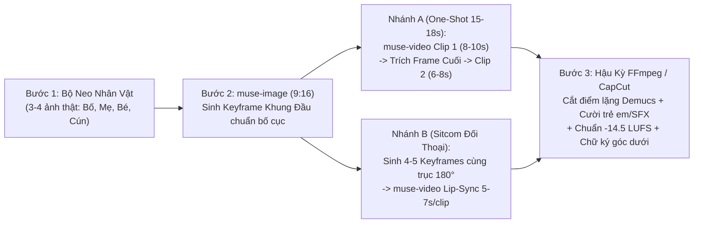

# Hồ Sơ Phân Tích Kênh **Linh Mít Daily** & Quy Trình Edit / Sản Xuất Bằng **Muse**

> [!IMPORTANT]
> **Giải mã cốt lõi giúp kênh đạt 1,5 tỷ lượt xem Reels:** Kênh dùng **gương mặt thật của 3 thành viên gia đình** làm mỏ neo nhân vật (`Character DNA Anchors`), sau đó dựng các tình huống hài hước đời thường siêu thực bằng AI (nhiều video gắn nhãn công khai **`Nội dung do AI tạo`** nhưng vẫn đạt **1,4 triệu – 11 triệu lượt xem/video**) nhờ lối dựng **"Giả Quay Thật 100%" (`Zero-Clutter Realism`)**: không phụ đề karaoke, không hộp tiêu đề màu mè, khóa chuẩn trục máy và chuẩn âm lượng **`-14.1` đến `-14.9 LUFS`**.

---

## 1. Thông Tin Tổng Quan Kênh & Dữ Liệu 5 Reels Đã Tải Về

- **Tên trang:** Linh Mít Daily (`https://www.facebook.com/Linhmitdaily`)
- **Hạng mục:** Blog cá nhân • Hà Nội (`Booking@radiantvietnam.vn`)
- **Quy mô:** **2,5 triệu người theo dõi** • **1,5 tỷ lượt xem thước phim (Reels)**
- **Hệ sinh thái đa kênh:** TikTok (`@linhmitdaily`), YouTube (`@giadinhlinhmitdaily`), Instagram (`@giadinhlinhmit`)
- **Thông số xuất file đồng nhất trên cả 5 Reels kiểm định (`ffprobe` + `ebur128`):**
  - **Độ phân giải & Khung hình:** `1080×1920` (`9:16`) @ **`30.0 fps`** (codec `AV1` / `H.264`, audio `AAC`)
  - **Độ lớn âm thanh tích hợp:** **`-14.1 LUFS` đến `-14.9 LUFS`** (trung bình `-14.4 LUFS` — trùng khít chuẩn phát sóng của Full Studio!)

| Mã tệp đã tải | Link gốc & Chủ đề | Thời lượng | Lượt xem FB | Số cú cắt (`scdet`) | Cấu trúc dựng thực tế |
| :--- | :--- | :---: | :---: | :---: | :--- |
| **`reel_01`** | [reel/2206732266546233](https://www.facebook.com/reel/2206732266546233/) *(Bố mời trà sữa hai mẹ con giận dỗi)* | `10.05s` | `738K` | `0` cú cắt | **1 clip đơn `10s`** khóa chân máy tĩnh (`Tripod Full-Body`) |
| **`reel_02`** | [reel/1878056259888976](https://www.facebook.com/reel/1878056259888976/) *(Thần chết đòi mang bình rượu mơ đi — AI)* | `19.09s` | `132K` | **`11` cú cắt** (`12` shots) | **Multi-Shot Sitcom** cắt đảo trục `OTS` cực nhanh (`0.6s – 3.3s`/cảnh) + Lip-sync tiếng Việt |
| **`reel_03`** | [reel/1705039944357159](https://www.facebook.com/reel/1705039944357159/) *(Zậy mà không có hiểu — Sửa quạt màu cam — AI)* | `18.09s` | **`1.4M`** | `0` cú cắt cứng | **Nối đuôi 3 nhịp `Last-Frame Chain`** (`0–6.5s` → `6.5–12.8s` → `12.8–18.1s`) |
| **`reel_04`** | [reel/1731217485091634](https://www.facebook.com/reel/1731217485091634/) *(Ba đón con đi học về kiểu — Cổng mầm non — AI)* | `18.04s` | **`4.5M`** | `0` cú cắt cứng | **Long-Take `18s` máy cầm tay nhẹ** (`2×9s` / `3×6s` nối frame cuối mượt) |
| **`reel_05`** | [reel/1533231795282271](https://www.facebook.com/reel/1533231795282271/) *(Âm thanh của sự hạnh phúc — Công viên — AI)* | `15.05s` | **`11.0M`** | `0` cú cắt cứng | **Nối đuôi `10s + 5s`** (điểm chuyển frame cuối tại `t ≈ 10.7s`) |


---

## 2. Giải Phẫu 2 Công Thức Dựng Giúp Video AI Nhìn "Thật Như Quay Đời Thường"

### Công thức A — Dạng "One-Shot Tình Huống" (`10s / 15s / 18s` — Vũ khí hút 4M–11M views)
1. **Bố cục Toàn thân / Trung-Toàn ngang tầm mắt trẻ nhỏ (`Child-Level Medium-Full Shot`)**:
   - Luôn lấy đủ đầu–chân hoặc từ đầu gối trở lên để thấy trọn **ngôn ngữ hình thể** của bé và bố mẹ (khoanh tay dỗi, dang tay chờ ôm, chạy vụt qua bố, kiễng chân hôn má bạn).
   - Đặt **1 đạo cụ màu nổi duy nhất** làm tâm điểm thị giác giữa nền trung tính ấm: *cánh quạt màu cam rực* (`reel_03`), *cổng trường mầm non xanh–vàng* (`reel_04`), *ủng đỏ trên thảm cỏ xanh* (`reel_05`).
2. **Cấu trúc Kịch bản "Hiểu Lầm Ngây Thơ / Bẻ Lái Cuối Cảnh" (`Expectation Subversion`)**:
   - `0s – 5s` (**Gieo kỳ vọng**): Bố đưa nửa trái tim / Bố dang rộng hai tay đón con ở cổng trường.
   - `5s – 12s` (**Bẻ lái hài hước**): Con hiểu nhầm vỗ tay lên lòng bàn tay xin tua-vít của bố / Con chạy lướt qua bố ôm chầm bạn trai cùng lớp.
   - `12s – 18s` (**Reo cảm xúc kết**): Biểu cảm "đứng hình" của bố + tiếng cười khanh khách của trẻ nhỏ khiến khán giả xem đi xem lại.
3. **Bí quyết vượt giới hạn `10 giây` của AI bằng Nối Đuôi Khung Cuối (`Last-Frame Chaining`)**:
   - Dữ liệu đo biến thiên điểm ảnh (`L1 pixel-diff`) cho thấy `reel_03` (`18.09s`) và `reel_05` (`15.05s`) không cắt cảnh mà **lấy chính xác frame cuối của clip trước (`ffmpeg -sseof -0.04`) làm ảnh đầu vào (`first_frame`) cho clip kế tiếp**, giúp bối cảnh, ánh sáng và vị trí nhân vật nối liền mạch thành một cú máy dài 15–18 giây!

---

### Công thức B — Dạng "Multi-Shot Sitcom Đối Thoại" (`12 Shots / 19s` — Nhịp cắt điện ảnh cực gắt)


Quan sát bảng giải phẫu 12 cú cắt của `reel_02` (`19.09s`), editor của kênh tuân thủ kỷ luật dựng phim chuyên nghiệp:
1. **Khóa cứng 2 góc máy đối xứng qua Trục 180° (chỉ cần tạo 2 Master Keyframes gốc rồi biến thiên!)**:
   - **Góc A — Qua vai Bố nhìn ra cửa (`Shots 01, 03, 05, 07`)**: Tiền cảnh trái là bờ vai áo nâu mờ của Bố cầm ly sứ trắng, chính diện là Thần Chết ngoài cửa đêm.
   - **Góc B — Từ cửa nhìn vào phòng khách (`Shots 02, 04, 06, 10, 12`)**: Bố đứng bên phải cửa, hậu cảnh sâu có ghế sofa xanh rêu, bé Mít chạy ra ôm chân bố, chú cún Poodle trắng tai cam ngồi dưới sàn và Mẹ đứng quay lưng ở bếp.
2. **Chèn 2 cú Cận Đặc Tả Phản Ứng siêu ngắn (`0.7s – 1.0s`) ngay đỉnh điểm gây cười**:
   - `Shot 08 (0.7s)`: Bé Mít nấp sau ống quần xám của Bố thò mắt tròn xoe nhìn ra.
   - `Shot 09 (1.0s)`: Cận mặt Bố trợn mắt há miệng sau cặp kính khi nghe đòi lấy bình rượu mơ.
3. **Chi tiết "Gag phụ" giữ chân người xem xem lại lần 2**: Ở `Shot 12 (15.8s–19.1s)`, khi Bố thò đầu qua khe cửa lườm Thần Chết, **chú chó Poodle dưới chân cũng thò đầu qua khe cửa nhìn theo y hệt Bố**!

---

## 3. Quy Trình Thực Chiến Dựng & Edit Phong Cách Này Bằng **Muse** Trên Full Studio

Trong hệ thống **Full Studio** của bạn (`Infinity Studio` + cổng cục bộ **`muse2api` tại `http://127.0.0.1:18610`**), Muse cung cấp 3 mô hình kết hợp hoàn hảo để làm dòng video này mà **0% dính watermark AI rác**:
- **`muse-image`** (`/v1/images/generations`): Nhận tối đa **4 ảnh tham chiếu (`image: [ref1..ref4]`)** ở tỷ lệ `9:16` — dùng để khóa 100% gương mặt gia đình/nhân vật vào Keyframe đầu.
- **`muse-video`** (`/v1/videos`): Tạo video `9:16` từ ảnh khung đầu (`image: first_frame_data_url`, thời lượng chuẩn `5s – 10s`/clip), hỗ trợ **Lip-sync thoại tiếng Việt trực tiếp** rất tự nhiên và sạch.
- **Quy tắc Vận hành Muse bắt buộc**: Luôn chạy tuần tự từng video một trên mỗi tài khoản (`MUSE2API_ACCOUNT_MAX_CONCURRENCY=1`), không bắn song song nhiều video cùng lúc trên 1 nick để tránh treo hàng đợi.



---

### Bước 1: Chuẩn bị "Bộ Neo Gia Đình" (`Character DNA Lock` — làm 1 lần dùng cả kênh)
Tạo thư mục `anchors/` gồm **4 tấm ảnh rõ nét trên nền trung tính**:
1. `ANC_DAD.jpg`: Chân dung nửa người & toàn thân Bố (khóa kiểu tóc, gọng kính, dáng người).
2. `ANC_MOM.jpg`: Chân dung nửa người & toàn thân Mẹ.
3. `ANC_BABY.jpg`: Ảnh bé 2–3 tuổi rõ nét biểu cảm bầu bĩnh đáng yêu.
4. `ANC_HOME.jpg`: 1 ảnh bối cảnh phòng khách / sân nhà cố định để giữ nhận diện kênh xuyên suốt.

---

### Bước 2A: Cách dựng Video **One-Shot 15s – 18s** bằng `Muse` (`Last-Frame Chaining`)

1. **Tạo Khung Hình Đầu (`kf_part1.jpg`) bằng `muse-image`**:
   - Truyền `image: [ANC_DAD, ANC_MOM, ANC_BABY, ANC_HOME]`, `size: "9:16"`.
   - Prompt khóa cỡ cảnh:
     > *"Vertical 9:16 photorealistic candid Vietnamese family medium-full shot at child eye-level inside the warm beige living room from reference: Dad (exact man in glasses, navy blazer, cream trousers) crouches on the right holding an orange plastic fan blade; toddler daughter (exact cute toddler girl in cream lace dress with pearl hair clips, holding a small red screwdriver) stands on the left; Mom smiles softly in the background holding a phone. Soft natural indoor lighting, raw iPhone 16 Pro camera look, ZERO text, ZERO watermark."*
2. **Tạo Nhịp 1 (`part1.mp4` — `8s` hoặc `10s`) bằng `muse-video`**:
   - Truyền `image: to_durl("kf_part1.jpg")`, `duration: 9`, `size: "9:16"`.
   - Prompt diễn xuất vật lý cụ thể theo mốc giây, khóa máy tĩnh:
     > *"Static tripod photorealistic 9:16 family video (9 seconds): Dad crouching with the orange fan blade smiles warmly and extends his left hand in a curved C-shape half-heart toward his toddler daughter; the little girl looks at his hand and playfully pinches/completes the finger heart with her tiny hand while Mom chuckles in the background. Natural subtle movement, NO camera cut, NO text, NO background music, NO watermark."*
3. **Trích Frame Cuối Sắc Nét (`kf_part2.jpg`) & Nối Nhịp 2 (`part2.mp4` — `8s` hoặc `9s`)**:
   - Dùng `ffmpeg` lấy đúng frame cuối cùng của `part1.mp4`:
     ```powershell
     ffmpeg -y -sseof -0.04 -i part1.mp4 -frames:v 1 -q:v 2 kf_part2.jpg
     ```
   - Đưa `kf_part2.jpg` vào `muse-video` (`duration: 9`, `size: "9:16"`):
     > *"Seamless continuation from exact starting frame, static tripod photorealistic 9:16 video (9 seconds): Dad now opens his palm flat asking the toddler girl for the red screwdriver ('Đưa ba cái tua-vít mà'), but the cute toddler girl misunderstands and happily places her tiny empty hand on top of Dad's open palm with a bright proud giggle while Dad freezes in amused confusion. NO camera cut, NO text, NO watermark."*
4. **Ghép mượt 0 vết cắt (`18s`)**:
   - Bỏ frame đầu bị trùng của `part2.mp4` (`-ss 0.034` ở `30fps`) rồi nối `concat` trên FFmpeg NVENC — bạn thu được đúng 1 cú máy `18.0s` liền mạch như `reel_03` & `reel_04`!

---

### Bước 2B: Cách dựng Video **Sitcom Đối Thoại Cắt Nhanh** bằng `Muse` (như `reel_02`)

1. **Tiết kiệm tối đa lượt tạo — Chỉ tạo 4 Keyframes Gốc bằng `muse-image`**:
   - `kf_A_ots_door.jpg`: Góc qua vai Bố nhìn ra nhân vật khách ngoài cửa.
   - `kf_B_room_wide.jpg`: Góc từ cửa nhìn vào Bố + Bé + Cún trong phòng khách.
   - `kf_C_baby_peek.jpg`: Cận bé nấp sau chân bố thò mặt ngước nhìn.
   - `kf_D_dad_shock.jpg`: Cận đặc tả mặt Bố trợn mắt bất ngờ (**mẹo vàng chống lỗi tay AI**: ghi rõ `tight facial close-up from shoulders up, NO hands in frame`).
2. **Tạo từng clip `muse-video` (`5s – 6s`) kèm Thoại Tiếng Việt Lip-Sync**:
   - Đặt lời thoại ngắn gọn trong ngoặc kép tiếng Việt trực tiếp trong prompt `muse-video` (giống pipeline `stage3_gen_muse_videos.py` đã kiểm chứng thành công 100% trên máy của bạn):
     > *"...the father in glasses widens his eyes in disbelief and speaks aloud immediately in clear natural Vietnamese voice with accurate lip-sync: \"Bình rượu mơ của tao đó! Kiếm việc tử tế mà làm, biến đi!\" Static camera, clean studio dialogue, NO background music, NO text, NO watermark."*
3. **Cắt dựng nhịp `0.7s – 2.2s` (Chuẩn Editor Sitcom)**:
   - Một clip `muse-video` dài `6s` của Góc A và Góc B có thể **cắt nhỏ làm 2–3 đoạn xen kẽ (`A1 -> B1 -> A2 -> B2 -> Cận Bé 0.7s -> Cận Bố 1.0s -> B3`)** trên CapCut hoặc FFmpeg!
   - Dùng `Demucs` (`htdemucs --two-stems=vocals`) lọc sạch âm nền ảo nếu có, cắt sát điểm bắt đầu mở miệng (`pre_pad = 0.12s`, `post_pad = 0.18s`) để các câu đối đáp dồn dập, không có khoảng chết.

---

### Bước 3: Hậu kỳ Âm thanh & Đóng dấu tối giản chuẩn **Linh Mít Daily**

1. **Tuyệt đối giữ khung hình "Zero-Clutter"**:
   - **Không chèn phụ đề chạy từng chữ**, không đặt banner tiêu đề trên đỉnh đầu. Câu dẫn gây tò mò chỉ viết **4–7 chữ ngắn gọn ở phần Caption bài đăng** (ví dụ: *"Zậy mà không có hiểu #baby #cute"*, *"Ba đón con đi học về kiểu"*).
2. **Thiết kế Lớp Âm Thanh Hút Triệu View (`-14.5 LUFS`)**:
   - **Với video One-Shot không thoại**: Đặt 1 lớp **tiếng trẻ con cười khanh khách trong trẻo (`baby giggle`)** trùng đúng giây cao trào (`t = 7s–15s`) + tiếng động vật lý khẽ (`tiếng bước chân lạch bạch`, `tiếng đặt tay`) + nhạc nền Acoustic/Pizzicato vui tươi giảm nhỏ ở `-18 dB`.
   - **Chuẩn hóa đầu ra FFmpeg NVENC**: `1080×1920 @ 30fps`, `loudnorm=I=-14.5:TP=-1.2:LRA=7`.
3. **Watermark chữ ký góc dưới trái**:
   - Tạo 1 file PNG trong suốt chữ ký tay mảnh (`Birthstone Bounce` / `Allison` + `Montserrat` in hoa dãn chữ có sẵn trong kho `65` font của Studio), đặt tại góc dưới trái (`X = 72px, Y = 1480px`, `opacity = 0.75`) — vừa chống reup tinh tế, vừa nằm trên vùng caption đen của Facebook/TikTok.

---

## 4. Vị Trí Lưu Trữ Trọn Bộ Video & Hồ Sơ Tham Khảo Đã Tải

- **Kho Dự Án Cloud (`AI_Full_Studio`)**: [261128-linhmitdaily-muse-analysis](file:///G:/My%20Drive/AI_Full_Studio/03_Du_An/261128-linhmitdaily-muse-analysis)
- **Kho Tham Khảo Trung Tâm (`TLH\Edit\08_Brand Kits...`)**: [Tham_Khao_LinhMitDaily_Muse](file:///G:/Other%20computers/My%20Computer/Document%20HT%20Media/TLH/Edit/08_Brand%20Kits%20Thương%20Hiệu%20&%20Ảnh%20PNG/Tham_Khao_LinhMitDaily_Muse)
- **Thư mục Làm việc Tốc độ cao (`D:\`)**: [linhmitdaily-muse-analysis](file:///D:/AI/full%20studio/output/linhmitdaily-muse-analysis) (chứa đủ 5 file `.mp4`, `.info.json`, `forensic_report.json`, 30 ảnh frame, 2 bảng Contact Sheet và script mẫu `muse_linhmit_pipeline_template.py`).
