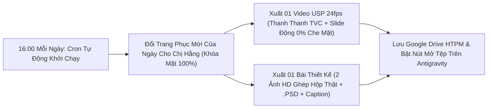

# Kế Hoạch Content & Tủ Đồ 30 Ngày Tự Động (`16:00` Hằng Ngày) — Hằng Thu Pharma (HTPM)
**Định mức bàn giao lúc `16:00` mỗi ngày:** `01 Video USP (9:16 · 24fps)` **+** `01 Bài Đăng Thiết Kế (Bộ 2 Ảnh HD + .PSD + Caption)` (`Tổng 60 ấn phẩm / 30 ngày`: `24/11/2026 → 23/12/2026`)

> [!IMPORTANT]
> **Quy chuẩn Vận hành & Khóa Nhân Vật Xuyên Suốt:**
> 1. **Mẫu USP Xuyên Suốt — Thay Đồ Mỗi Ngày:** Khóa cứng `100%` gương mặt & thần thái **Chị Hằng** (`MAU_CHI_HANG_PORTRAIT.png`), đồng thời **thay mới 100% trang phục, kiểu tóc/phụ kiện & bối cảnh mỗi ngày** theo cột **👗 Tạo hình Chị Hằng trong ngày** (`30 bộ không trùng ngày nào`).
> 2. **Quy chuẩn `01 Video USP (9:16 @ 24fps)`:** Giọng **`THANH THANH TVC`** · Bao bì thật `IS-Net 100%` · Viết hoa `100%` đầu câu · `0%` chữ che mặt (`Face-Safe`) · Đan xen **4–6 Lớp phủ Slide kính mờ động** · Nằm gọn `100%` trong Vùng An Toàn TikTok × Reels.
> 3. **Quy chuẩn `01 Bài Đăng Thiết Kế`:** Bộ **02 ảnh HD đồng bộ** (Ảnh 1: *Key Visual Chị Hằng mặc đồ mới + ghép hộp thật 100%* · Ảnh 2: *Infographic 4 Thảo dược & Lợi ích*) + file gốc **`.PSD` đa layer** + **Caption thổi hồn** kèm `#HangThuPharma`.
> 4. **Lịch Giao Tự Động `16:00` Giờ Việt Nam:** Lưu trực tiếp vào Google Drive của Hằng Thu Pharma + bật báo cáo kèm nút **📂 Mở vị trí tệp** ngay trên Antigravity (kịp đăng bài tối cùng ngày & sáng hôm sau).

---

## Luồng Tự Động Sản Xuất & Bàn Giao Hằng Ngày (`16:00 ICT`)

---

## Bảng Phân Bổ 9 Sản Phẩm Chủ Lực & Ảnh Tách Nền `IS-Net` Chuẩn Sẵn Sàng

| Mã SP | Sản phẩm chủ lực | File tách nền `IS-Net` sẵn trong Brand Kit | Số Video USP | Số Bài Thiết Kế | Tổng hiện diện |
| :--- | :--- | :--- | :---: | :---: | :---: |
| **SP01** | **Điều Kinh HT (Bổ Trứng)** | `SP_DIEU_KINH_HT_CUTOUT.png` | 4 | 4 | **8 lần** |
| **SP02** | **Viên Đặt LT Plus (Hộp Hồng)** | `SP_LT_PLUS_COMBO_CUTOUT.png` | 4 | 4 | **8 lần** |
| **SP03** | **Dạ Dày HT** | `SP_DA_DAY_HT_COMBO_CUTOUT.png` | 4 | 3 | **7 lần** |
| **SP04** | **DDVS Romance VIP** | `SP_ROMANCE_VIP_CUTOUT.png` | 3 | 4 | **7 lần** |
| **SP05** | **Viên Đặt Phụ Khoa (Hộp Xanh)** | `SP_VIEN_DAT_HOP_XANH_CUTOUT.png` | 3 | 3 | **6 lần** |
| **SP06** | **Romance Love** | `SP_ROMANCE_LOVE_CUTOUT.png` | 3 | 3 | **6 lần** |
| **SP07** | **Ngọc Long Hoàn** | `SP_NGOC_LONG_HOAN_CUTOUT.png` | 3 | 3 | **6 lần** |
| **SP08** | **Viên Uống WhiteSkin** | `SP_WHITESKIN_COMBO_CUTOUT.png` | 3 | 3 | **6 lần** |
| **SP09** | **Gel Phụ Khang Hằng Thu** | `SP_GEL_PHU_KHANG_CUTOUT.png` | 3 | 3 | **6 lần** |

---

## TUẦN 1 (`24/11 – 30/11/2026`): Lắng Nghe Tín Hiệu Cơ Thể Giữa Nhịp Sống Bận Rộn

| Ngày | 👗 Tạo Hình Chị Hằng Trong Ngày (Đổi Mới 100%) | 🎬 01 VIDEO USP (`9:16 · 24fps` — Giọng Thanh Thanh) | 🎨 01 BÀI ĐĂNG THIẾT KẾ (`2 Ảnh HD + .PSD + Caption`) |
| :--- | :--- | :--- | :--- |
| **Ngày 01** `T3 · 24/11` | **Bộ 01 — Công sở Trắng Kem & Hồng Phấn:** Blazer trắng kem chiết eo khoác ngoài áo lụa hồng phấn cổ đổ, khuyên tai ngọc trai nhỏ, tóc uốn sóng lơi rẽ ngôi, phòng làm việc sáng thoáng. | **SP02 — Viên Đặt LT Plus** • **Hook 3s:** *"Càng tự tra triệu chứng trên mạng, chị càng… hoang mang?"* • **Slide động:** 3 nỗi lo dân văn phòng → Cơ chế làm sạch dịch nhầy & giữ ẩm tự nhiên. • **CTA:** Nhắn “LT PLUS” tư vấn riêng tư. | **SP09 — Gel Phụ Khang Hằng Thu** • **Chủ đề:** *Skincare da mặt đủ 10 bước, sao lại để “cô bé” chờ đến lúc khó chịu mới nhớ?* • **Layout 2 ảnh:** KV bàn trang điểm sang trọng + Infographic 4 thảo dược (`Kim ngân hoa · Trầu không · Khổ sâm · Trinh nữ hoàng cung`). |
| **Ngày 02** `T4 · 25/11` | **Bộ 02 — Đầm Lụa Hồng Đào Nắng Sớm:** Đầm lụa satin hồng đào tay bồng nhẹ cổ vuông tinh tế, tóc vén nhẹ một bên tai khoe làn da sáng mịn dưới nắng ban công buổi sáng. | **SP08 — Viên Uống WhiteSkin** • **Hook 3s:** *"Ảnh chụp cam thường hơi xỉn màu, bước ra nắng lại càng ngại soi gương?"* • **Slide động:** Checklist dưỡng sáng đa tầng (`L-Glutathione · NMN · Collagen · Vitamin E`). • **CTA:** Nhắn “WHITESKIN” đón nền da rạng rỡ. | **SP01 — Điều Kinh HT** • **Chủ đề:** *Chưa tới ngày “đèn đỏ” mà bụng đã âm ỉ, người mệt rũ chẳng muốn làm gì?* • **Layout 2 ảnh:** KV Chị Hằng ôm tách trà ấm + Infographic `Đương quy · Hương phụ · Ích mẫu` bổ huyết lưu thông. |
| **Ngày 03** `T5 · 26/11` | **Bộ 03 — Sơ Mi Lụa Tơ Tằm Đỏ Hoa Hồng:** Áo sơ mi lụa tơ tằm màu rose-burgundy phối chân váy chữ A màu kem, tóc búi thấp Hàn Quốc thanh lịch, không gian phòng tắm/bàn phấn đá cẩm thạch trắng. | **SP04 — DDVS Romance VIP** • **Hook 3s:** *"Chăm sóc vùng nhạy cảm không phải chạy theo mùi hương nồng, mà là sự dịu nhẹ chuẩn pH."* • **Slide động:** 4 điểm cộng `Hoa hồng Bulgaria · Lô hội · Trà xanh · Vitamin E`. • **CTA:** Nhắn “ROMANCE VIP” trải nghiệm bảo bối 10 năm. | **SP03 — Dạ Dày HT** • **Chủ đề:** *Đói cũng rát thượng vị, ăn no lại đầy tức — đừng để mỗi bữa ngon thành áp lực!* • **Layout 2 ảnh:** KV mâm cơm ấm cúng + Infographic 4 vị thảo mộc vàng (`Dạ cẩm · Nghệ đen · Hoàng liên · Mộc hương`). |
| **Ngày 04** `T6 · 27/11` | **Bộ 04 — Len Dệt Kim Tím Hoa Cà:** Áo len mỏng dệt kim màu tím lilac cổ tim phối quần âu trắng ngà, tóc xõa tự nhiên mềm mại bên bàn trà hoa ấm áp. | **SP01 — Điều Kinh HT** • **Hook 3s:** *"Lịch công việc luôn đúng hẹn, sao lịch chu kỳ lại tháng sớm tháng muộn?"* • **Slide động:** So sánh chu kỳ thất thường vs Chu kỳ êm ái + Bảng thảo dược bổ huyết. • **CTA:** Nhắn “ĐIỀU KINH” để mỗi tháng nhẹ tênh. | **SP07 — Ngọc Long Hoàn** • **Chủ đề:** *Đàn ông ngoài mặt vẫn cười nói đi làm, nhưng nỗi lo hụt hơi xuống sức lại giấu riêng trong lòng.* • **Layout 2 ảnh:** KV không gian lịch lãm + Infographic `Bá bệnh · Dâm dương hoắc · Maca · Đông trùng hạ thảo`. |
| **Ngày 05** `T7 · 28/11` | **Bộ 05 — Đầm Midi Lụa Champagne Ánh Kim:** Váy lụa champagne cổ tròn thanh nhã khoác hờ khăn voan tơ mỏng, tóc uốn gợn quyến rũ, phòng ngủ ánh đèn vàng ấm tinh tế. | **SP06 — Romance Love** • **Hook 3s:** *"Nến đã thắp, cảm xúc đã lên… nhưng sự khô rát lại khiến chị ngại ngần?"* • **Slide động:** Bộ dưỡng chất cấp ẩm mềm mịn (`Hyaluronic Acid · Panthenol · Niacinamide · Vit E`). • **CTA:** Nhắn “ROMANCE LOVE” giữ trọn lửa yêu. | **SP05 — Viên Đặt Phụ Khoa (Hộp Xanh)** • **Chủ đề:** *“Cô bé” không biết nhắn tin, nên mỗi lần khó chịu là một lần gửi tín hiệu cầu cứu!* • **Layout 2 ảnh:** KV thông báo điện thoại ẩn dụ tinh tế + Infographic `Cúc La Mã · Cam thảo · Lactic Acid`. |
| **Ngày 06** `CN · 29/11` | **Bộ 06 — Set Gile Vest Xanh Lục Bảo:** Áo gile vest thiết kế màu xanh rêu đậm (emerald) phối quần suông đồng bộ sang trọng, đồng hồ dây da mảnh, phòng khách gỗ ấm cúng cuối tuần. | **SP07 — Ngọc Long Hoàn** • **Hook 3s:** *"Lịch bóng đá anh nhớ từng giờ, còn lịch bồi bổ sức khỏe bản thân anh để quên bao lâu rồi?"* • **Slide động:** 3 trụ cột phong độ phái mạnh + Thảo dược bổ thận tráng dương an toàn. • **CTA:** Nhắn “NGỌC LONG HOÀN” chăm sức khỏe từ gốc. | **SP08 — Viên Uống WhiteSkin** • **Chủ đề:** *Chăm da cuối tuần: Đừng giao hết KPI sáng mịn cho chiếc app chỉnh ảnh!* • **Layout 2 ảnh:** KV nắng sớm trong trẻo + Infographic cơ chế chống oxy hóa từ bên trong. |
| **Ngày 07** `T2 · 30/11` | **Bộ 07 — Blouse Voan Cổ Nơ Xanh Bạc Hà:** Áo blouse voan cổ nơ màu xanh mint tươi mát sơ vin chân váy bút chì xám sáng, tóc buộc nửa đầu thanh thoát tại văn phòng đầu tuần. | **SP09 — Gel Phụ Khang Hằng Thu** • **Hook 3s:** *"Ngồi văn phòng suốt 8 tiếng bí bách, làm sao để cả ngày vẫn thoáng sạch thơm mát?"* • **Slide động:** Quy cách ống gel tiện lợi + 4 thảo dược kháng khuẩn dịu êm. • **CTA:** Nhắn “GEL PHỤ KHANG” tự tin suốt tuần mới. | **SP04 — DDVS Romance VIP** • **Chủ đề:** *Khởi đầu tuần mới tự tin bắt đầu từ cảm giác sạch dịu nhẹ ở những điều riêng tư nhất.* • **Layout 2 ảnh:** KV cánh hồng Bulgaria đẫm sương + Infographic giữ ẩm mềm mịn cho cả hai vợ chồng. |

---

## TUẦN 2 (`01/12 – 07/12/2026`): Giải Mã Hiểu Lầm & Tôn Vinh Thảo Dược Thật

| Ngày | 👗 Tạo Hình Chị Hằng Trong Ngày (Đổi Mới 100%) | 🎬 01 VIDEO USP (`9:16 · 24fps` — Giọng Thanh Thanh) | 🎨 01 BÀI ĐĂNG THIẾT KẾ (`2 Ảnh HD + .PSD + Caption`) |
| :--- | :--- | :--- | :--- |
| **Ngày 08** `T3 · 01/12` | **Bộ 08 — Suit Xanh Lá Thông Nhạt (Sage Green):** Suit nữ hiện đại màu sage green khoác ngoài áo lụa trắng kem, cài áo hoa trà tinh xảo, góc phòng tư vấn sức khỏe chuyên nghiệp. | **SP05 — Viên Đặt Phụ Khoa (Hộp Xanh)** • **Hook 3s:** *"Vừa hết khó chịu ít hôm lại tái lại — đừng chỉ che giấu mùi hương bên ngoài!"* • **Slide động:** Cơ chế làm sạch dịu nhẹ, khử mùi & cân bằng pH tự nhiên từ `Cúc La Mã · Cam thảo`. • **CTA:** Nhắn “VIÊN ĐẶT” nhận lộ trình chăm đúng. | **SP02 — Viên Đặt LT Plus** • **Chủ đề:** *Nghe đến lộ tuyến ra nhiều dịch là lo lắng mất ăn mất ngủ? Bình tĩnh hiểu đúng để chăm êm!* • **Layout 2 ảnh:** KV Chị Hằng tư vấn ấm áp + Infographic 3 tác động sạch dịch nhầy – giảm mùi – giữ pH. |
| **Ngày 09** `T4 · 02/12` | **Bộ 09 — Sơ Mi Đũi Vàng Bơ Tươi Sáng:** Áo sơ mi linen cao cấp màu vàng bơ (butter yellow) tay lỡ phối quần culottes trắng kem, tóc cột đuôi ngựa thấp tại căn bếp sáng sạch. | **SP03 — Dạ Dày HT** • **Hook 3s:** *"Đã kiêng đồ cay nóng mà vùng thượng vị vẫn âm ỉ mỗi chiều?"* • **Slide động:** Cơ chế kép `Giảm acid dịch vị + Bao phủ bảo vệ niêm mạc` của bộ tứ thảo dược Đông y. • **CTA:** Nhắn “DẠ DÀY” để bụng êm ăn ngon. | **SP06 — Romance Love** • **Chủ đề:** *Dưỡng ẩm hằng ngày và bôi trơn tức thời: Hai nhu cầu khác nhau mà chị em hay gộp làm một!* • **Layout 2 ảnh:** KV lụa hồng satin mềm mại + Infographic cấp ẩm sâu nuôi dưỡng sắc da nhạy cảm. |
| **Ngày 10** `T5 · 03/12` | **Bộ 10 — Set Tweed Hồng Pastel Viền Vàng:** Áo khoác tweed dáng ngắn màu hồng phấn viền ánh kim phối chân váy xếp ly trắng, tóc xoăn sóng nước sang trọng trên sofa kem. | **SP02 — Viên Đặt LT Plus** • **Hook 3s:** *"Qua tuổi 35–40, vì sao chỉ chú ý làm sạch thôi vẫn thấy khô và kém thoải mái?"* • **Slide động:** Tác động kép của LT Plus: `Làm sạch dịch nhầy` song hành `Duy trì độ ẩm tự nhiên`. • **CTA:** Nhắn “LT PLUS” hồi sinh sự tự tin. | **SP01 — Điều Kinh HT (Bổ Trứng)** • **Chủ đề:** *Hành trình mong con yêu: Chu kỳ đều đặn chính là nền tảng ấm áp đầu tiên của người mẹ.* • **Layout 2 ảnh:** KV tổ ấm ngập nắng + Infographic thảo dược bồi bổ khí huyết. |
| **Ngày 11** `T6 · 04/12` | **Bộ 11 — Đồ Tập Pilates Hồng Đất Thanh Lịch:** Áo khoác thể thao dáng ôm kín đáo màu hồng đất (dusty rose) phối quần tập đồng bộ, tóc buộc cao khỏe khoắn bên khung cửa kính phòng tập sáng sớm. | **SP08 — Viên Uống WhiteSkin** • **Hook 3s:** *"Che chắn kỹ rồi mà vết sạm sau nắng vẫn chậm đều màu?"* • **Slide động:** Phối hợp `Chống nắng bên ngoài` + `Nuôi dưỡng L-Glutathione & Cà chua đỏ từ bên trong`. • **CTA:** Nhắn “WHITESKIN” nuôi nền da sáng khỏe. | **SP09 — Gel Phụ Khang Hằng Thu** • **Chủ đề:** *Mồ hôi sau giờ tập yoga hay ngày nắng nóng: Đừng cố rửa thật mạnh làm mất cân bằng tự nhiên!* • **Layout 2 ảnh:** KV phụ nữ năng động khỏe khoắn + Infographic làm sạch êm không khô căng. |
| **Ngày 12** `T7 · 05/12` | **Bộ 12 — Đầm Sơ Mi Trắng Khăn Lụa Hoa Hồng:** Đầm sơ mi chiết eo màu trắng tinh khôi đính cúc ngọc trai, cổ thắt nhẹ khăn lụa họa tiết hoa hồng đỏ, không gian spa ngập hoa tươi. | **SP04 — DDVS Romance VIP** • **Hook 3s:** *"Đã rửa sạch bên ngoài, có cần xịt rửa sâu vào bên trong cho 'sạch hẳn' không?"* • **Slide động:** Phân biệt rõ chăm sóc vùng ngoài chuẩn khoa học + Độ êm của `Romance VIP 150ml`. • **CTA:** Nhắn “ROMANCE VIP” nâng niu đúng cách. | **SP03 — Dạ Dày HT** • **Chủ đề:** *Cuối tuần tụ họp gia đình, tiệc tùng bia rượu — đừng quên người bạn bảo vệ niêm mạc dạ dày!* • **Layout 2 ảnh:** KV bàn tiệc gia đình vui vẻ + Infographic giảm ợ hơi, ợ chua, đầy chướng. |
| **Ngày 13** `CN · 06/12` | **Bộ 13 — Len Cashmere Hồng San Hô Dịu Dàng:** Áo len cashmere mềm màu hồng san hô (coral pink) phối chân váy lụa suông màu kem sữa, tóc xõa đọc sách bên cửa sổ chiều Chủ nhật. | **SP01 — Điều Kinh HT** • **Hook 3s:** *"Đau bụng ngày đèn đỏ không phải do chị 'chịu đau kém' — cơ thể đang cần được vỗ về!"* • **Slide động:** 3 bước chườm ấm, nghỉ ngơi & bồi bổ khí huyết cùng `Đương quy · Hương phụ · Sài hồ`. • **CTA:** Nhắn “ĐIỀU KINH” tạm biệt nỗi ám ảnh mỗi tháng. | **SP07 — Ngọc Long Hoàn** • **Chủ đề:** *Bản lĩnh phái mạnh đến từ nền tảng thể lực bền bỉ, không phải những giải pháp thúc ép tức thời.* • **Layout 2 ảnh:** KV thảo dược quý trên nền đá trầm + Infographic quy cách 40 viên chăm sóc chủ động. |
| **Ngày 14** `T2 · 07/12` | **Bộ 14 — Blouse Lụa Tím Mẫu Đơn (Peony Mauve):** Áo blouse lụa tay phồng nhẹ màu tím mẫu đơn phối chân váy midi kem, khuyên tai giọt pha lê mảnh, không gian phòng ngủ sang trọng. | **SP06 — Romance Love** • **Hook 3s:** *"Đừng để cảm giác khô căng sau sinh làm xa cách những khoảnh khắc vợ chồng gần gũi."* • **Slide động:** Bảng thành phần dưỡng ẩm chuẩn spa (`HA · Panthenol · Vitamin E`) dạng gói riêng tinh tế. • **CTA:** Nhắn “ROMANCE LOVE” để được lắng nghe. | **SP05 — Viên Đặt Phụ Khoa (Hộp Xanh)** • **Chủ đề:** *Tân trang sự tự tin cho mẹ bỉm sau sinh: Khi phụ nữ biết thương mình, hạnh phúc tự khắc nở hoa.* • **Layout 2 ảnh:** KV phụ nữ rạng rỡ tự tin + Infographic hỗ trợ sạch thoáng, săn se, duy trì pH. |

---

## TUẦN 3 (`08/12 – 14/12/2026`): Câu Chuyện Chuyển Hóa & Niềm Tin Khách Hàng Thật

| Ngày | 👗 Tạo Hình Chị Hằng Trong Ngày (Đổi Mới 100%) | 🎬 01 VIDEO USP (`9:16 · 24fps` — Giọng Thanh Thanh) | 🎨 01 BÀI ĐĂNG THIẾT KẾ (`2 Ảnh HD + .PSD + Caption`) |
| :--- | :--- | :--- | :--- |
| **Ngày 15** `T3 · 08/12` | **Bộ 15 — Polo Dệt Kim Xanh Navy Viền Trắng:** Áo polo dệt kim cổ bẻ màu xanh navy phối viền trắng trẻ trung & quần tây kem cạp cao, bối cảnh phòng ăn gia đình ấm cúng. | **SP03 — Dạ Dày HT** • **Hook 3s:** *"Bữa tối ngon trước mặt mà không dám gắp vì sợ đêm nằm trào ngược mất ngủ?"* • **Slide động:** Hành trình 3 nhịp: `Êm thượng vị` → `Bữa cơm tròn vị` → `Ngủ sâu tới sáng`. • **CTA:** Nhắn “DẠ DÀY” tìm lại niềm vui ăn ngon. | **SP04 — DDVS Romance VIP** • **Chủ đề:** *Vì sao nhiều chị dùng Romance VIP suốt nhiều năm liền rồi lại mua tặng cả em gái, bạn thân?* • **Layout 2 ảnh:** KV hộp quà hoa hồng tinh tế + Infographic 5 điểm chạm chinh phục khách kỹ tính. |
| **Ngày 16** `T4 · 09/12` | **Bộ 16 — Blazer Xám Ngọc Trai & Lụa Xanh Thiên Thanh:** Blazer suông màu pearl grey khoác ngoài sơ mi lụa xanh baby blue, phong thái nữ chủ tịch tự tin bước vào phòng họp kính. | **SP09 — Gel Phụ Khang Hằng Thu** • **Hook 3s:** *"Cảm giác nhẹ nhõm khi bước vào cuộc họp quan trọng mà không còn chút thấp thỏm nào!"* • **Slide động:** 4 lợi ích thực tế: `Sạch dịu nhẹ · Khử mùi · Cấp ẩm mềm da · Thơm mát tự nhiên`. • **CTA:** Nhắn “GEL PHỤ KHANG” giữ phong thái tự tin. | **SP08 — Viên Uống WhiteSkin** • **Chủ đề:** *Câu chuyện tuổi 34: “Chị không tìm loại trắng cấp tốc, chị chọn thứ nuôi da khỏe thật sự.”* • **Layout 2 ảnh:** KV chân dung da căng bóng dưới nắng + Infographic `Glutathione · NMN · Collagen`. |
| **Ngày 17** `T5 · 10/12` | **Bộ 17 — Đầm Nhung Đỏ Rượu Bordeaux Quý Phái:** Đầm nhung mềm cổ V kín đáo màu đỏ rượu Bordeaux đính khuy vàng đồng, tóc uốn cụp bồng bềnh tại phòng khách sang trọng. | **SP07 — Ngọc Long Hoàn** • **Hook 3s:** *"Món quà tinh tế nhất người vợ tâm lý dành tặng chồng sau những tháng ngày anh gồng gánh áp lực."* • **Slide động:** Tổ hợp thảo dược `Bá bệnh · Maca · Đông trùng hạ thảo · Bạch tật lê` bồi bổ nguyên khí. • **CTA:** Nhắn “NGỌC LONG HOÀN” giữ lửa tổ ấm. | **SP02 — Viên Đặt LT Plus** • **Chủ đề:** *Khách cũ rỉ tai khách mới: Điều quý giá nhất là tìm được giải pháp uy tín để không còn lo tái đi tái lại.* • **Layout 2 ảnh:** KV nụ cười nhẹ nhõm rạng ngời + Infographic lộ trình chăm sóc êm dịu tại nhà. |
| **Ngày 18** `T6 · 11/12` | **Bộ 18 — Đồ Mặc Nhà Lụa Tơ Tằm Xanh Ngọc Bích:** Set lụa dài tay cao cấp kín đáo màu xanh ngọc celadon phối viền trắng tinh tế, tóc xõa thư thái trong phòng ngủ tối giản ấm áp. | **SP05 — Viên Đặt Phụ Khoa (Hộp Xanh)** • **Hook 3s:** *"Đừng đợi đến khi mất ngủ, ngại gần gũi chồng mới bắt đầu lắng nghe cơ thể mình."* • **Slide động:** Ba tác động gói gọn trong 1 liệu trình: `Sạch êm · Giảm mùi · Cân bằng độ ẩm & pH`. • **CTA:** Nhắn “VIÊN ĐẶT” chăm sóc kín đáo. | **SP01 — Điều Kinh HT** • **Chủ đề:** *Tin vui từ những gia đình kiên trì chăm dưỡng khí huyết & chu kỳ ổn định cùng Hằng Thu.* • **Layout 2 ảnh:** KV hoa mẫu đơn ấm áp + Infographic dưỡng huyết điều hòa kinh nguyệt. |
| **Ngày 19** `T7 · 12/12` | **Bộ 19 — Khoác Dạ Mỏng Trắng Sữa & Cổ Lọ Hồng Phấn:** Áo khoác dạ mỏng không cổ màu trắng sữa phối áo thun cổ lọ mỏng hồng phấn, dây chuyền mặt đá nhỏ tại showroom dược phẩm. | **SP02 — Viên Đặt LT Plus** • **Hook 3s:** *"Giữa hàng trăm lời khuyên truyền miệng, phụ nữ hiện đại chọn giải pháp thảo dược rõ nguồn gốc."* • **Slide động:** Điểm danh thảo dược `Trầu không · Hoàng bá · Kim ngân hoa · Trinh nữ hoàng cung`. • **CTA:** Nhắn “LT PLUS” tư vấn 1:1 bảo mật. | **SP06 — Romance Love** • **Chủ đề:** *Cuối tuần thảnh thơi: Để sự gần gũi bắt đầu bằng cảm xúc tự nhiên chứ không phải sự gượng gạo.* • **Layout 2 ảnh:** KV phòng ngủ ánh nến sang trọng + Infographic dưỡng ẩm mềm mượt. |
| **Ngày 20** `CN · 13/12` | **Bộ 20 — Đầm Tơ Organza Trắng Ngọc Trai:** Đầm tơ sống màu trắng ánh ngọc trai thêu hoa nổi tinh tế, tóc búi cao kiêu sa giữa không gian trà chiều ngập nắng cuối tuần. | **SP08 — Viên Uống WhiteSkin** • **Hook 3s:** *"Mùa tiệc cuối năm sắp gõ cửa — mỗi ngày 2 viên nhỏ để lên hình góc nào cũng rạng rỡ!"* • **Slide động:** Lộ trình chăm da đón lễ hội: `Đủ ẩm mịn màng · Đều sắc da · Tràn sức sống`. • **CTA:** Nhắn “WHITESKIN” kịp đẹp mùa lễ hội. | **SP09 — Gel Phụ Khang Hằng Thu** • **Chủ đề:** *Chủ nhật dọn lại góc phòng tắm của nàng: Tối giản nhưng đúng sản phẩm cơ thể cần.* • **Layout 2 ảnh:** KV khay gỗ spa tại gia + Infographic êm dịu dùng hằng ngày. |
| **Ngày 21** `T2 · 14/12` | **Bộ 21 — Áo Dài Cách Tân Lụa Hồng Sen:** Áo dài cách tân lụa tơ tằm màu hồng sen nhạt thêu nhành hoa mảnh nền nã, tóc xõa vén tai dịu dàng bên bàn trà gốm Á Đông. | **SP01 — Điều Kinh HT** • **Hook 3s:** *"Phụ nữ khí huyết lưu thông thì sắc diện tươi hồng, tinh thần cũng nhẹ nhõm hẳn ra!"* • **Slide động:** Mối liên hệ giữa `Khí huyết ổn định` → `Chu kỳ êm` → `Thần sắc tươi tắn`. • **CTA:** Nhắn “ĐIỀU KINH” nuôi dưỡng nét xuân. | **SP04 — DDVS Romance VIP** • **Chủ đề:** *Mùi hương hoa hồng thanh khiết giúp chị em giữ trọn sự tự tin suốt ngày đầu tuần bận rộn.* • **Layout 2 ảnh:** KV chai Romance VIP giữa vườn hồng + Infographic cân bằng sinh lý tự nhiên. |

---

## TUẦN 4 & CAO ĐIỂM LỄ HỘI (`15/12 – 23/12/2026`): Rạng Rỡ Sắc Xuân — Khỏe Trong Đẹp Ngoài

| Ngày | 👗 Tạo Hình Chị Hằng Trong Ngày (Đổi Mới 100%) | 🎬 01 VIDEO USP (`9:16 · 24fps` — Giọng Thanh Thanh) | 🎨 01 BÀI ĐĂNG THIẾT KẾ (`2 Ảnh HD + .PSD + Caption`) |
| :--- | :--- | :--- | :--- |
| **Ngày 22** `T3 · 15/12` | **Bộ 22 — Blazer Kẻ Nâu Hạt Dẻ (Chestnut Plaid):** Áo blazer kẻ caro mảnh tông nâu hạt dẻ khoác ngoài áo dệt kim trắng sữa, bối cảnh bàn tiệc tất niên ấm cúng sang trọng. | **SP03 — Dạ Dày HT** • **Hook 3s:** *"Mùa tất niên liên miên tiệc tùng, làm sao để dạ dày không 'biểu tình' lúc nửa đêm?"* • **Slide động:** Checklist bảo vệ dạ dày mùa tiệc cuối năm + Bổ sung `Dạ Dày HT` giảm acid & đầy hơi. • **CTA:** Nhắn “DẠ DÀY” sẵn sàng mùa lễ hội. | **SP05 — Viên Đặt Phụ Khoa (Hộp Xanh)** • **Chủ đề:** *Đừng mang những nỗi khó chịu thầm kín sang năm mới — giải quyết êm gọn ngay từ tháng 12!* • **Layout 2 ảnh:** KV lịch tháng 12 tươi sáng + Infographic làm sạch & tái tạo sự tự tin. |
| **Ngày 23** `T4 · 16/12` | **Bộ 23 — Trench Coat Lửng Màu Camel Đi Công Tác:** Áo khoác trench coat dáng lửng màu nâu camel sáng phối sơ mi trắng cổ đức & quần âu tôn dáng, sảnh khách sạn/vali công tác. | **SP04 — DDVS Romance VIP** • **Hook 3s:** *"Đi công tác hay du lịch cuối năm, món đồ nhỏ luôn nằm sẵn trong vali của Chị Hằng là gì?"* • **Slide động:** Unbox túi đồ cá nhân thanh lịch + Ưu điểm giữ ẩm, khử mùi dịu nhẹ của `Romance VIP`. • **CTA:** Nhắn “ROMANCE VIP” rinh ngay bản chuẩn. | **SP07 — Ngọc Long Hoàn** • **Chủ đề:** *Cuối năm chạy doanh số, tiếp khách triền miên — anh càng cần giữ vững nền tảng thể lực & phong độ.* • **Layout 2 ảnh:** KV phong thái doanh nhân đĩnh đạc + Infographic bồi bổ thận khí & sinh lực. |
| **Ngày 24** `T5 · 17/12` | **Bộ 24 — Đầm Lụa Chéo Vạt Đỏ Cranberry:** Đầm lụa bóng nhẹ màu đỏ hồng cranberry cổ đắp chéo thanh lịch, khuyên tai mạ vàng tinh tế, không gian lung linh đèn ấm mùa lễ hội. | **SP06 — Romance Love** • **Hook 3s:** *"Hạnh phúc hôn nhân đôi khi được hâm nóng từ sự tinh tế chăm chút cho bản thân người phụ nữ."* • **Slide động:** 3 giá trị `Dưỡng ẩm mềm mịn · Xoa dịu khô căng · Tự tin thăng hoa`. • **CTA:** Nhắn “ROMANCE LOVE” tư vấn kín đáo. | **SP08 — Viên Uống WhiteSkin** • **Chủ đề:** *Đếm ngược đón Giáng Sinh & Năm Mới: Đầu tư cho làn da sáng mịn là khoản đầu tư sinh lời nhất!* • **Layout 2 ảnh:** KV lễ hội sang trọng tông kem vàng + Infographic dưỡng chất trẻ hóa nền da. |
| **Ngày 25** `T6 · 18/12` | **Bộ 25 — Áo Len Cổ Lọ Xanh Cổ Vịt (Teal) Mùa Đông:** Áo len mịn cổ cao vừa phải màu xanh teal tôn da trắng phối chân váy dạ chữ A màu kem, tóc uốn sóng bồng bềnh ngày se lạnh. | **SP09 — Gel Phụ Khang Hằng Thu** • **Hook 3s:** *"Thời tiết giao mùa ẩm lạnh, quần áo dày dễ gây bí bách — bí quyết giữ sự khô thoáng cả ngày!"* • **Slide động:** Tổ hợp thảo dược `Trầu không · Khổ sâm · Bạch linh` làm dịu ngứa rát & khử mùi. • **CTA:** Nhắn “GEL PHỤ KHANG” êm dịu suốt mùa đông. | **SP03 — Dạ Dày HT** • **Chủ đề:** *Trời se lạnh càng dễ đau âm ỉ vùng thượng vị: Giữ ấm bụng kết hợp thảo dược lành tính mỗi ngày.* • **Layout 2 ảnh:** KV tách trà gừng ấm & hộp Dạ Dày HT + Infographic bảo vệ niêm mạc mùa lạnh. |
| **Ngày 26** `T7 · 19/12` | **Bộ 26 — Set Tweed Kem Ánh Kim & Blouse Nơ Trắng:** Khoác tweed trắng kem dệt sợi kim tuyến mảnh phối blouse cổ nơ lụa trắng, thần thái viên mãn bên phòng khách gia đình cuối tuần. | **SP07 — Ngọc Long Hoàn** • **Hook 3s:** *"Sức khỏe sinh sản và hạnh phúc lứa đôi luôn là câu chuyện đồng hành của cả hai vợ chồng."* • **Slide động:** Kết hợp lối sống lành mạnh + Bổ thận tráng dương từ thảo dược thiên nhiên. • **CTA:** Nhắn “NGỌC LONG HOÀN” nhận tư vấn riêng. | **SP01 — Điều Kinh HT** • **Chủ đề:** *Combo đôi vợ chồng cùng khỏe: Vợ điều hòa khí huyết êm chu kỳ — Chồng vững vàng phong độ.* • **Layout 2 ảnh:** KV tổ ấm hạnh phúc + Infographic bộ đôi chăm sóc sức khỏe gia đình. |
| **Ngày 27** `CN · 20/12` | **Bộ 27 — Blouse Lụa Cổ Tàu Hồng Vỏ Đỗ (Rosewood):** Áo lụa cổ tàu cách điệu màu hồng trầm rosewood phối quần lụa ống rộng trắng ngà, bàn làm việc điểm bình lan hồ điệp trắng. | **SP02 — Viên Đặt LT Plus** • **Hook 3s:** *"Phụ nữ hiện đại thương bản thân không chờ có bệnh mới chữa, mà chủ động giữ mình luôn sạch khỏe."* • **Slide động:** Tổng kết 4 lý do phụ nữ hiện đại tin chọn `LT Plus Hằng Thu`. • **CTA:** Nhắn “LT PLUS” để được đồng hành. | **SP04 — DDVS Romance VIP** • **Chủ đề:** *Bộ đôi “Trong sạch thoáng – Ngoài mềm thơm” (`LT Plus` + `Romance VIP`) được lòng chị em nhất tháng!* • **Layout 2 ảnh:** KV Combo hồng pastel sang trọng + Infographic quy trình 2 bước chuẩn khoa học. |
| **Ngày 28** `T2 · 21/12` | **Bộ 28 — Đầm Công Sở Chiết Eo Xanh Ngọc Lục Bảo:** Đầm liền tay lỡ màu xanh ngọc lục bảo (emerald green) đính đai eo tinh tế, dây chuyền ngọc trai đơn, sảnh sự kiện cuối năm. | **SP05 — Viên Đặt Phụ Khoa (Hộp Xanh)** • **Hook 3s:** *"Cảm giác tự tin diện mọi trang phục dự tiệc cuối năm bắt đầu từ sự thoải mái bên trong."* • **Slide động:** Điểm danh công thức dịu êm `Cam thảo · Cúc La Mã · Niacinamide · Glycerin`. • **CTA:** Nhắn “VIÊN ĐẶT” sẵn sàng tỏa sáng. | **SP06 — Romance Love** • **Chủ đề:** *Yêu chiều bản thân dịp cuối năm: Mềm mịn, đủ ẩm và tràn đầy năng lượng nữ tính.* • **Layout 2 ảnh:** KV lụa kem ánh kim + Infographic dưỡng ẩm chuyên sâu vùng nhạy cảm. |
| **Ngày 29** `T3 · 22/12` | **Bộ 29 — Sơ Mi Sọc Xanh Pastel & Gile Len Trắng Kem:** Áo sơ mi sọc mảnh xanh da trời nhạt phối áo gile len mỏng màu trắng kem trẻ trung, bàn làm việc tất bật cuối năm. | **SP03 — Dạ Dày HT** • **Hook 3s:** *"Chạy deadline chốt năm bận đến mấy cũng đừng lấy cà phê thay bữa sáng chị nhé!"* • **Slide động:** Nhắc lịch chăm bụng ngày bận rộn + `Dạ Dày HT` xoa dịu đau rát, ợ chua, trào ngược. • **CTA:** Nhắn “DẠ DÀY” giữ trọn sức khỏe mùa cuối năm. | **SP09 — Gel Phụ Khang Hằng Thu** • **Chủ đề:** *Nhỏ gọn tinh tế, chăm sóc dịu êm mỗi tối để sáng mai thức dậy nhẹ tênh sảng khoái.* • **Layout 2 ảnh:** KV phòng ngủ sáng thoáng + Infographic 4 thảo dược thiên nhiên lành tính. |
| **Ngày 30** `T4 · 23/12` | **Bộ 30 — Đầm Nhung Đỏ Giáng Sinh Đính Nơ Trắng Kem:** Đầm nhung đỏ lễ hội cổ vuông thanh lịch viền nơ lụa trắng kem, tóc uốn sóng lộng lẫy bên cây thông Giáng Sinh ấm áp. | **SP01 × SP08 — Tổng Kết Thương Hiệu (Điều Kinh HT & WhiteSkin)** • **Hook 3s:** *"Khí huyết bên trong thông suốt, làn da bên ngoài khắc tự sáng hồng rạng rỡ đón Giáng Sinh!"* • **Slide động:** Lộ trình kép *Trong khỏe nội tiết – Ngoài sáng sắc xuân* cùng đại sứ Chị Hằng. • **CTA:** Nhắn “TƯ VẤN” nhận phác đồ cá nhân hóa đón Tết. | **Bộ Sản Phẩm Tổng Hợp Hằng Thu Pharma** • **Chủ đề:** *Đón mùa Giáng Sinh ấm áp: Gửi trao món quà sức khỏe trọn vẹn cho chính mình và người thương.* • **Layout 2 ảnh:** KV Chị Hằng bên đại gia đình sản phẩm HTPM + Infographic chọn sản phẩm theo nhu cầu. |
