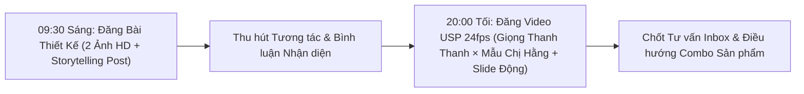

# Kế Hoạch Content 30 Ngày — Hằng Thu Pharma (HTPM)
**Công thức vận hành:** `01 Video USP (9:16 · 24fps)` **+** `01 Bài Thiết Kế (1:1 hoặc 4:5)` mỗi ngày (`Tổng 60 ấn phẩm / 30 ngày`: `24/11/2026 → 23/12/2026`)

> [!IMPORTANT]
> **Kim chỉ nam nội dung chuẩn định hướng Chị Hằng (`CT Hằng`):**
> 1. **Thổi hồn vào sản phẩm:** Đi từ câu chuyện đời sống thật, tâm lý thầm kín và cảm nhận chuyển hóa thực tế; **tuyệt đối không** dùng văn phong cảnh báo y khoa khô khan gây hoang mang (*"xem kỹ nhãn"*, *"đừng hiểu thành cam kết"*).
> 2. **Quy chuẩn Video USP (`19:30 – 20:30` Khung giờ Vàng Chuyển đổi):** Tỷ lệ `9:16 (1080×1920 @ 24fps)` · Giọng **`THANH THANH TVC`** · Đại sứ **Mẫu Chị Hằng** + Bao bì thật `100%` · Viết hoa `100%` đầu câu · `0%` chữ che mặt (`Face-Safe`) · Đan xen **4–6 Lớp phủ Slide kính mờ động** (`Checklist / Triệu chứng / Thảo dược`).
> 3. **Quy chuẩn Bài Thiết Kế (`09:00 – 10:30` Khung giờ Vàng Nhận diện):** Bộ **02 ảnh HD đồng bộ** (Ảnh 1: *Key Visual Cảm xúc / Câu hỏi chạm nỗi đau* · Ảnh 2: *Infographic 4 Thảo dược & Lợi ích nổi bật*) kèm bộ Hashtag thương hiệu bắt buộc (`#HangThuPharma`).
> 4. **Nguyên tắc Phối Cặp Trong Ngày:** Video buổi tối và Bài thiết kế buổi sáng luôn đi **2 sản phẩm bổ trợ khác nhau** để tệp khách hàng không bị nhàm chán, đồng thời tạo hiệu ứng bán chéo (Cross-sell).

---

## Luồng Sản Xuất & Đăng Tải Hằng Ngày

---

## Phân Bổ Tần Suất 9 Sản Phẩm Chủ Lực Trong 30 Ngày

| Mã SP | Sản phẩm chủ lực | Thành phần / USP cốt lõi trên hộp | Số Video USP | Số Bài Thiết Kế | Tổng hiện diện |
| :--- | :--- | :--- | :---: | :---: | :---: |
| **SP01** | **Điều Kinh HT (Bổ Trứng)** | Đương quy, Hương phụ, Ích mẫu, Sài hồ — Bổ huyết, điều hòa chu kỳ, dịu đau bụng kinh | 4 | 4 | **8 lần** |
| **SP02** | **Viên Đặt LT Plus (Hộp Hồng)** | Trầu không, Hoàng bá, Kim ngân hoa, Lô hội — Đào thải dịch nhầy, giữ ẩm, êm lộ tuyến | 4 | 4 | **8 lần** |
| **SP03** | **Dạ Dày HT** | Dạ cẩm, Nghệ đen, Hoàng liên, Mộc hương — Giảm acid, bảo vệ niêm mạc, dịu trào ngược | 4 | 3 | **7 lần** |
| **SP04** | **DDVS Romance VIP** | Hoa hồng Bulgaria, Collagen thực vật, Trà xanh, Lô hội, Vit E — Sạch dịu nhẹ, cân bằng pH | 3 | 4 | **7 lần** |
| **SP05** | **Viên Đặt Phụ Khoa (Hộp Xanh)** | Cúc La Mã, Cam thảo, Niacinamide, Lactic Acid — Sạch thoáng, khử mùi, săn se sau sinh | 3 | 3 | **6 lần** |
| **SP06** | **Romance Love** | Hyaluronic Acid, Panthenol, Niacinamide, Vit E — Cấp ẩm mềm mịn, thăng hoa gắn kết | 3 | 3 | **6 lần** |
| **SP07** | **Ngọc Long Hoàn** | Bá bệnh, Dâm dương hoắc, Maca, Đông trùng hạ thảo — Bổ thận tráng dương, giữ phong độ | 3 | 3 | **6 lần** |
| **SP08** | **Viên Uống WhiteSkin** | L-Glutathione, NMN, Collagen, Cà chua đỏ, Vit C & E — Sáng da đều màu, chống oxy hóa | 3 | 3 | **6 lần** |
| **SP09** | **Gel Phụ Khang Hằng Thu** | Kim ngân hoa, Khổ sâm, Trầu không, Trinh nữ hoàng cung — Sạch êm, giảm ngứa, thơm mát | 3 | 3 | **6 lần** |

---

## TUẦN 1 (`24/11 – 30/11/2026`): Lắng Nghe Tín Hiệu Cơ Thể Giữa Nhịp Sống Bận Rộn
*Tâm lý chủ đạo: Chạm đúng thói quen đời thường của dân văn phòng & phụ nữ hiện đại (Pain / Relatable Hook).*

| Ngày | 🎬 VIDEO USP (`20:00` — Mẫu Chị Hằng × Giọng Thanh Thanh) | 🎨 BÀI THIẾT KẾ (`09:30` — Bộ 2 Ảnh HD + Caption Thổi Hồn) |
| :--- | :--- | :--- |
| **Ngày 01** `T3 · 24/11` | **SP02 — Viên Đặt LT Plus** • **Hook 3s:** *"Càng tự tra triệu chứng trên mạng, chị càng… hoang mang?"* • **Slide động:** 3 nỗi lo dân văn phòng → Cơ chế làm sạch dịch nhầy & giữ ẩm tự nhiên. • **CTA:** Nhắn “LT PLUS” tư vấn riêng tư. | **SP09 — Gel Phụ Khang Hằng Thu** • **Chủ đề:** *Skincare da mặt đủ 10 bước, sao lại để “cô bé” chờ đến lúc khó chịu mới nhớ?* • **Layout 2 ảnh:** KV bàn trang điểm sang trọng + Infographic 4 thảo dược (`Kim ngân hoa · Trầu không · Khổ sâm · Trinh nữ hoàng cung`). • **Hashtag:** `#HangThuPharma #GelPhuKhang #ChamSocPhuNu` |
| **Ngày 02** `T4 · 25/11` | **SP08 — Viên Uống WhiteSkin** • **Hook 3s:** *"Ảnh chụp cam thường hơi xỉn màu, bước ra nắng lại càng ngại soi gương?"* • **Slide động:** Checklist dưỡng sáng đa tầng (`L-Glutathione · NMN · Collagen · Vitamin E`). • **CTA:** Nhắn “WHITESKIN” đón nền da rạng rỡ. | **SP01 — Điều Kinh HT** • **Chủ đề:** *Chưa tới ngày “đèn đỏ” mà bụng đã âm ỉ, người mệt rũ chẳng muốn làm gì?* • **Layout 2 ảnh:** KV chị Hằng ôm tách trà ấm + Infographic `Đương quy · Hương phụ · Ích mẫu` bổ huyết lưu thông. • **Hashtag:** `#HangThuPharma #DieuKinhHT #ChuKyEmDiu` |
| **Ngày 03** `T5 · 26/11` | **SP04 — DDVS Romance VIP** • **Hook 3s:** *"Chăm sóc vùng nhạy cảm không phải chạy theo mùi hương nồng, mà là sự dịu nhẹ chuẩn pH."* • **Slide động:** 4 điểm cộng `Hoa hồng Bulgaria · Lô hội · Trà xanh · Vitamin E`. • **CTA:** Nhắn “ROMANCE VIP” trải nghiệm bảo bối 10 năm. | **SP03 — Dạ Dày HT** • **Chủ đề:** *Đói cũng rát thượng vị, ăn no lại đầy tức — đừng để mỗi bữa ngon thành áp lực!* • **Layout 2 ảnh:** KV mâm cơm ấm cúng + Infographic 4 vị thảo mộc vàng (`Dạ cẩm · Nghệ đen · Hoàng liên · Mộc hương`). • **Hashtag:** `#HangThuPharma #DaDayHangThu #TraoNguocDaDay` |
| **Ngày 04** `T6 · 27/11` | **SP01 — Điều Kinh HT** • **Hook 3s:** *"Lịch công việc luôn đúng hẹn, sao lịch chu kỳ lại tháng sớm tháng muộn?"* • **Slide động:** Slide so sánh chu kỳ thất thường vs Chu kỳ êm ái + Bảng thảo dược bổ huyết. • **CTA:** Nhắn “ĐIỀU KINH” để mỗi tháng nhẹ tênh. | **SP07 — Ngọc Long Hoàn** • **Chủ đề:** *Đàn ông ngoài mặt vẫn cười nói đi làm, nhưng nỗi lo hụt hơi xuống sức lại giấu riêng trong lòng.* • **Layout 2 ảnh:** KV quý ông lịch lãm + Infographic `Bá bệnh · Dâm dương hoắc · Maca · Đông trùng hạ thảo`. • **Hashtag:** `#HangThuPharma #NgocLongHoan #PhongDoPhaiManh` |
| **Ngày 05** `T7 · 28/11` | **SP06 — Romance Love** • **Hook 3s:** *"Nến đã thắp, cảm xúc đã lên… nhưng sự khô rát lại khiến chị ngại ngần?"* • **Slide động:** Bộ dưỡng chất cấp ẩm mềm mịn (`Hyaluronic Acid · Panthenol · Niacinamide · Vit E`). • **CTA:** Nhắn “ROMANCE LOVE” giữ trọn lửa yêu. | **SP05 — Viên Đặt Phụ Khoa Hằng Thu (Hộp Xanh)** • **Chủ đề:** *“Cô bé” không biết nhắn tin, nên mỗi lần khó chịu là một lần gửi tín hiệu cầu cứu!* • **Layout 2 ảnh:** KV thông báo điện thoại ẩn dụ tinh tế + Infographic `Cúc La Mã · Cam thảo · Lactic Acid`. • **Hashtag:** `#HangThuPharma #VienDatHangThu #SachThoangTuTin` |
| **Ngày 06** `CN · 29/11` | **SP07 — Ngọc Long Hoàn** • **Hook 3s:** *"Lịch bóng đá anh nhớ từng giờ, còn lịch bồi bổ sức khỏe bản thân anh để quên bao lâu rồi?"* • **Slide động:** 3 trụ cột phong độ phái mạnh + Thảo dược bổ thận tráng dương an toàn. • **CTA:** Nhắn “NGỌC LONG HOÀN” chăm sức khỏe từ gốc. | **SP08 — Viên Uống WhiteSkin** • **Chủ đề:** *Chăm da cuối tuần: Đừng giao hết KPI sáng mịn cho chiếc app chỉnh ảnh!* • **Layout 2 ảnh:** KV nắng sớm trong trẻo + Infographic cơ chế chống oxy hóa từ bên trong. • **Hashtag:** `#HangThuPharma #WhiteSkin #Glutathione #NMN` |
| **Ngày 07** `T2 · 30/11` | **SP09 — Gel Phụ Khang Hằng Thu** • **Hook 3s:** *"Ngồi văn phòng suốt 8 tiếng bí bách, làm sao để cả ngày vẫn thoáng sạch thơm mát?"* • **Slide động:** Quy cách ống gel tiện lợi + 4 thảo dược kháng khuẩn dịu êm. • **CTA:** Nhắn “GEL PHỤ KHANG” tự tin suốt tuần mới. | **SP04 — DDVS Romance VIP** • **Chủ đề:** *Khởi đầu tuần mới tự tin bắt đầu từ cảm giác sạch dịu nhẹ ở những điều riêng tư nhất.* • **Layout 2 ảnh:** KV cánh hồng Bulgaria đẫm sương + Infographic giữ ẩm mềm mịn cho cả hai vợ chồng. • **Hashtag:** `#HangThuPharma #RomanceVIP #TinhChatHoaHong` |

---

## TUẦN 2 (`01/12 – 07/12/2026`): Giải Mã Hiểu Lầm & Tôn Vinh Thảo Dược Thật
*Tâm lý chủ đạo: Bẻ gãy các thói quen chăm sóc sai cách bằng góc nhìn chuyên gia dịu dàng của Chị Hằng (Contrarian / Educational).*

| Ngày | 🎬 VIDEO USP (`20:00` — Mẫu Chị Hằng × Giọng Thanh Thanh) | 🎨 BÀI THIẾT KẾ (`09:30` — Bộ 2 Ảnh HD + Caption Thổi Hồn) |
| :--- | :--- | :--- |
| **Ngày 08** `T3 · 01/12` | **SP05 — Viên Đặt Phụ Khoa (Hộp Xanh)** • **Hook 3s:** *"Vừa hết khó chịu ít hôm lại tái lại — đừng chỉ che giấu mùi hương bên ngoài!"* • **Slide động:** Cơ chế làm sạch dịu nhẹ, khử mùi & cân bằng pH tự nhiên từ `Cúc La Mã · Cam thảo`. • **CTA:** Nhắn “VIÊN ĐẶT” nhận lộ trình chăm đúng. | **SP02 — Viên Đặt LT Plus** • **Chủ đề:** *Nghe đến lộ tuyến ra nhiều dịch là lo lắng mất ăn mất ngủ? Bình tĩnh hiểu đúng để chăm êm!* • **Layout 2 ảnh:** KV chuyên gia tư vấn ấm áp + Infographic 3 tác động sạch dịch nhầy – giảm mùi – giữ pH. • **Hashtag:** `#HangThuPharma #LTPlus #ChamSocCoTuCung` |
| **Ngày 09** `T4 · 02/12` | **SP03 — Dạ Dày HT** • **Hook 3s:** *"Đã kiêng đồ cay nóng mà vùng thượng vị vẫn âm ỉ mỗi chiều?"* • **Slide động:** Cơ chế kép `Giảm acid dịch vị + Bao phủ bảo vệ niêm mạc` của bộ tứ thảo dược Đông y. • **CTA:** Nhắn “DẠ DÀY” để bụng êm ăn ngon. | **SP06 — Romance Love** • **Chủ đề:** *Dưỡng ẩm hằng ngày và bôi trơn tức thời: Hai nhu cầu khác nhau mà chị em hay gộp làm một!* • **Layout 2 ảnh:** KV lụa hồng satin mềm mại + Infographic cấp ẩm sâu nuôi dưỡng sắc da nhạy cảm. • **Hashtag:** `#HangThuPharma #RomanceLove #DuongAmMemMin` |
| **Ngày 10** `T5 · 03/12` | **SP02 — Viên Đặt LT Plus** • **Hook 3s:** *"Qua tuổi 35–40, vì sao chỉ chú ý làm sạch thôi vẫn thấy khô và kém thoải mái?"* • **Slide động:** Tác động kép của LT Plus: `Làm sạch dịch nhầy` song hành `Duy trì độ ẩm tự nhiên`. • **CTA:** Nhắn “LT PLUS” hồi sinh sự tự tin. | **SP01 — Điều Kinh HT (Bổ Trứng)** • **Chủ đề:** *Hành trình mong con yêu: Chu kỳ đều đặn chính là nền tảng ấm áp đầu tiên của người mẹ.* • **Layout 2 ảnh:** KV gia đình hạnh phúc ngập nắng + Infographic thảo dược bồi bổ khí huyết. • **Hashtag:** `#HangThuPharma #DieuKinhBoTrung #MongConYeu` |
| **Ngày 11** `T6 · 04/12` | **SP08 — Viên Uống WhiteSkin** • **Hook 3s:** *"Che chắn kỹ rồi mà vết sạm sau nắng vẫn chậm đều màu?"* • **Slide động:** Phối hợp `Chống nắng bên ngoài` + `Nuôi dưỡng L-Glutathione & Cà chua đỏ từ bên trong`. • **CTA:** Nhắn “WHITESKIN” nuôi nền da sáng khỏe. | **SP09 — Gel Phụ Khang Hằng Thu** • **Chủ đề:** *Mồ hôi sau giờ tập gym hay ngày nắng nóng: Đừng cố rửa thật mạnh làm mất cân bằng tự nhiên!* • **Layout 2 ảnh:** KV phụ nữ năng động tập yoga + Infographic làm sạch êm không khô căng. • **Hashtag:** `#HangThuPharma #GelPhuKhang #ThoangSachMoiNgay` |
| **Ngày 12** `T7 · 05/12` | **SP04 — DDVS Romance VIP** • **Hook 3s:** *"Đã rửa sạch bên ngoài, có cần xịt rửa sâu vào bên trong cho 'sạch hẳn' không?"* • **Slide động:** Phân biệt rõ chăm sóc vùng ngoài chuẩn khoa học + Độ êm của `Romance VIP 150ml`. • **CTA:** Nhắn “ROMANCE VIP” nâng niu đúng cách. | **SP03 — Dạ Dày HT** • **Chủ đề:** *Cuối tuần tụ họp gia đình, tiệc tùng bia rượu — đừng quên người bạn bảo vệ niêm mạc dạ dày!* • **Layout 2 ảnh:** KV bàn tiệc cuối tuần vui vẻ + Infographic giảm ợ hơi, ợ chua, đầy chướng. • **Hashtag:** `#HangThuPharma #DaDayHT #BaoVeNiemMac` |
| **Ngày 13** `CN · 06/12` | **SP01 — Điều Kinh HT** • **Hook 3s:** *"Đau bụng ngày đèn đỏ không phải do chị 'chịu đau kém' — cơ thể đang cần được vỗ về!"* • **Slide động:** 3 bước chườm ấm, nghỉ ngơi & bồi bổ khí huyết cùng `Đương quy · Hương phụ · Sài hồ`. • **CTA:** Nhắn “ĐIỀU KINH” tạm biệt nỗi ám ảnh mỗi tháng. | **SP07 — Ngọc Long Hoàn** • **Chủ đề:** *Bản lĩnh phái mạnh đến từ nền tảng thể lực bền bỉ, không phải những giải pháp thúc ép tức thời.* • **Layout 2 ảnh:** KV thảo dược quý trên nền đá trầm + Infographic quy cách 40 viên chăm sóc chủ động. • **Hashtag:** `#HangThuPharma #NgocLongHoan #SucKhoeNamGioi` |
| **Ngày 14** `T2 · 07/12` | **SP06 — Romance Love** • **Hook 3s:** *"Đừng để cảm giác khô căng sau sinh làm xa cách những khoảnh khắc vợ chồng gần gũi."* • **Slide động:** Bảng thành phần dưỡng ẩm chuẩn spa (`HA · Panthenol · Vitamin E`) dạng gói riêng tinh tế. • **CTA:** Nhắn “ROMANCE LOVE” để được lắng nghe. | **SP05 — Viên Đặt Phụ Khoa (Hộp Xanh)** • **Chủ đề:** *Tân trang sự tự tin cho mẹ bỉm sau sinh: Khi phụ nữ biết thương mình, hạnh phúc tự khắc nở hoa.* • **Layout 2 ảnh:** KV mẹ trẻ rạng rỡ + Infographic hỗ trợ sạch thoáng, săn se, duy trì pH. • **Hashtag:** `#HangThuPharma #VienDatPhuKhoa #SauSinhTuTin` |

---

## TUẦN 3 (`08/12 – 14/12/2026`): Câu Chuyện Chuyển Hóa & Niềm Tin Khách Hàng Thật
*Tâm lý chủ đạo: Kể chuyện trên vai người trải nghiệm & phản hồi truyền miệng thực tế ("sản phẩm xịn người ta nhớ theo năm tháng").*

| Ngày | 🎬 VIDEO USP (`20:00` — Mẫu Chị Hằng × Giọng Thanh Thanh) | 🎨 BÀI THIẾT KẾ (`09:30` — Bộ 2 Ảnh HD + Caption Thổi Hồn) |
| :--- | :--- | :--- |
| **Ngày 15** `T3 · 08/12` | **SP03 — Dạ Dày HT** • **Hook 3s:** *"Bữa tối ngon trước mặt mà không dám gắp vì sợ đêm nằm trào ngược mất ngủ?"* • **Slide động:** Hành trình 3 nhịp: `Êm thượng vị` → `Bữa cơm tròn vị` → `Ngủ sâu tới sáng`. • **CTA:** Nhắn “DẠ DÀY” tìm lại niềm vui ăn ngon. | **SP04 — DDVS Romance VIP** • **Chủ đề:** *Vì sao nhiều chị dùng Romance VIP suốt nhiều năm liền rồi lại mua tặng cả em gái, bạn thân?* • **Layout 2 ảnh:** KV hộp quà hoa hồng tinh tế + Infographic 5 điểm chạm chinh phục khách kỹ tính. • **Hashtag:** `#HangThuPharma #RomanceVIP #DungDichVanNguoiMe` |
| **Ngày 16** `T4 · 09/12` | **SP09 — Gel Phụ Khang Hằng Thu** • **Hook 3s:** *"Cảm giác nhẹ nhõm khi bước vào cuộc họp quan trọng mà không còn chút thấp thỏm nào!"* • **Slide động:** 4 lợi ích thực tế: `Sạch dịu nhẹ · Khử mùi · Cấp ẩm mềm da · Thơm mát tự nhiên`. • **CTA:** Nhắn “GEL PHỤ KHANG” giữ phong thái tự tin. | **SP08 — Viên Uống WhiteSkin** • **Chủ đề:** *Câu chuyện của chị khách tuổi 34: “Chị không tìm loại trắng cấp tốc, chị chọn thứ nuôi da khỏe thật sự.”* • **Layout 2 ảnh:** KV chân dung da căng bóng dưới nắng + Infographic `Glutathione · NMN · Collagen`. • **Hashtag:** `#HangThuPharma #WhiteSkin #DaSangKhoeTuBenTrong` |
| **Ngày 17** `T5 · 10/12` | **SP07 — Ngọc Long Hoàn** • **Hook 3s:** *"Món quà tinh tế nhất người vợ tâm lý dành tặng chồng sau những tháng ngày anh gồng gánh áp lực."* • **Slide động:** Tổ hợp thảo dược `Bá bệnh · Maca · Đông trùng hạ thảo · Bạch tật lê` bồi bổ nguyên khí. • **CTA:** Nhắn “NGỌC LONG HOÀN” giữ lửa tổ ấm. | **SP02 — Viên Đặt LT Plus** • **Chủ đề:** *Khách cũ rỉ tai khách mới: Điều quý giá nhất là tìm được giải pháp uy tín để không còn lo tái đi tái lại.* • **Layout 2 ảnh:** KV niềm vui rạng ngời + Infographic lộ trình chăm sóc êm dịu tại nhà. • **Hashtag:** `#HangThuPharma #LTPlus #PhuNuTuTin` |
| **Ngày 18** `T6 · 11/12` | **SP05 — Viên Đặt Phụ Khoa (Hộp Xanh)** • **Hook 3s:** *"Đừng đợi đến khi mất ngủ, ngại gần gũi chồng mới bắt đầu lắng nghe cơ thể mình."* • **Slide động:** Ba tác động gói gọn trong 1 liệu trình: `Sạch êm · Giảm mùi · Cân bằng độ ẩm & pH`. • **CTA:** Nhắn “VIÊN ĐẶT” chăm sóc kín đáo. | **SP01 — Điều Kinh HT** • **Chủ đề:** *Tin vui từ những gia đình kiên trì chăm dưỡng khí huyết & chu kỳ ổn định cùng Hằng Thu.* • **Layout 2 ảnh:** KV đôi giày nhỏ / hoa mẫu đơn ấm áp + Infographic dưỡng huyết điều kinh. • **Hashtag:** `#HangThuPharma #DieuKinhHT #HanhTrinhHanhPhuc` |
| **Ngày 19** `T7 · 12/12` | **SP02 — Viên Đặt LT Plus** • **Hook 3s:** *"Giữa hàng trăm lời khuyên truyền miệng, phụ nữ hiện đại chọn giải pháp thảo dược rõ nguồn gốc."* • **Slide động:** Điểm danh thảo dược `Trầu không · Hoàng bá · Kim ngân hoa · Trinh nữ hoàng cung`. • **CTA:** Nhắn “LT PLUS” tư vấn 1:1 bảo mật. | **SP06 — Romance Love** • **Chủ đề:** *Cuối tuần thảnh thơi: Để sự gần gũi bắt đầu bằng cảm xúc tự nhiên chứ không phải sự gượng gạo.* • **Layout 2 ảnh:** KV phòng ngủ ánh nến sang trọng + Infographic dưỡng ẩm mềm mượt. • **Hashtag:** `#HangThuPharma #RomanceLove #GiuLuaHonNhan` |
| **Ngày 20** `CN · 13/12` | **SP08 — Viên Uống WhiteSkin** • **Hook 3s:** *"Mùa tiệc cuối năm sắp gõ cửa — mỗi ngày 2 viên nhỏ để lên hình góc nào cũng rạng rỡ!"* • **Slide động:** Lộ trình chăm da đón lễ hội: `Đủ ẩm mịn màng · Đều sắc da · Tràn sức sống`. • **CTA:** Nhắn “WHITESKIN” kịp đẹp mùa lễ hội. | **SP09 — Gel Phụ Khang Hằng Thu** • **Chủ đề:** *Chủ nhật dọn lại góc phòng tắm của nàng: Tối giản nhưng đúng sản phẩm cơ thể cần.* • **Layout 2 ảnh:** KV khay gỗ spa tại gia + Infographic không paraben, êm dịu dùng hằng ngày. • **Hashtag:** `#HangThuPharma #GelPhuKhang #YeuBanThan` |
| **Ngày 21** `T2 · 14/12` | **SP01 — Điều Kinh HT** • **Hook 3s:** *"Phụ nữ khí huyết lưu thông thì sắc diện tươi hồng, tinh thần cũng nhẹ nhõm hẳn ra!"* • **Slide động:** Mối liên hệ giữa `Khí huyết ổn định` → `Chu kỳ êm` → `Thần sắc tươi tắn`. • **CTA:** Nhắn “ĐIỀU KINH” nuôi dưỡng nét xuân. | **SP04 — DDVS Romance VIP** • **Chủ đề:** *Mùi hương hoa hồng thanh khiết giúp chị em giữ trọn sự tự tin suốt ngày đầu tuần bận rộn.* • **Layout 2 ảnh:** KV chai Romance VIP giữa vườn hồng + Infographic cân bằng sinh lý tự nhiên. • **Hashtag:** `#HangThuPharma #RomanceVIP #SachDiuNhe` |

---

## TUẦN 4 & CAO ĐIỂM CUỐI NĂM (`15/12 – 23/12/2026`): Rạng Rỡ Sắc Xuân — Khỏe Trong Đẹp Ngoài
*Tâm lý chủ đạo: Nhu cầu làm đẹp, giữ bụng khỏe cho mùa tất niên & phối hợp Combo chăm sóc toàn diện (Desire & Combo Synergy).*

| Ngày | 🎬 VIDEO USP (`20:00` — Mẫu Chị Hằng × Giọng Thanh Thanh) | 🎨 BÀI THIẾT KẾ (`09:30` — Bộ 2 Ảnh HD + Caption Thổi Hồn) |
| :--- | :--- | :--- |
| **Ngày 22** `T3 · 15/12` | **SP03 — Dạ Dày HT** • **Hook 3s:** *"Mùa tất niên liên miên tiệc tùng, làm sao để dạ dày không 'biểu tình' lúc nửa đêm?"* • **Slide động:** Checklist bảo vệ dạ dày mùa tiệc cuối năm + Bổ sung `Dạ Dày HT` giảm acid & đầy hơi. • **CTA:** Nhắn “DẠ DÀY” sẵn sàng mùa lễ hội. | **SP05 — Viên Đặt Phụ Khoa (Hộp Xanh)** • **Chủ đề:** *Đừng mang những nỗi khó chịu thầm kín sang năm mới — giải quyết êm gọn ngay từ tháng 12!* • **Layout 2 ảnh:** KV lịch tháng 12 tươi sáng + Infographic làm sạch & tái tạo sự tự tin. • **Hashtag:** `#HangThuPharma #VienDatHangThu #ChaoNamMoiTuTin` |
| **Ngày 23** `T4 · 16/12` | **SP04 — DDVS Romance VIP** • **Hook 3s:** *"Đi công tác hay du lịch cuối năm, món đồ nhỏ luôn nằm sẵn trong vali của chị Hằng là gì?"* • **Slide động:** Unbox túi đồ cá nhân thanh lịch + Ưu điểm giữ ẩm, khử mùi dịu nhẹ của `Romance VIP`. • **CTA:** Nhắn “ROMANCE VIP” rinh ngay bản chuẩn. | **SP07 — Ngọc Long Hoàn** • **Chủ đề:** *Cuối năm chạy doanh số, tiếp khách triền miên — anh càng cần giữ vững nền tảng thể lực & phong độ.* • **Layout 2 ảnh:** KV doanh nhân phong thái đĩnh đạc + Infographic bồi bổ thận khí & sinh lực. • **Hashtag:** `#HangThuPharma #NgocLongHoan #BanLinhQuyOng` |
| **Ngày 24** `T5 · 17/12` | **SP06 — Romance Love** • **Hook 3s:** *"Hạnh phúc hôn nhân đôi khi được hâm nóng từ sự tinh tế chăm chút cho bản thân người phụ nữ."* • **Slide động:** 3 giá trị `Dưỡng ẩm mềm mịn · Xoa dịu khô căng · Tự tin thăng hoa`. • **CTA:** Nhắn “ROMANCE LOVE” tư vấn kín đáo. | **SP08 — Viên Uống WhiteSkin** • **Chủ đề:** *Đếm ngược đón Giáng Sinh & Năm Mới: Đầu tư cho làn da sáng mịn là khoản đầu tư sinh lời nhất!* • **Layout 2 ảnh:** KV lễ hội sang trọng tông kem vàng + Infographic dưỡng chất trẻ hóa nền da. • **Hashtag:** `#HangThuPharma #WhiteSkin #RangRoDonLeHoi` |
| **Ngày 25** `T6 · 18/12` | **SP09 — Gel Phụ Khang Hằng Thu** • **Hook 3s:** *"Thời tiết giao mùa ẩm lạnh, quần áo dày dễ gây bí bách — bí quyết giữ sự khô thoáng cả ngày!"* • **Slide động:** Tổ hợp thảo dược `Trầu không · Khổ sâm · Bạch linh` làm dịu ngứa rát & khử mùi. • **CTA:** Nhắn “GEL PHỤ KHANG” êm dịu suốt mùa đông. | **SP03 — Dạ Dày HT** • **Chủ đề:** *Trời se lạnh càng dễ đau âm ỉ vùng thượng vị: Giữ ấm bụng kết hợp thảo dược lành tính mỗi ngày.* • **Layout 2 ảnh:** KV tách trà gừng & hộp Dạ Dày HT + Infographic bảo vệ niêm mạc mùa lạnh. • **Hashtag:** `#HangThuPharma #DaDayHangThu #AmBungKhoeNguoi` |
| **Ngày 26** `T7 · 19/12` | **SP07 — Ngọc Long Hoàn** • **Hook 3s:** *"Sức khỏe sinh sản và hạnh phúc lứa đôi luôn là câu chuyện đồng hành của cả hai vợ chồng."* • **Slide động:** Kết hợp lối sống lành mạnh + Bổ thận tráng dương từ thảo dược thiên nhiên. • **CTA:** Nhắn “NGỌC LONG HOÀN” nhận tư vấn riêng. | **SP01 — Điều Kinh HT** • **Chủ đề:** *Combo đôi vợ chồng cùng khỏe: Vợ điều hòa khí huyết êm chu kỳ — Chồng vững vàng phong độ.* • **Layout 2 ảnh:** KV cặp đôi nắm tay ấm áp + Infographic bộ đôi chăm sóc sức khỏe gia đình. • **Hashtag:** `#HangThuPharma #DieuKinhHT #GiaDinhHanhPhuc` |
| **Ngày 27** `CN · 20/12` | **SP02 — Viên Đặt LT Plus** • **Hook 3s:** *"Phụ nữ hiện đại thương bản thân không chờ có bệnh mới chữa, mà chủ động giữ mình luôn sạch khỏe."* • **Slide động:** Tổng kết 4 lý do hàng triệu phụ nữ tin chọn `LT Plus Hằng Thu`. • **CTA:** Nhắn “LT PLUS” để được đồng hành. | **SP04 — DDVS Romance VIP** • **Chủ đề:** *Bộ đôi “Trong sạch thoáng – Ngoài mềm thơm” (`LT Plus` + `Romance VIP`) được lòng chị em nhất tháng!* • **Layout 2 ảnh:** KV Combo hồng pastel sang trọng + Infographic quy trình 2 bước chuẩn khoa học. • **Hashtag:** `#HangThuPharma #ComboPhuKhoa #RomanceVIP #LTPlus` |
| **Ngày 28** `T2 · 21/12` | **SP05 — Viên Đặt Phụ Khoa (Hộp Xanh)** • **Hook 3s:** *"Cảm giác tự tin diện mọi trang phục dự tiệc cuối năm bắt đầu từ sự thoải mái bên trong."* • **Slide động:** Điểm danh công thức dịu êm `Cam thảo · Cúc La Mã · Niacinamide · Glycerin`. • **CTA:** Nhắn “VIÊN ĐẶT” sẵn sàng tỏa sáng. | **SP06 — Romance Love** • **Chủ đề:** *Yêu chiều bản thân dịp cuối năm: Mềm mịn, đủ ẩm và tràn đầy năng lượng nữ tính.* • **Layout 2 ảnh:** KV lụa kem ánh kim + Infographic dưỡng ẩm chuyên sâu vùng nhạy cảm. • **Hashtag:** `#HangThuPharma #RomanceLove #PhuNuHienDai` |
| **Ngày 29** `T3 · 22/12` | **SP03 — Dạ Dày HT** • **Hook 3s:** *"Chạy deadline chốt năm bận đến mấy cũng đừng lấy cà phê thay bữa sáng chị nhé!"* • **Slide động:** Nhắc lịch chăm bụng ngày bận rộn + `Dạ Dày HT` xoa dịu đau rát, ợ chua, trào ngược. • **CTA:** Nhắn “DẠ DÀY” giữ trọn sức khỏe mùa cuối năm. | **SP09 — Gel Phụ Khang Hằng Thu** • **Chủ đề:** *Nhỏ gọn tinh tế, chăm sóc dịu êm mỗi tối để sáng mai thức dậy nhẹ tênh sảng khoái.* • **Layout 2 ảnh:** KV phòng ngủ sáng thoáng + Infographic 4 thảo dược thiên nhiên lành tính. • **Hashtag:** `#HangThuPharma #GelPhuKhang #SachEmMoiNgay` |
| **Ngày 30** `T4 · 23/12` | **SP01 × SP08 — Video Tổng Kết Thương Hiệu (Điều Kinh HT & WhiteSkin)** • **Hook 3s:** *"Khí huyết bên trong thông suốt, làn da bên ngoài khắc tự sáng hồng rạng rỡ đón Giáng Sinh!"* • **Slide động:** Lộ trình kép *Trong khỏe nội tiết – Ngoài sáng sắc xuân* cùng đại sứ Chị Hằng. • **CTA:** Nhắn “TƯ VẤN” nhận phác đồ cá nhân hóa đón Tết. | **Bộ Sản Phẩm Tổng Hợp Hằng Thu Pharma** • **Chủ đề:** *Đón mùa Giáng Sinh ấm áp: Gửi trao món quà sức khỏe trọn vẹn cho chính mình và người thương.* • **Layout 2 ảnh:** KV Đại sứ Chị Hằng bên đại gia đình sản phẩm HTPM + Infographic chọn sản phẩm theo nhu cầu. • **Hashtag:** `#HangThuPharma #SucKhoeToanDien #QuaTangYeuThuong` |

---

## Quy Trình Triển Khai Tự Động Hóa Trên Full Studio

> [!TIP]
> Toàn bộ 30 ngày trên đã được thiết kế khớp sẵn với kho tài nguyên hiện có trên máy:
> - **Video USP (`01 clip/ngày`)**: Chạy thẳng pipeline `Voice Studio (THANH THANH TVC)` → `ChatGPT HTPM (Mẫu Chị Hằng + Ảnh hộp tách nền IS-Net)` → `Google Flow (Thành phần)` → `HyperFrames 24fps (Chữ 3D Gradient viết hoa đầu câu + Lớp phủ Slide động 0% che mặt)`.
> - **Bài Thiết Kế (`01 bộ 2 ảnh HD + Caption/ngày`)**: Chạy thẳng pipeline `Photoshop Pro Studio (.PSD đa layer 1080×1080 / 1080×1350)` kết hợp kho ảnh hộp tách nền sẵn trong `brand_kits/01_HTPM_Hang_Thu_Pharma/`.
