# Hồ Sơ Gia Phả & Chuẩn Đặt Tên Nhân Vật — Vũ Trụ K4 "Chuyện Trong Nhà"

Tài liệu này liên kết **toàn bộ 26 nhân vật (40 tệp ảnh tham chiếu)** trong thư mục `CHARACTER/` thành **một Đại Gia Đình thống nhất gồm 6 nhánh có quan hệ huyết thống – thông gia chặt chẽ**, lấy vợ chồng **Tuấn – Thảo (`G01`)** làm tâm điểm.

- **Thư mục gốc**: `Z:\Máy tính khác\My Computer\hằng thu pharma\05. Video Hoàn Thiện\K4 - Mẹ Chồng Nàng Dâu\đã đăng\CHARACTER\`
- **File tra cứu máy đọc**: `character_registry.json` (nằm cùng thư mục `CHARACTER/`)

---

## 1. Sơ Đồ Kết Nối Đại Gia Đình (6 Nhánh Liên Kết)

```mermaid
flowchart TD
    subgraph G01["G01: NHÁNH TRUNG TÂM (NHÀ NỘI TUẤN - THẢO)"]
        CuTam["G01_01: Cụ Tâm (Bà nội Tuấn)"] --> OngTan["G01_02: Ông Tấn (Bố Tuấn)"]
        BaHanh["G01_03: Bà Hạnh (Mẹ Tuấn - 3 bộ đồ)"] --- OngTan
        OngTan --> Tuan["G01_04: Tuấn (Chồng Thảo - 3 bộ đồ)"]
        OngTan --> Linh["G01_08: Linh (Em gái ruột Tuấn)"]
        Tuan --- Thao["G01_05: Thảo (Vợ Tuấn - 3 bộ đồ)"]
        Tuan --> BeBo["G01_06: Bé Bơ (Con gái lớn)"]
        Tuan --> BeDi["G01_07: Bé Di (Con gái út - 2 ảnh)"]
        Linh --- Thanh["G01_09: Thành (Chồng Linh - Em rể Tuấn)"]
    end

    subgraph G02["G02: NHÀ NGOẠI THẢO (THÔNG GIA NHÀ TUẤN)"]
        BaHien["G02_01: Bà Hiền (Mẹ ruột Thảo)"] --> Ngan["G02_02: Ngân (Chị gái ruột Thảo - 3 bộ đồ)"]
        BaHien --> Thao
        BaHien --> Mai["G02_03: Mai (Em gái út Thảo)"]
    end

    subgraph G03["G03: NHÁNH CÔ RUỘT BÊN NỘI TUẤN"]
        CuTam --> CoLan["G03_01: Cô Lan (Em gái ông Tấn - Cô ruột Tuấn)"]
        CoLan --> Tu["G03_02: Tú (Em họ nội Tuấn)"]
        Tu --- Lam["G03_03: Lam (Vợ Tú - Em dâu họ Tuấn)"]
        CoLan --> Ha["G03_04: Hà (Em gái ruột Tú - Em họ Tuấn)"]
    end

    subgraph G04["G04: NHÁNH BÁC CẢ BÊN NỘI TUẤN"]
        CuCuc["G04_01: Cụ Cúc (Chị cụ Tâm)"] --> BacNga["G04_02: Bác Nga (Bác dâu Tuấn)"]
        BacNga --> Uyen["G04_03: Uyên (Chị họ nội Tuấn)"]
        Uyen --> BeNa["G04_04: Bé Na (Con gái Uyên)"]
    end

    subgraph G05["G05: NHÁNH BÁC GÁI BÊN NGOẠI TUẤN"]
        BaMan["G05_01: Bà Mận (Chị gái bà Hạnh - Bác ruột Tuấn)"] --> Hieu["G05_02: Hiếu (Anh họ ngoại Tuấn)"]
        BaMan --> Quynh["G05_04: Quỳnh (Em gái ruột Hiếu - Em chồng Trang)"]
        Hieu --- Trang["G05_03: Trang (Vợ Hiếu)"]
        Nhung["G05_05: Nhung (Chị gái ruột Trang - 2 ảnh)"] -.Chị em ruột.- Trang
    end

    subgraph G06["G06: NHÁNH BÁC GÁI DƯỚI QUÊ CỦA THẢO"]
        BacTham["G06_01: Bác Thắm (Chị gái bà Hiền - Bác ruột Thảo)"] --> Tien["G06_02: Tiến (Anh họ ngoại Thảo)"]
        Tien --- KhanhLy["G06_03: Khánh Ly (Vợ Tiến - Bế con nhỏ)"]
    end
```



---

## 2. Danh Sách Chi Tiết 6 Nhánh & Cách Xưng Hô Khi Viết Kịch Bản

### `G01` — Nhánh Trung Tâm: Gia Đình Nội Tuấn & Thảo (9 nhân vật / 16 files)
| Mã file | Nhân vật | Vai vế & Mối quan hệ kết nối | Trang phục sẵn có |
|---|---|---|---|
| `G01_01` | **Cụ Tâm** | Bà nội ruột của Tuấn & Linh; mẹ đẻ ông Tấn (`G01_02`) và cô Lan (`G03_01`). | Áo nâu bà già truyền thống |
| `G01_02` | **Ông Tấn** | Bố ruột Tuấn & Linh; bố chồng Thảo; anh trai ruột cô Lan (`G03_01`). | Áo polo xám điềm đạm, đeo kính |
| `G01_03a..c` | **Bà Hạnh** | Mẹ ruột Tuấn & Linh; mẹ chồng Thảo; em gái ruột bà Mận (`G05_01`). | `a`: Đầm nâu · `b`: Đầm hoa xanh · `c`: Nhung đỏ |
| `G01_04a..c` | **Tuấn** | Con trai trưởng ông Tấn & bà Hạnh; chồng Thảo; anh trai ruột Linh; bố Bơ & Di. | `a`: Polo nâu · `b`: Sơ mi trắng · `c`: Vest đen |
| `G01_05a..c` | **Thảo** | Vợ Tuấn; con dâu trưởng bà Hạnh; con gái thứ bà Hiền (`G02_01`); em ruột Ngân, chị ruột Mai. | `a`: Váy trắng · `b`: Đồ ngủ · `c`: Váy nâu |
| `G01_06` | **Bé Bơ** | Con gái đầu lòng của Tuấn & Thảo (~5 tuổi); chị ruột bé Di. | Váy trắng cổ thủy thủ |
| `G01_07a..b` | **Bé Di** | Con gái út của Tuấn & Thảo (~2–3 tuổi); em ruột bé Bơ. | `a`: Đầm hồng · `b`: Đầm hồng ôm thỏ bông |
| `G01_08` | **Linh** | Em gái ruột của Tuấn; em chồng đỏng đảnh của Thảo; vợ của Thành (`G01_09`). | Áo trễ vai trắng, tóc vàng xoăn |
| `G01_09` | **Thành** | Chồng của Linh; em rể Tuấn & Thảo; con rể ông Tấn & bà Hạnh. | Áo polo trắng cổ xanh navy |

---

### `G02` — Nhánh Nhà Ngoại Thảo (Thông gia với ông Tấn – bà Hạnh) (3 nhân vật / 5 files)
| Mã file | Nhân vật | Vai vế & Mối quan hệ kết nối | Trang phục sẵn có |
|---|---|---|---|
| `G02_01` | **Bà Hiền** | Mẹ ruột của Ngân, Thảo, Mai; mẹ vợ Tuấn; bà ngoại Bơ & Di; em gái ruột bác Thắm (`G06_01`). | Bộ đồ hoa nâu giản dị hiền hậu |
| `G02_02a..c` | **Ngân** | Chị gái cả ruột của Thảo & Mai; chị vợ sắc sảo, thành đạt của Tuấn. | `a`: Công sở đeo thẻ · `b`: Đồ trắng ở nhà · `c`: Áo ren ngủ |
| `G02_03` | **Mai** | Em gái út ruột của Ngân & Thảo; em vợ cá tính của Tuấn; dì út của Bơ & Di. | Đầm đen cá tính |

---

### `G03` — Nhánh Cô Ruột Bên Nội Tuấn (Gia đình Cô Lan – Tú – Lam – Hà) (4 nhân vật / 4 files)
| Mã file | Nhân vật | Vai vế & Mối quan hệ kết nối | Trang phục sẵn có |
|---|---|---|---|
| `G03_01` | **Cô Lan** | Em gái ruột ông Tấn (`G01_02`); cô ruột của Tuấn & Linh; mẹ ruột của Tú & Hà; mẹ chồng Lam. | Đầm hoa nền xanh than sang trọng |
| `G03_02` | **Tú** | Con trai lớn cô Lan; em họ bên nội của Tuấn; anh trai ruột Hà; chồng Lam. | Bộ sơ mi & quần short nâu trẻ trung |
| `G03_03` | **Lam** | Vợ trẻ của Tú; con dâu cô Lan; chị dâu của Hà; em dâu họ Tuấn & Thảo. | Áo nâu croptop & chân váy |
| `G03_04` | **Hà** | Con gái út cô Lan; em gái ruột Tú; em chồng Lam; em họ bên nội của Tuấn & Linh. | Váy xanh navy viền kem |

---

### `G04` — Nhánh Bác Cả Bên Nội Tuấn (Gia đình Chị họ Uyên) (4 nhân vật / 4 files)
| Mã file | Nhân vật | Vai vế & Mối quan hệ kết nối | Trang phục sẵn có |
|---|---|---|---|
| `G04_01` | **Cụ Cúc** | Chị gái cụ Tâm (`G01_01`); bà nội của Uyên (`G04_03`). | Bảng 5 góc — áo hoa xám bạc tóc |
| `G04_02` | **Bác Nga** | Bác dâu bên nội của Tuấn; mẹ ruột của Uyên; bà ngoại của bé Na. | Bảng 5 góc — áo đen quần kem đeo kính |
| `G04_03` | **Uyên** | Chị họ bên nội của Tuấn & Linh; con gái bác Nga; mẹ ruột bé Na. | Bảng 5 góc — đồ lụa hồng nhạt |
| `G04_04` | **Bé Na** | Con gái ruột của Uyên (~6 tuổi); gọi Tuấn & Thảo bằng cậu – mợ họ *(đổi từ tên cũ `ly` để không trùng Khánh Ly `G06_03`)*. | Bảng 5 góc — áo gile kem quần nâu |

---

### `G05` — Nhánh Bác Gái Bên Ngoại Tuấn (Gia đình Bà Mận – Hiếu – Trang – Quỳnh – Nhung) (5 nhân vật / 6 files)
| Mã file | Nhân vật | Vai vế & Mối quan hệ kết nối | Trang phục sẵn có |
|---|---|---|---|
| `G05_01` | **Bà Mận** | Chị gái ruột ở quê của bà Hạnh (`G01_03`); bác gái của Tuấn & Linh; mẹ ruột Hiếu & Quỳnh; mẹ chồng Trang. | Áo bà già nâu đứng trước cổng biệt thự |
| `G05_02` | **Hiếu** | Con trai bà Mận; anh họ bên ngoại của Tuấn & Linh; anh trai ruột Quỳnh; chồng Trang. | Sơ mi/polo đen lịch lãm |
| `G05_03` | **Trang** | Vợ của Hiếu; con dâu bà Mận; chị dâu Quỳnh; em gái ruột của Nhung (`G05_05`). | Áo trắng quần short jean trẻ trung |
| `G05_04` | **Quỳnh** | Con gái út bà Mận; em gái ruột Hiếu; **em chồng của Trang**; em họ bên ngoại Tuấn. | Váy trắng cổ yếm chấm bi |
| `G05_05a..b` | **Nhung** | Chị gái ruột giàu sang của Trang; chị vợ của Hiếu. | `a`: Cận mặt · `b`: Đầm dạ hội ánh kim |

---

### `G06` — Nhánh Bác Gái Ở Quê Của Thảo (Gia đình Bác Thắm – Tiến – Khánh Ly) (3 nhân vật / 4 files)
| Mã file | Nhân vật | Vai vế & Mối quan hệ kết nối | Trang phục sẵn có |
|---|---|---|---|
| `G06_01` | **Bác Thắm** | Chị gái ruột ở quê của bà Hiền (`G02_01`); bác ruột Ngân, Thảo, Mai; mẹ ruột Tiến; mẹ chồng Khánh Ly. | Áo bà ba đỏ sẫm quấn khăn rằn cắp rổ rau |
| `G06_02a..b` | **Tiến** | Con trai bác Thắm; anh họ bên ngoại của Thảo; chồng Khánh Ly. | Áo khoác xám nâu tóc vàng rơm ở làng quê |
| `G06_03` | **Khánh Ly** | Vợ của Tiến (đang bế con nhỏ mới sinh); con dâu bác Thắm; chị dâu họ của Thảo. | Khoác cardigan đen bế em bé ở ngõ quê |

---

### `BG` — Bối Cảnh Chuẩn (`1` file)
- `BG_01 - Phòng khách nhà Tuấn & Thảo (Căn hộ thành phố).png`: Phòng khách chung cư tông kem ấm áp của vợ chồng Tuấn – Thảo.

---

## 2.5. Tính Cách & Bối Cảnh Thực Tế Đã Xác Minh Qua Các Tập Phim Hoàn Thiện

Qua đối chiếu trực tiếp hình ảnh các tập đã sản xuất (*Bát canh vỡ*, *Bên tình bên hiếu ở cữ*, *Con dâu con ruột*, *Người dưng gọi mẹ*, *Túi cá*, *Chồng đòi quản lý chi tiêu*, *Mang gà quê và rau sạch*):

1. **Tuyến nhà nội Thành phố (`G01` — Bà Hạnh, Tuấn, Thảo, Linh + `G03_04` Hà)**:
   - **Bà Hạnh (`G01_03`)**: Mẹ chồng sắc sảo, sĩ diện, thương chiều con gái ruột **Linh (`G01_08`)** và cháu gái bên nội **Hà (`G03_04`)**, nhưng khắt khe với con dâu **Thảo (`G01_05`)** ngay cả lúc Thảo mang bầu, ở cữ ăn cơm trắng hay lỡ làm vỡ bát canh.
   - **Tuấn (`G01_04`)**: Chồng Thảo, dân công sở/doanh nhân thành đạt nhưng nhiều lúc gia trưởng hoặc đứng kẹt giữa chữ hiếu với mẹ và chữ tình với vợ.
   - **Linh (`G01_08`) & Thành (`G01_09`)**: Vợ chồng em gái ruột Tuấn; Linh đỏng đảnh hay so bì với chị dâu Thảo.
2. **Tuyến nhà ngoại Thảo dưới quê (`G02` — Bà Hiền, Ngân, Mai)**:
   - **Bà Hiền (`G02_01`)**: Chồng mất sớm (thờ di ảnh ở căn nhà ngói cũ dưới quê — tập *Người dưng gọi mẹ*), một mình tần tảo nuôi 3 con gái (**Ngân, Thảo, Mai**); thương con thương cháu, mang gà quê & rau sạch lên thăm nhưng hay bị thông gia giàu có xem nhẹ.
3. **Tuyến mẹ quê – con trai giàu thành phố (`G05` — Bà Mận, Hiếu, Trang, Quỳnh, Nhung)**:
   - **Bà Mận (`G05_01`)**: Chị gái bà Hạnh sống nghèo khó ở quê, lưng còng chống gậy mang túi cá khô lên căn hộ sang trọng thăm con trai **Hiếu (`G05_02`)** và con dâu **Trang (`G05_03`)** (tập *Túi cá*).
4. **Tuyến gia đình trẻ nông thôn (`G06` — Bác Thắm, Tiến, Khánh Ly)**:
   - **Bác Thắm (`G06_01`)**, vợ chồng **Tiến (`G06_02`) – Khánh Ly (`G06_03`)** (đang nuôi con nhỏ mới sinh ở làng quê) — chuyên dùng cho các kịch bản mẹ chồng nàng dâu vùng quê bình dị.

---

## 3. Quy Tắc Tạo Thêm & Lưu Trữ Nhân Vật Mới Khi Kịch Bản Chưa Có

Khi làm tập phim mới xuất hiện nhân vật chưa có trong 6 nhánh trên (ví dụ: *Bố ruột của Thảo*, *Chồng của chị Ngân*, *Chú ruột của Tuấn*, *Bố chồng của Linh*, *Hàng xóm / Sếp / Bác sĩ*...), thực hiện đúng **3 bước chuẩn**:

### Bước 1: Gán Mã Số Nối Tiếp Vào Đúng Nhánh Gia Phả
- Nếu thuộc **Nhà nội Tuấn – Thảo**: đặt tiếp `G01_10`, `G01_11`...
- Nếu thuộc **Nhà ngoại Thảo** (ví dụ *Ông Phúc - Bố ruột Thảo*, *Chồng của Ngân*): đặt tiếp **`G02_04`**, **`G02_05`**...
- Nếu thuộc **Nhánh Cô Lan (`G03`)** (ví dụ *Chú Khải - Chồng cô Lan*): đặt tiếp **`G03_05`**...
- Nếu là **Tuyến xã hội / Công ty / Hàng xóm / Bệnh viện** (ngoài dòng họ nhưng liên kết với nhân vật chính): mở mã nhánh **`G07`**:
  - Ví dụ: `G07_01 - Ông Khang (Sếp tổng của Tuấn - Bố đơn thân).png`
  - Ví dụ: `G07_02 - Bà Tám (Hàng xóm sát vách nhà bà Hạnh).png`
- Nếu tạo **trang phục mới cho nhân vật đã có**: giữ nguyên mã số nhân vật, chỉ tăng hậu tố chữ cái `a, b, c, d` và ghi rõ `[Trang phục]` ở cuối (ví dụ: `G01_05d - Thảo (Vợ Tuấn - Con dâu bà Hạnh - Chị ruột Mai) [Áo dài Tết].png`).

### Bước 2: Khuôn Prompt Sinh Ảnh Tham Chiếu Nhân Vật Chuẩn K4 (Split 2 Khung Cận + Toàn)
Mọi nhân vật mới sinh ra **bắt buộc 100% tạo bằng ChatGPT (`chatgpt::chatgpt-image` trên Dự án `HTPM`)** theo bố cục **2 khung ghép ngang đồng bộ** như các file hiện có trong `CHARACTER/`:
```text
Character reference sheet split into two side-by-side panels (left panel: close-up portrait from chest up looking slightly toward camera; right panel: full-body standing shot head-to-toe in a realistic Vietnamese home/street setting).
Subject: Vietnamese [gender], [age] years old, [facial features & expression matching family resemblance], wearing [specific outfit].
Photorealistic Vietnamese TV family drama aesthetic, natural skin texture, warm cinematic lighting, 8k, no text, no watermarks.
```
*(Mẹo giữ nét huyết thống: khi tạo anh/chị/em ruột hoặc bố/mẹ/con của nhân vật nào, đính kèm ảnh nhân vật gốc đó làm `referenceNodeIds` để gương mặt có nét giống người nhà thật!)*

### Bước 3: Lưu Trực Tiếp Vào Kho & Cập Nhật Sổ Gia Phả
1. Lưu ảnh `.png` vào `Z:\Máy tính khác\My Computer\hằng thu pharma\05. Video Hoàn Thiện\K4 - Mẹ Chồng Nàng Dâu\đã đăng\CHARACTER\` theo đúng công thức:
   `<Nhánh>_<Số>[chữ cái] - <Tên> (<Quan hệ kết nối với nhân vật gốc>) [<Trang phục>].png`
2. Bổ sung dòng tương ứng vào `00_GIA_PHA_NHAN_VAT_K4.md` và `character_registry.json`.
